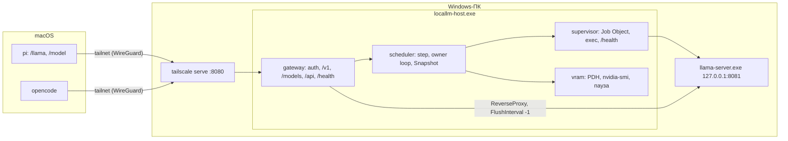
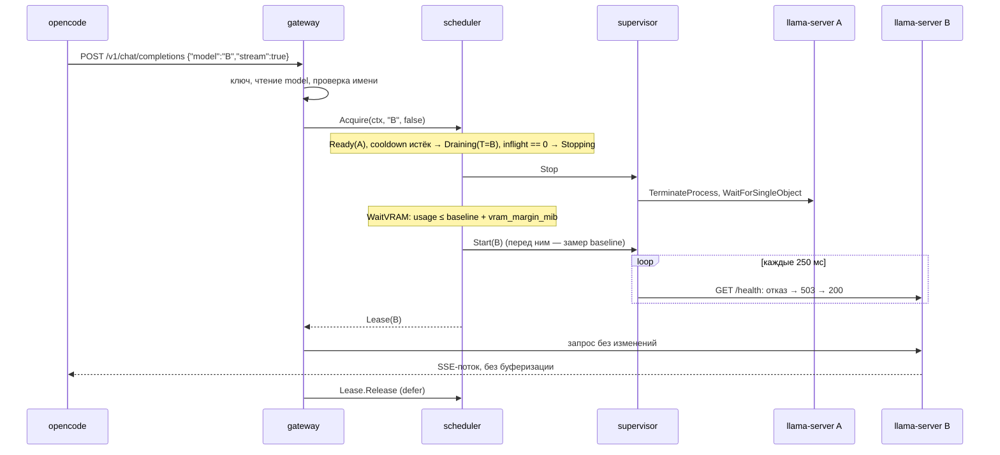
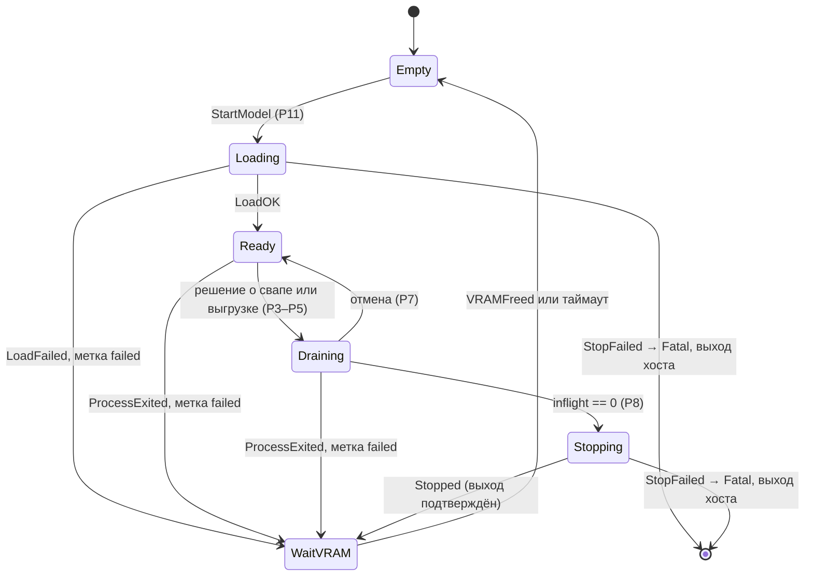

# locallm-host: MVP хоста (этап 1) — дизайн-спецификация

> **Дата:** 2026-11-03 · **Статус:** дизайн утверждён владельцем; документ — основа плана реализации.
>
> **В открытом репозитории:** документ исторический. Упомянутые в нём `spikes/`, `docs/research/`, `docs/plans/` и `docs/manual-checks.md` в открытый репозиторий не вошли; актуальное описание — `docs/reference.ru.md`.
>
> **Область:** `locallm-host.exe` (этап 1 из [04-architecture v1.1](../../research/04-architecture.md)) и фаза 0 (спайки S0–S7, эталоны `/models*`, `cmd/fakeupstream`).
> **Связанные документы:** [04 — архитектура](../../research/04-architecture.md) · [05 — клиенты opencode/pi](../../research/05-clients-opencode-pi.md) · [02 — референсы модулей](../../research/02-module-references.md).
> «Должен», «не должен», «может» в тексте — нормативные. Где этот документ расходится с 04 v1.1, действует этот документ (перечень расхождений — §15.1).

---

## 1. Что это и зачем

`locallm-host.exe` — маленькая программа для Windows-ПК с видеокартой. Она стоит между llama.cpp и программами на маке (pi и opencode): принимает их запросы через Tailscale и передаёт модели. Видеокарта одна, поэтому в памяти живёт одна модель. Когда клиент просит другую, программа сама выгружает текущую, дожидается, пока память видеокарты реально освободится, и загружает нужную; клиент в это время просто ждёт ответа. Сменить модель можно и явно — командой `/llama` в pi; этот документ точно описывает, что делает первая версия, чего она не делает и как мы проверим, что она работает.

---

## 2. Цели, не-цели, границы MVP

### 2.1. Цели

| # | Цель | Чем подтверждается |
|---|---|---|
| G1 | OpenAI-совместимый `/v1/*`: тела запросов и ответов проходят без изменений, SSE не буферизуется, tool calling не искажается | S5, тесты шлюза (§14.4), приёмка A2 |
| G2 | Неявная смена модели по полю `model`: запрос молча ждёт пересадку и получает ответ, а не ошибку | приёмка A5 |
| G3 | Явное управление: pi `/llama` через API роутера llama.cpp (`/models*`) и `curl` через `/api/*` | приёмка A1 |
| G4 | В VRAM не больше одной модели: хост не запускает `llama-server`, пока выход предыдущего процесса не подтверждён (`WaitForSingleObject`); если выход подтвердить не удалось, хост завершается с фатальной ошибкой (§7.4). Освобождения VRAM после подтверждённого выхода хост ждёт по замеру не дольше `vram_free_timeout` (без замера — пауза 2 с) и затем запускает новую модель с предупреждением в журнале (§8.4). После падения хоста не остаётся ни одного `llama-server.exe` | S1, S4, юнит-тесты `step` (§14.4), приёмка A3, A4 |
| G5 | Защита от «перетягивания каната» (cooldown) и от повторной загрузки сломанной модели (failed-sticky) | юнит-тесты `step` (§14.4) |
| G6 | Доступ только из tailnet и только с Bearer-ключом | §12, тесты шлюза |
| G7 | Лёгкость: один exe без рантаймов; зависимости — stdlib, `golang.org/x/sys/windows`, `gopkg.in/yaml.v3` | сборка (§4.8) |

### 2.2. Не входит в MVP (следующие спеки)

- иконка в трее, автозапуск при входе в Windows, режим службы Windows;
- выгрузка по простою (`idle_ttl`), режим «замок» (`policy: lock`), алиас `current`;
- клиентский CLI `locallm` для macOS/Linux/Windows, генераторы конфигов opencode/pi, `/api/client-config`;
- веб-страница `/ui`, потоки событий `/models/sse` и `/api/events`;
- tsnet, bind на `100.x`, HTTPS через `tailscale serve --https`;
- авторизация по Tailscale identity (`trust_tailscale_identity`, `admins`);
- перечитывание конфига на лету (`/api/reload`), `/api/policy`, `force` у свапа;
- NVML через `nvml.dll`, бэкенды `llama-router` и `llama-swap`;
- `vram_estimate_mib`, `aliases` у моделей, автообнаружение `*.gguf`;
- несколько GPU, несколько одновременно загруженных моделей, хост под macOS/Linux, подпись exe, установщик.

### 2.3. Как пользоваться в MVP

| Действие | Как |
|---|---|
| Запустить | Двойной щелчок по `locallm-host.exe` (окна нет) или `locallm-host.exe --config <путь>` |
| Остановить | `taskkill /f /im locallm-host.exe` — безопасно: Job Object завершит `llama-server` (§7.1) |
| Сменить модель | pi `/llama`, выбор модели в opencode, `curl -X POST …/api/swap` |
| Посмотреть состояние | `curl …/api/status`, pi `/llama` |
| Изменить настройки | Правка `locallm.yaml` и перезапуск хоста |

---

## 3. Контекст и ограничения

### 3.1. Целевой ПК (проверено 2026-11-03; он же ПК разработки)

| Параметр | Значение | Следствие |
|---|---|---|
| ОС | Windows 11 Pro 10.0.26200, **русская локаль интерфейса** | PDH-счётчики добавлять только через `PdhAddEnglishCounterW` (§8.2) |
| GPU | NVIDIA RTX 5070 Ti, 16303 MiB VRAM, драйвер 616.92 | Одна модель в VRAM; счётчики `\GPU Adapter Memory(luid_…_phys_0)\Dedicated Usage` присутствуют; `nvidia-smi` доступен как резерв |
| llama.cpp | `C:\llama\llama-server.exe`, сборка **b11476** (0.6.0-dev, Clang, CUDA), официальный релиз; рядом `llama.exe` | Router mode в сборке есть — используется только для снятия эталонов `/models*` (§14.2), не как бэкенд |
| Go | **не установлен** | Спайк S0 ставит Go ≥ 1.26 (`winget install GoLang.Go`) |
| Tailscale | 1.102.2, установлен и работает | Выдача — `tailscale serve` (§10) |

### 3.2. Модели на диске (`C:\models\<org>--<repo>\*.gguf`)

| Назначение | Путь | Размер | Особенность |
|---|---|---|---|
| Тестовая малая | `C:\models\LiquidAI--LFM2.5-2.6B-GGUF\LFM2.5-2.6B-QAD-Q4_0.gguf` | 1.5 ГБ | Для S1, S2, S5 и быстрых hw-тестов |
| Большая 1 | `C:\models\unsloth--Qwen3.8-27B-GGUF\Qwen3.8-27B-UD-IQ3_XXS.gguf` | 10 ГБ | Приёмка A4 |
| Большая 2 | Jack-3.8-27B-Coder | 12 ГБ | Запасная большая |
| Большая 3 | `C:\models\google-- gemma-4-26B-q4-0-it-GGUF\gemma-4-26B_q4_0-it.gguf` + `mmproj-gemma-4-26B-A4B-it-Q8_0.gguf` | 13.7 ГБ | **Пробел в имени каталога**; мультимодальная (`--mmproj`) |
| Составная | Qwen3.6-35B, 2 шарда | — | Путь указывает на первый шард `…-00001-of-00002.gguf` |

### 3.3. Клиенты и сеть

- Клиентское устройство — **macOS** с **pi** и **opencode**. Приёмка выполняется с мака через tailnet.
- Хост слушает `127.0.0.1:8080`; в tailnet его выставляет `tailscale serve --bg --http=8080 http://127.0.0.1:8080` (без прав администратора; настройка переживает перезагрузку; таймаутов не вводит; добавляет заголовки `Tailscale-User-*`).
- Известные ограничения клиентов, на которых построен дизайн:
  - pi: `POST /models/load` и `POST /models/unload` ждут ответа не дольше **15 с** (`client.ts`); после загрузки pi опрашивает `GET /models` каждые 250 мс;
  - OpenAI SDK (его использует pi) ждёт ответа до 600 с, повторяет 408/409/429/5xx (по умолчанию 2 раза), учитывает `Retry-After` только до 60 с и не повторяет при `x-should-retry: false`;
  - собственные повторы pi — 3 попытки за ~14 с, поэтому `503 + Retry-After` как основной механизм ожидания свапа отвергнут;
  - opencode V2 шлёт параллельный запрос на генерацию заголовка сессии, если его не отключить (§11.1).

### 3.4. Ограничения проекта

- Только бесплатное ПО с открытым кодом; Ollama и LM Studio исключены.
- Go ≥ 1.26, `CGO_ENABLED=0`, `GOOS=windows`, `GOARCH=amd64`.
- Модуль Go — `github.com/strigov/strigov-locallm`.
- Зависимости хоста: stdlib, `golang.org/x/sys/windows`, `gopkg.in/yaml.v3`. Других нет.

---

## 4. Архитектура

### 4.1. Компоненты

| Компонент | Пакет | Обязанность |
|---|---|---|
| Конфиг | `internal/config` | Чтение `locallm.yaml`, значения по умолчанию, раскрытие `%VAR%`, валидация (§5) |
| Супервизор | `internal/supervisor` | Job Object на хост; запуск и остановка `llama-server.exe`; опрос `/health`; кольцевой буфер вывода (§7). Реализует `scheduler.Backend` |
| Планировщик | `internal/scheduler` | Единственный владелец решения «какая модель в VRAM»: чистый автомат `step`, цикл-владелец, очередь, Lease, Snapshot (§6) |
| Монитор VRAM | `internal/vram` | `Probe`: PDH → `nvidia-smi` → пауза; `WaitReleased` (§8) |
| HTTP-шлюз | `internal/gateway` | Авторизация, `/v1/*` (прокси), `/models*` (API роутера llama.cpp), `/api/*`, `/health` (§9) |
| Логирование | `internal/logging` | `log/slog` в файл с ротацией по размеру (§13) |
| Точка входа | `cmd/locallm-host` | Флаги, порядок старта, фатальные ошибки (§4.7) |
| Фейковый сервер | `cmd/fakeupstream` | Притворяется `llama-server` с настраиваемыми задержками и ошибками (§14.3) |

### 4.2. Схема



### 4.3. Раскладка репозитория (подмножество 04 §10)

```text
strigov-locallm/
├── cmd/
│   ├── locallm-host/          # main.go: флаги, порядок старта, MessageBox при фатальной ошибке
│   └── fakeupstream/          # фейковый llama-server (§14.3)
├── internal/
│   ├── config/                # config.go, expand.go (%VAR%), validate.go
│   ├── supervisor/            # job_windows.go, process.go, health.go, ringbuf.go, *_hw_test.go (S1, S2)
│   ├── scheduler/             # backend.go, state.go, step.go, loop.go, snapshot.go, lease.go
│   ├── vram/                  # probe.go, pdh_windows.go, nvidiasmi.go, none.go, wait.go, *_hw_test.go (S3, S4)
│   ├── gateway/               # server.go, auth.go, proxy.go, models.go, admin.go, errors.go, *_hw_test.go (S5)
│   └── logging/               # logging.go (slog + ротация)
├── spikes/
│   ├── s0-hello/              # S0: hello-world с -H=windowsgui и дочерним процессом
│   └── logproxy/              # S5/P0-REF: минимальный ReverseProxy с журналом запросов
├── testdata/
│   ├── routermode/            # эталоны /models* из router mode b11476 (§14.2)
│   └── config/                # валидные и невалидные locallm.yaml для тестов
├── docs/research/06-phase0-results.md   # результаты фазы 0 (замеры, принятые значения)
└── locallm.example.yaml
```

### 4.4. Интерфейсы

```go
// internal/scheduler/backend.go — интерфейс объявлен потребителем, реализует internal/supervisor.
type Backend interface {
	// Start запускает llama-server для m и возвращается, когда GET /health == 200,
	// процесс завершился или истёк ctx (load_timeout). Ошибка *supervisor.LoadError
	// означает, что процесс уже завершён и дождан (или не стартовал). Если по истечении
	// load_timeout процесс не удалось завершить (Stop вернул ErrStopUnconfirmed),
	// Start возвращает ErrStopUnconfirmed: процесс остаётся во владении супервизора.
	// Start при живом процессе — ошибка.
	Start(ctx context.Context, m config.Model) (*Upstream, error)
	// Stop: TerminateProcess + ожидание выхода до stop_timeout, до 3 попыток (§7.4).
	// nil — только если выход подтверждён (или процесса нет); идемпотентен.
	// Иначе ErrStopUnconfirmed: хэндл процесса не закрывается, Status().Running == true.
	Stop(ctx context.Context) error
	// Status — мгновенный снимок процесса для /api/status.
	Status() BackendStatus
}

var ErrStopUnconfirmed = errors.New("llama-server did not exit after TerminateProcess")

// Upstream — один запуск llama-server. Создаётся супервизором через NewUpstream.
type Upstream struct {
	Model     string
	URL       *url.URL        // http://127.0.0.1:<llama.port>
	PID       int
	Transport *http.Transport // свой на каждый запуск, DialContext с проверкой Retire (§9.3)
	Done      <-chan ExitInfo // одно значение при выходе процесса, затем канал закрывается
	// ctx (отменяется Retire) и флаг retired — неэкспортируемые
}

func NewUpstream(model string, u *url.URL, pid int, done <-chan ExitInfo) *Upstream
// Context отменяется, когда запуск выведен из обслуживания (Retire).
func (u *Upstream) Context() context.Context
// Retire — идемпотентно: retired = true, отмена Context, Transport.CloseIdleConnections().
// После Retire Transport не открывает новых соединений (§9.3). Вызывает только владелец планировщика.
func (u *Upstream) Retire()

type ExitInfo struct {
	Code int
	At   time.Time
	Tail []string // последние строки вывода этого запуска (§7.5)
}

type BackendStatus struct {
	Running bool
	Model   string
	PID     int
	Since   time.Time
}

// internal/supervisor
type LoadError struct {
	Reason   string   // "exited" | "timeout" | "port_busy" | "spawn"
	ExitCode int      // -1, если процесс не стартовал
	Tail     []string // хвост вывода (§7.5)
}
```

```go
// internal/scheduler
// onFatal вызывается эффектом Fatal (§6.3); реализует cmd/locallm-host (§4.7) и не возвращается.
func New(cfg *config.Config, b Backend, p vram.Probe, onFatal func(error), log *slog.Logger) *Scheduler
func (s *Scheduler) Run(ctx context.Context) // цикл владельца (§4.5)

// Acquire ждёт, пока model станет Ready, и выдаёт Lease.
// explicit=false — запросы /v1/*: проходят cooldown, failed-sticky и max_queue.
// explicit=true — одним событием Acquire{Explicit: true} регистрирует и явное намерение
// Load(model), и ожидающего (§6.4, §6.7.4); ждёт Lease в обход cooldown и max_queue;
// намерение переживает отмену ctx.
func (s *Scheduler) Acquire(ctx context.Context, model string, explicit bool) (*Lease, error)

// Load — явное асинхронное намерение «загрузить model». Возвращается, когда владелец
// обработал событие и опубликовал Snapshot (§6.9); сама загрузка к этому моменту только
// принята. Ошибка — только ErrModelNotFound.
func (s *Scheduler) Load(model string) error

// Unload — явное асинхронное намерение «выгрузить»; model == "" — выгрузить всё.
// Возвращается так же, как Load: после обработки события и публикации Snapshot.
func (s *Scheduler) Unload(model string) error

// Snapshot — последний опубликованный снимок (atomic.Pointer[Snapshot]); без блокировок.
func (s *Scheduler) Snapshot() *Snapshot

type Lease struct {
	Model    string
	Gen      uint64    // поколение процесса, для которого выдан Lease (§6.1)
	Upstream *Upstream // запуск именно этого Gen
	Waited   time.Duration
	// sync.Once и функция отправки события Release — неэкспортируемые
}
// Valid — false, если запуск Gen выведен из обслуживания (Upstream.Retire, §6.9).
func (l *Lease) Valid() bool
// Context — Upstream.Context(): отменяется при Retire поколения Lease.
func (l *Lease) Context() context.Context
func (l *Lease) Release() // идемпотентен; шлюз вызывает в defer

// Чистая функция переходов: не мутирует входное состояние, не делает I/O, не читает часы.
func step(st State, ev Event, now time.Time, p Params) (State, []Effect)
```

```go
// internal/vram
type Probe interface {
	Name() string                                // "pdh" | "nvidia-smi" | "none"
	UsageMiB(ctx context.Context) (int64, error) // сумма Dedicated Usage по всем адаптерам, МиБ
}
func Detect(ctx context.Context, source string, log *slog.Logger) (Probe, error) // §8.1
func WaitReleased(ctx context.Context, p Probe, baselineMiB, marginMiB int64, timeout time.Duration) WaitResult

type WaitResult struct {
	Waited   time.Duration
	LastMiB  int64 // -1, если неизвестно
	TimedOut bool
	Unknown  bool // замер невозможен — выполнена фиксированная пауза 2 с
}
```

```go
// internal/gateway
type LogSource interface {
	Logs(model string, tail int) (lines []string, ok bool) // реализует supervisor
}
func New(cfg *config.Config, s *scheduler.Scheduler, logs LogSource, p vram.Probe, keys [][]byte, log *slog.Logger) http.Handler
```

### 4.5. Модель конкурентности

- **Горутина-владелец планировщика** — единственный писатель `State`. Читает канал событий (буфер 64), вызывает `step`, публикует новый `Snapshot` через `atomic.Pointer[Snapshot].Store`, затем закрывает канал подтверждения события (`ack`), если он есть (`Load`, `Unload`, `WaiterGone`), и исполняет эффекты в порядке выдачи. Поэтому к моменту возврата `Scheduler.Load`/`Unload` их результат уже виден в `Snapshot()`.
- Эффекты `Grant` и `Reject` — неблокирующая отправка в канал ответа ожидающего (буфер 1). `RetireUpstream` исполняется владельцем синхронно, до обработки следующего события (отмена контекста и закрытие простаивающих соединений не ждут I/O). `StartModel`, `StopModel`, `WaitVRAM`, `SetTimer` исполняются в отдельных горутинах; их результат возвращается событием в тот же канал. `Fatal` вызывает `onFatal`, который завершает хост (§4.7). Владелец никогда не ждёт I/O.
- HTTP-хендлеры читают `Snapshot` без блокировок и общаются с владельцем только событиями. Поэтому `GET /models` отвечает мгновенно в любой фазе, включая середину свапа.
- Супервизор: на процесс — горутина `cmd.Wait`, две горутины чтения stdout/stderr; на время `Start` — цикл опроса `/health`.

### 4.6. Главный сценарий: неявная пересадка A → B



Пока идёт пересадка (30–90 с), клиент ждёт на открытом соединении: хост не отправляет ни байта, пока не получит Lease. Бюджет ожидания — `swap.wait_timeout` (240 с), затем `504 swap_wait_timeout`.

### 4.7. Старт и остановка хоста

Флаги: `--config <путь>` (по умолчанию `%LOCALAPPDATA%\locallm\locallm.yaml`), `--log-stderr` (дублировать журнал в stderr — для отладочной консольной сборки), `--no-dialog` (не показывать MessageBox — для скриптов и тестов).

Порядок старта; любая ошибка шагов 2–8 фатальна:

| Шаг | Действие | Код выхода при ошибке |
|---|---|---|
| 1 | Разбор флагов | 2 |
| 2 | Загрузка и валидация конфига (§5); все ошибки собираются в одно сообщение | 2 |
| 3 | Инициализация журнала (§13) | 2 |
| 4 | Помещение хоста в Job Object (§7.1) | 3 |
| 5 | Загрузка файла ключей; создание, если файла нет (§5.4) | 4 |
| 6 | Выбор источника VRAM (`vram.Detect`, §8.1) | 5 |
| 7 | Создание супервизора, планировщика, шлюза; запуск цикла владельца | — |
| 8 | `net.Listen` на `server.listen` (занят — второй экземпляр или чужой процесс) | 6 |
| 9 | Если задан `swap.default_model` — `Load(default_model)` (явное намерение) | — |
| 10 | `http.Server.Serve` | — |

При фатальной ошибке хост пишет её в журнал (если журнал ещё не открыт — в `%LOCALAPPDATA%\locallm\logs\host.log`) и, если не задан `--no-dialog`, показывает `MessageBoxW` с текстом ошибки и путём к журналу: у exe с `-H=windowsgui` нет консоли, и без окна владелец не узнает о проблеме.

Единственная фатальная ошибка во время работы — неподтверждённая остановка `llama-server` (эффект `Fatal` после `StopFailed`, §6.5 E14, §7.4). Её обрабатывает `onFatal`, переданный в `scheduler.New`: запись в журнал (`error`, PID процесса), `http.Server.Close()` (открытые соединения клиентов закрываются, новые не принимаются), `MessageBoxW` (если не задан `--no-dialog`), выход с кодом **7**. Пока окно открыто, новый `llama-server` не запускается (автомат в состоянии `Halted`, §6.1); при выходе хоста ядро закрывает хэндл Job Object и завершает зависший процесс (§7.1).

Штатной мягкой остановки в MVP нет: `taskkill /f` завершает хост, ядро закрывает хэндл Job Object и завершает `llama-server` (§7.1). В консольной отладочной сборке `Ctrl+C` приводит к тому же через выход процесса.

### 4.8. Сборка

```powershell
$env:CGO_ENABLED = "0"
go build -trimpath -ldflags "-H=windowsgui -s -w -X main.version=0.1.0" -o bin\locallm-host.exe .\cmd\locallm-host
go build -trimpath -o bin\fakeupstream.exe .\cmd\fakeupstream
```

Отладочная сборка хоста — без `-H=windowsgui` (появляется консоль) и с `--log-stderr`. `go.mod`: `go 1.26` (точная директива — по итогам S0).

---

## 5. Конфиг `locallm.yaml`

### 5.1. Пример

```yaml
server:
  listen: 127.0.0.1:8080
  api_keys_file: '%LOCALAPPDATA%\locallm\keys.txt'

llama:
  server_exe: 'C:\llama\llama-server.exe'
  port: 8081
  default_args: ['-ngl', '99', '-np', '1', '-fa', 'on', '--cache-reuse', '256', '--no-webui']
  load_timeout: 300s
  stop_timeout: 10s
  log_lines: 1000

swap:
  default_model: qwen-coder   # загружается при старте хоста; '' — ничего не загружать
  swap_cooldown: 30s          # период остывания; 0 — выключен
  wait_timeout: 240s          # сколько запрос клиента ждёт пересадку
  vram_free_timeout: 10s      # сколько ждём освобождения VRAM
  vram_margin_mib: 512
  max_queue: 8
  failed_ttl: 120s            # сколько помним, что модель не загрузилась

vram:
  source: auto                # auto | pdh | nvidia-smi | none

logging:
  dir: '%LOCALAPPDATA%\locallm\logs'
  level: info
  max_size_mib: 10
  max_files: 5

models:
  qwen-coder:
    path: 'C:\models\unsloth--Qwen3.8-27B-GGUF\Qwen3.8-27B-UD-IQ3_XXS.gguf'
    args: ['-c', '32768']
  gemma:
    path: 'C:\models\google-- gemma-4-26B-q4-0-it-GGUF\gemma-4-26B_q4_0-it.gguf'
    args: ['-c', '16384', '--mmproj', 'C:\models\google-- gemma-4-26B-q4-0-it-GGUF\mmproj-gemma-4-26B-A4B-it-Q8_0.gguf']
  tiny:                       # для тестов, 1.5 ГБ
    path: 'C:\models\LiquidAI--LFM2.5-2.6B-GGUF\LFM2.5-2.6B-QAD-Q4_0.gguf'
```

Имена моделей (`qwen-coder`, `gemma`) задаёт владелец; именно их видят pi и opencode. Значения `vram_free_timeout`, `vram_margin_mib`, `stop_timeout`, `load_timeout`, `wait_timeout` — предварительные; окончательные фиксируются по итогам S4 и S7 в `locallm.example.yaml` и `06-phase0-results.md`.

### 5.2. Схема

Длительности — строки формата `time.ParseDuration` (`30s`, `5m`); число без единицы — ошибка.

| Ключ | Тип | По умолчанию | Правила |
|---|---|---|---|
| `server.listen` | `host:port` | `127.0.0.1:8080` | Хост — IP-литерал из `127.0.0.0/8` или `::1`; имена (`localhost`), `0.0.0.0`, `100.x` — ошибка. Порт 1–65535 |
| `server.api_keys_file` | путь | `%LOCALAPPDATA%\locallm\keys.txt` | Абсолютный (§5.3 п. 2); §5.4 |
| `llama.server_exe` | путь | — (обязателен) | Абсолютный путь к существующему файлу |
| `llama.port` | int | `8081` | 1024–65535, ≠ порту `server.listen` |
| `llama.default_args` | `[]string` | `['-ngl','99','-np','1','-fa','on','--cache-reuse','256','--no-webui']` | Без зарезервированных флагов (§5.3) |
| `llama.load_timeout` | duration | `300s` | ≥ 10 с |
| `llama.stop_timeout` | duration | `10s` | 1–60 с |
| `llama.log_lines` | int | `1000` | 100–100000; строк вывода на модель в памяти |
| `swap.default_model` | string | `''` | Пусто или ключ из `models` |
| `swap.swap_cooldown` | duration | `30s` | ≥ 0; `0` выключает cooldown полностью |
| `swap.wait_timeout` | duration | `240s` | 10 с – 590 с (меньше 600-секундного лимита OpenAI SDK) |
| `swap.vram_free_timeout` | duration | `10s` | 1–120 с |
| `swap.vram_margin_mib` | int | `512` | 0–4096 |
| `swap.max_queue` | int | `8` | 1–64 |
| `swap.failed_ttl` | duration | `120s` | ≥ 0; `0` выключает failed-sticky |
| `vram.source` | enum | `auto` | `auto` / `pdh` / `nvidia-smi` / `none` (§8.1) |
| `logging.dir` | путь | `%LOCALAPPDATA%\locallm\logs` | Абсолютный; создаётся, если нет |
| `logging.level` | enum | `info` | `debug` / `info` / `warn` / `error` |
| `logging.max_size_mib` | int | `10` | 1–1024 |
| `logging.max_files` | int | `5` | 1–100 |
| `models` | map | — (обязателен) | ≥ 1 модель |
| `models.<id>` | — | — | `id` соответствует `^[A-Za-z0-9][A-Za-z0-9._-]{0,63}$`; сравнение имён точное, с учётом регистра |
| `models.<id>.path` | путь | — (обязателен) | Абсолютный путь к существующему файлу с расширением `.gguf` (без учёта регистра); правила шардов — §5.3 |
| `models.<id>.args` | `[]string` | `[]` | Без зарезервированных флагов |

### 5.3. Правила валидации

1. **Неизвестные ключи** — ошибка (`yaml.v3` с `KnownFields(true)`): опечатка не должна молча превращаться в значение по умолчанию. Повторяющееся имя модели в `models` — ошибка. Порядок моделей сохраняется таким, как в файле (`models` декодируется через `yaml.Node`); в этом порядке модели выдаются в `/models` и `/v1/models`.
2. **Раскрытие `%VAR%`** — во всех путях (`server.api_keys_file`, `llama.server_exe`, `logging.dir`, `models.*.path`) и в **каждом элементе** `llama.default_args` и `models.*.args`. Синтаксис Windows: `%NAME%` заменяется значением переменной окружения; `%%` — литерал `%`; неизвестная переменная — ошибка (не оставляется как есть). **После раскрытия** каждый путь и каждое значение файлового аргумента (п. 5) должны быть абсолютными: `filepath.IsAbs` (`C:\…` или `\\server\share\…`); относительные пути, пути от корня текущего диска (`\models\…`) и пути вида `C:models\…` — ошибка. Причина: хост проверяет файлы из своего рабочего каталога, а `llama-server` запускается с `Dir` = каталог `server_exe` (§7.2), и относительный путь разрешился бы в этих двух местах по-разному.
3. **Пути с пробелами** поддерживаются: аргументы передаются процессу отдельными элементами `argv`, экранирование делает `os/exec` (`syscall.EscapeArg`). В YAML такие пути пишутся в одинарных кавычках.
4. **Составные модели.** Если имя файла соответствует `-(\d{5})-of-(\d{5})\.gguf$`, номер шарда должен быть `00001`, и все шарды `00001…N` должны существовать в том же каталоге.
5. **Файлы в аргументах.** Значение после флагов `--mmproj`, `-mm`, `--model-draft`, `-md`, `--lora`, `--chat-template-file` должно быть абсолютным путём (п. 2) к существующему файлу.
6. **Зарезервированные флаги** — запрещены в `default_args` и `args`, потому что ими управляет хост или они конфликтуют с `path`: `-m`, `--model`, `--host`, `--port`, `--api-key`, `--api-key-file`, `-hf`, `--hf-repo`, `-mu`, `--model-url`, а также всё с префиксом `--models-` (флаги router mode).
7. **`context_length`** модели — значение последнего `-c` / `--ctx-size` в `default_args + args`; если флага нет или значение `0`, `context_length` неизвестен и в ответах опускается.
8. Конфиг читается один раз при старте. Изменения вступают в силу после перезапуска хоста.

### 5.4. Файл ключей

- Формат: UTF-8, один ключ на строку; пробелы по краям обрезаются; пустые строки и строки, начинающиеся с `#`, пропускаются.
- Ключ — печатные ASCII-символы без пробелов, длина ≥ 32. Строка, не прошедшая проверку, — фатальная ошибка с номером строки (значение ключа в сообщение не попадает).
- Если файла нет, хост создаёт каталог и файл с одним ключом: 32 байта из `crypto/rand` в `base64.RawURLEncoding` (43 символа), и пишет в журнал путь к файлу (не ключ). Файл в `%LOCALAPPDATA%` наследует ACL профиля: доступ у пользователя, `SYSTEM` и администраторов.
- Если файл есть, но валидных ключей в нём нет, — фатальная ошибка.
- Ключи читаются при старте; ротация — правка файла и перезапуск хоста.

---

## 6. Планировщик

Планировщик — автомат с одной чистой функцией переходов `step(State, Event, now, Params) (State, []Effect)`. Цикл-владелец (§4.5) подаёт в неё события и исполняет эффекты. Все правила ниже — правила `step`.

### 6.1. Состояние

| Поле | Тип | Смысл |
|---|---|---|
| `Phase` | `Phase` | Фаза (§6.2) |
| `Gen` | `uint64` | Номер запуска процесса (поколение); растёт на каждом `StartModel`. События с чужим `Gen` игнорируются. Каждый Lease несёт `Gen`, для которого выдан (§6.9) |
| `Current` | `string` | Модель в процессе; не пусто ровно в фазах Loading, Ready, Draining, Stopping |
| `Upstream` | `*Upstream` | Запуск текущего `Gen` из `LoadOK`; не `nil` ровно в фазах Ready и Draining. Выводится из обслуживания эффектом `RetireUpstream` (P8, E9) |
| `Target` | `string` | Куда пересаживаемся. В Draining фиксируется решением о свапе (`""` — выгрузка); в Stopping и WaitVRAM равен `nextTarget()` |
| `Inflight` | `int` | Число выданных Lease текущего `Gen` |
| `Queue` | `[]Waiter` | FIFO ожидающих: `{ID, Model, Explicit, Since}` |
| `Intent` | `*Intent` | Не больше одного явного намерения: `{Kind: Load или Unload, Model}`. Новое заменяет старое |
| `Failed` | `map[string]FailInfo` | Метки failed-sticky: `{ExitCode, Message, At, Until}` |
| `LastActivity` | `time.Time` | Момент перехода в Ready или последнего `Release` текущего `Gen` |
| `Baseline` | `int64` | VRAM usage (МиБ), замеренный перед стартом `Current`; `-1` — неизвестно |
| `PhaseSince` | `time.Time` | Начало текущей фазы |
| `Halted` | `bool` | `true` после `StopFailed` (E14): выход процесса не подтверждён, хост завершается (§4.7). Фаза и `Current` при этом не меняются; `step` больше не выдаёт эффектов (E15) |

Производные величины:

- `hot(now)` ≡ `swap_cooldown > 0 ∧ Phase == Ready ∧ (Inflight > 0 ∨ now < LastActivity + swap_cooldown)`;
- `nextTarget()` ≡ `Intent.Model`, если `Intent.Kind == Load`; иначе `Queue[0].Model`, если очередь не пуста; иначе `""`;
- `implicitLen()` ≡ число ожидающих с `Explicit == false`;
- `Params` — `swap_cooldown`, `max_queue`, `failed_ttl` и список известных моделей из конфига.

### 6.2. Фазы



| Фаза | Процесс | Что происходит |
|---|---|---|
| Empty | нет | Ничего не загружено |
| Loading | запущен | Ждём `/health` 200. **Не прерывается**: явные команды, пришедшие в Loading, выполняются после Ready |
| Ready | готов | Запросы к `Current` проходят сразу |
| Draining | готов | Дорабатывают выданные Lease; новые запросы к `Current` встают в очередь за `Target` |
| Stopping | убиваем | `TerminateProcess` + ожидание выхода. **Необратима**: выйти можно только по `Stopped` (выход подтверждён) или завершением хоста по `StopFailed` |
| WaitVRAM | нет (выход подтверждён) | Ждём, пока usage ≤ `Baseline + vram_margin_mib`, не дольше `vram_free_timeout` |

Failed — не фаза, а метка на модели (`Failed[m]`). После неудачной загрузки или падения автомат проходит WaitVRAM → Empty, как после обычной остановки. В WaitVRAM автомат попадает **только** по событию, которое подтверждает выход процесса текущего `Gen`: `LoadFailed` (`Backend.Start` вернул `*LoadError` — процесс дождан), `ProcessExited` (сработал `Upstream.Done`) или `Stopped` (`Backend.Stop` вернул `nil`). Неподтверждённый выход — событие `StopFailed`: процесс по-прежнему считается живым, новый не запускается, хост завершается (E14, §7.4).

### 6.3. События и эффекты

| Событие | Источник | Поля |
|---|---|---|
| `Acquire` | `Scheduler.Acquire` | `ID, Model, Explicit`, канал ответа. При `Explicit` одно это событие регистрирует и намерение `Load(Model)`, и ожидающего (§6.4) |
| `WaiterGone` | `Acquire` при отмене ctx | `ID`, канал подтверждения |
| `Release` | `Lease.Release` | `Gen` |
| `Load` | `Scheduler.Load`, предзагрузка `default_model` | `Model`, канал подтверждения |
| `Unload` | `Scheduler.Unload` | `Model` (`""` — всё), канал подтверждения |
| `Baseline` | исполнитель `StartModel` | `Gen, MiB` (`-1` — неизвестно) |
| `LoadOK` | исполнитель `StartModel` | `Gen, Upstream` |
| `LoadFailed` | исполнитель `StartModel` (`Backend.Start` вернул `*LoadError`) | `Gen, ExitCode, Message` |
| `ProcessExited` | наблюдатель `Upstream.Done` | `Gen, ExitCode, Message` |
| `Stopped` | исполнитель `StopModel` (`Backend.Stop` вернул `nil`) | `Gen` |
| `StopFailed` | исполнитель `StopModel` или `StartModel` (`ErrStopUnconfirmed`) | `Gen, PID, Message` |
| `VRAMFreed` | исполнитель `WaitVRAM` | `Gen, Waited, LastMiB, TimedOut, Unknown` |
| `Timer` | исполнитель `SetTimer` | `Kind = cooldown` |

| Эффект | Исполнение |
|---|---|
| `Grant{ID, Lease}` | Отправить Lease ожидающему; Lease несёт `Gen` и `Upstream` текущего запуска |
| `Reject{ID, Err}` | Отправить ошибку ожидающему |
| `StartModel{Gen, Model}` | Горутина: замер `probe.UsageMiB` → `Baseline`; `Backend.Start` с таймаутом `load_timeout` → `LoadOK`, `LoadFailed` (`*LoadError`) или `StopFailed` (`ErrStopUnconfirmed`); при успехе — горутина-наблюдатель `<-Upstream.Done` → `ProcessExited` |
| `RetireUpstream{Gen, Upstream}` | Владелец, синхронно: `Upstream.Retire()` — все Lease этого `Gen` становятся недействительными, их upstream-операции отменяются, Transport больше не открывает соединений (§6.9) |
| `StopModel{Gen}` | Горутина: `Backend.Stop` → `nil`: `Stopped`; `ErrStopUnconfirmed`: `StopFailed` |
| `Fatal{Err}` | Владелец: `onFatal(Err)` (§4.7) — журнал, закрытие HTTP-сервера, `MessageBoxW`, выход с кодом 7 |
| `WaitVRAM{Gen, Baseline}` | Горутина: `vram.WaitReleased(…, Baseline, vram_margin_mib, vram_free_timeout)` → `VRAMFreed` |
| `SetTimer{Kind, At}` | `time.AfterFunc` → `Timer`; заменяет ранее установленный таймер того же вида (таймер cooldown всегда один) |
| `Log{Level, Msg, Attrs}` | `slog` (сама `step` не пишет в журнал) |

### 6.4. Приём неявного и явного запроса (`Acquire`)

Правила проверяются по порядку; срабатывает первое подходящее (кроме A1a: оно только меняет состояние и передаёт проверку дальше).

| # | Условие | Результат |
|---|---|---|
| A1 | Модель неизвестна | `Reject(model_not_found)`. Шлюз проверяет это раньше; здесь — страховка |
| A1a | `Explicit` | В том же вызове `step` применить к состоянию изменения E3 для `m` (снять `Failed[m]`, `Intent = Load(m)`, поправка Draining), затем продолжить проверку с A3; A2, A4 и A5 к явному ожидающему не применяются (их условия содержат `!Explicit`) |
| A2 | `!Explicit ∧ Failed[m]` активна (`now < Until`) | `Reject(model_load_failed, cached)` — без новой загрузки |
| A3 | `Phase == Ready ∧ Current == m` | `Grant`, `Inflight++` |
| A4 | `!Explicit ∧ Phase == Ready ∧ Current ≠ m ∧ hot(now) ∧` в `Queue` нет ожидающих `m` | `Reject(model_cooldown, RetryAfter)` |
| A5 | `!Explicit ∧ implicitLen() ≥ max_queue` | `Reject(queue_full)` |
| A6 | Иначе | Добавить в конец `Queue`; затем продвижение (§6.6) |

`RetryAfter` = `ceil(LastActivity + swap_cooldown − now)` в секундах; при `Inflight > 0` — `ceil(swap_cooldown)`; не меньше 1.

Запрос к `Current` в фазе Draining попадает в A6, то есть в очередь **за** `Target`, а не «вне очереди» (правило ADR-10 из 04). Запрос к `Current` в фазе Loading тоже попадает в A6 и получает Lease по P1 в момент Ready.

**Атомарность явного запроса (A1a).** Намерение и ожидающий явного свапа регистрируются одним событием, поэтому между ними не может обработаться никакое другое событие. Следствия: (1) метка failed снимается и ожидающий встаёт в очередь в одном шаге — I6 не нарушается; (2) ожидающий разрешается исходом ближайшей попытки загрузки `m`: уже идущей (если `m` в этот момент в Loading) или той, которую начнёт P11; при `LoadFailed` этой попытки E8 убирает его из очереди с `503 model_load_failed` и снимает намерение, повторной загрузки без новой явной команды нет; (3) `LoadFailed`, обработанный **до** явного `Acquire`, ставит метку, которую этот `Acquire` затем снимает, — это и есть явный повтор загрузки, и ожидающий получает исход новой попытки.

### 6.5. Обработка остальных событий

| # | Событие | Условие | Изменения состояния | Эффекты |
|---|---|---|---|---|
| E1 | `WaiterGone(ID)` | — | Убрать ожидающего из `Queue`, если он там | Подтверждение; продвижение |
| E2 | `Release(g)` | `g == Gen`, Phase — Ready или Draining | `Inflight--`, `LastActivity = now` | Продвижение |
| E3 | `Load(m)` | — | `delete(Failed, m)`; `Intent = Load(m)`. Если Draining: при `Current == m` — Phase = Ready, Target = `""`; иначе Target = m | `Log`; продвижение |
| E4 | `Unload(m)` | `m ≠ ""` и `m ≠ Current` | `delete(Failed, m)`; если `Intent == Load(m)` — `Intent = nil` | Продвижение |
| E5 | `Unload(m)` | `m == ""` или `m == Current` | `delete(Failed, m)`; `Intent = Unload`; если Draining — Target = `""` | `Log`; продвижение |
| E6 | `Baseline(g, mib)` | `g == Gen` | `Baseline = mib` | `Log` |
| E7 | `LoadOK(g, up)` | `g == Gen`, Loading | Phase = Ready, `Upstream = up`, `LastActivity = now`; `delete(Failed, Current)` (истёкшая метка) | `Log` (время загрузки); продвижение |
| E8 | `LoadFailed(g, info)` | `g == Gen`, Loading | `Failed[Current] = info` с `Until = now + failed_ttl`; убрать из `Queue` всех ожидающих `Current`; если `Intent == Load(Current)` — `Intent = nil`; Phase = WaitVRAM; Current = `""`; Target = `nextTarget()` | `Reject(model_load_failed)` каждому убранному; `WaitVRAM(Gen, Baseline)`; `Log(error)` с хвостом вывода |
| E9 | `ProcessExited(g, info)` | `g == Gen`, Ready или Draining | Как E8, плюс `Inflight = 0` (Release этого `Gen` станут устаревшими) и `Upstream = nil` | `RetireUpstream(Gen, прежний Upstream)` — первым, до остальных эффектов; далее как E8 |
| E10 | `Stopped(g)` | `g == Gen`, Stopping | Phase = WaitVRAM; Current = `""`; Target = `nextTarget()` | `WaitVRAM(Gen, Baseline)` |
| E11 | `VRAMFreed(g, r)` | `g == Gen`, WaitVRAM | Phase = Empty | `Log` (`Waited`; при `TimedOut` — `warn`); продвижение |
| E12 | `Timer(cooldown)` | — | — | Продвижение |
| E13 | E2, E6–E11, E14 с `g ≠ Gen` или не в своей фазе | — | — | `Log(debug, "stale event")` |
| E14 | `StopFailed(g, info)` | `g == Gen`, Loading или Stopping | `Halted = true`; Phase, `Current`, `Gen` не меняются (процесс считается живым) | `Log(error)` с PID; `Fatal` |
| E15 | Любое, включая `Acquire` | `Halted` (проверяется раньше всех правил §6.4–§6.6) | — | Эффектов нет, в том числе `Log`: ни `StartModel`, ни `Grant`; ожидающие остаются без ответа до выхода хоста, который закрывает их соединения |

`ProcessExited` в фазе Stopping — ожидаемый выход; его игнорирует E13, переход делает `Stopped`. WaitVRAM, а значит и следующий `StartModel`, наступает только после событий, подтверждающих выход процесса (E8, E9, E10); `StopFailed` (E14) в WaitVRAM не ведёт никогда.

### 6.6. Продвижение (pump)

После каждого события `step` применяет правила ниже, пока состояние меняется (до неподвижной точки). Публикуется только итоговое состояние.

| # | Фаза | Условие | Действие |
|---|---|---|---|
| P1 | Ready | В `Queue` есть ожидающие `Current` | Всем по порядку FIFO: `Grant`, `Inflight += n` |
| P2 | Ready | `Intent == Load(Current)` | `Intent = nil` (выполнено) |
| P3 | Ready | `Intent == Load(m)`, `m ≠ Current` | Phase = Draining, Target = m |
| P4 | Ready | `Intent == Unload` | Phase = Draining, Target = `""` |
| P5 | Ready | `Intent == nil`, очередь не пуста, `!hot(now)` | Phase = Draining, Target = `Queue[0].Model` |
| P6 | Ready | `Intent == nil`, очередь не пуста, `hot(now)`, `Inflight == 0` | `SetTimer(cooldown, LastActivity + swap_cooldown)` |
| P7 | Draining | `Intent == nil` и в `Queue` нет ожидающих `Target` | Отмена: Phase = Ready, Target = `""` (далее P1 выдаёт Lease ожидавшим `Current`) |
| P8 | Draining | `Inflight == 0` | Phase = Stopping; `Upstream = nil`; эффекты `RetireUpstream(Gen, прежний Upstream)`, затем `StopModel(Gen)` |
| P9 | Stopping, WaitVRAM | — | Target = `nextTarget()` |
| P10 | Empty | `Intent == Unload` | `Intent = nil` (выполнено) |
| P11 | Empty | `nextTarget() == m ≠ ""` | `Gen++`; Phase = Loading; Current = m; Target = `""`; Baseline = `-1`; `StartModel(Gen, m)` |

P7 проверяется раньше P8: если все ожидавшие `Target` ушли, а `Inflight` уже 0, модель остаётся, а не останавливается.

### 6.7. Правила поведения

#### 6.7.1. Cooldown (период остывания)

- Модель «горячая» (`hot`), пока она отвечает (`Inflight > 0`) или пока с момента её готовности либо последнего ответа не прошло `swap_cooldown`.
- Неявный запрос к другой модели при горячей текущей получает `409 model_cooldown` с `Retry-After` (A4). OpenAI SDK повторяет 409 и выдерживает паузу до 60 с — это желаемое поведение: клиент сам переждёт.
- Если в очереди уже ждут запросы к той же модели (они попали туда во время прошлой пересадки), новый запрос встаёт к ним, а не получает 409: иначе первый запрос ждал бы, а второй к той же модели — получал отказ.
- Ожидающие в очереди тоже ждут окончания cooldown новой модели (P5, P6). Пример: устройство 1 ждёт A, пока грузится B для устройства 2; после загрузки B устройство 2 получает свои ответы, и только когда B остынет, хост пересаживает на A. Если устройство 2 работает без пауз дольше `wait_timeout`, устройство 1 получает `504`. Ручная защита для такой работы — режим lock, он вне MVP.
- При `swap_cooldown > 0` неявный свап начинается только при `Inflight == 0`, поэтому Draining с активными стримами возникает при явных командах и при `swap_cooldown: 0`. Правила Draining от этого не меняются.
- Явные команды cooldown не проверяют (P3, P4 не смотрят на `hot`).

#### 6.7.2. Draining

- Решение о свапе M → N переводит автомат в Draining с `Target = N`. Выданные Lease на M дорабатывают; ответы не прерываются.
- Новые запросы к M с этого момента встают в очередь за N (A6), иначе агент в tool-loop не отпустил бы M никогда.
- Если все ожидающие N ушли (отключились или истёк их `wait_timeout`) и явного намерения нет, пересадка отменяется (P7): M остаётся, ожидавшие M получают Lease сразу (P1) в порядке очереди.
- Явное намерение не отменяется уходом ожидающих: оно не привязано к соединению.
- С началом Stopping пересадка необратима. Какая модель грузится после WaitVRAM, решает `nextTarget()` в момент Empty: если N больше никто не ждёт, грузится модель следующего ожидающего; если очередь пуста, автомат остаётся в Empty.

#### 6.7.3. Failed-sticky

- Неудачная загрузка (E8) или неожиданный выход процесса (E9) ставят метку `Failed[m]` на `failed_ttl` (120 с) и отклоняют всех ожидающих `m` с `503 model_load_failed`, хвостом вывода `llama-server` и заголовком `x-should-retry: false`.
- Пока метка активна, неявные запросы к `m` сразу получают ту же ошибку из кэша, без новой загрузки (A2). Без этого повторы клиентов (SDK, pi, opencode) перегружали бы сломанную 12-гигабайтную модель 3–4 раза подряд.
- Метку снимают явные команды: `Load(m)` (`POST /models/load`, предзагрузка) и явный `Acquire` (`POST /api/swap`, A1a) — со следующей попыткой загрузки; `Unload(m)` (`POST /models/unload`) — без загрузки.
- Истечение метки проверяется «лениво» по `now` (A2, Snapshot); отдельного события нет.

#### 6.7.4. Явные команды

- Явные: `POST /models/load`, `POST /models/unload`, `POST /api/swap`, `POST /api/unload`, предзагрузка `swap.default_model` при старте. Запросы `/v1/*` явными не бывают никогда.
- Явная команда превращается в намерение `Intent`. Действует одно намерение: новое молча заменяет предыдущее («последняя команда побеждает»).
- Намерение имеет приоритет над очередью (`nextTarget()` берёт его первым), игнорирует cooldown, снимает метку failed с целевой модели и живёт до выполнения, отмены (`Unload` той же модели, E4) или замены; отключение клиента его не отменяет.
- В Loading намерение откладывается до Ready (P1 сначала выдаёт Lease ожидавшим, затем P3/P4 начинают Draining). `Current` и `Target` при этом не меняются, но модель отложенного `Load` уже показывается как `loading` (§6.8, правило 4): команда принята.
- `Load(m)` в Draining при `Current == m` отменяет текущую пересадку (E3): владелец сказал «оставь m».
- `Load(m)` в Stopping или WaitVRAM, когда выгружается как раз `m`, остановку не отменяет (Stopping необратима): после Empty `m` загружается заново.
- `Unload` не отклоняет ожидающие запросы клиентов: после выгрузки автомат обслуживает очередь как обычно (P11), и активный клиент снова загрузит свою модель. Запретить это может только режим lock (вне MVP).
- `Acquire(ctx, m, true)` = **одно** событие `Acquire{Explicit: true}`, которое в одном шаге регистрирует намерение `Load(m)` и ожидающего (A1a, §6.4); отдельного события `Load` не отправляется. Ожидающий не учитывается в `max_queue`, не проверяется на cooldown и получает исход ближайшей попытки загрузки `m`. В MVP так работает только `POST /api/swap`.

#### 6.7.5. Очередь и таймауты

- Очередь — FIFO. Дедупликация по целевой модели: когда модель становится Ready, Lease получают сразу все ожидающие её (P1); llama-server с `-np 1` выстраивает их у себя.
- `max_queue` (8) ограничивает число неявных ожидающих; сверх него — `429 queue_full` с `Retry-After: 10`.
- `wait_timeout` (240 с) — бюджет ожидания одного запроса от приёма до выдачи Lease. Реализуется контекстом в шлюзе (§6.9), а не таймерами автомата. Истёк — ожидающий уходит (E1), клиент получает `504 swap_wait_timeout`.
- `load_timeout` (300 с) больше `wait_timeout`. Если загрузка идёт дольше, первый запрос получит 504, загрузка продолжится, и повтор клиента попадёт в готовую модель. Загрузка не отменяется, даже если все ожидающие ушли.

#### 6.7.6. WaitVRAM

Подробно — §8.4. Для автомата важно: WaitVRAM начинается только после подтверждённого выхода процесса (E8, E9, E10; §6.2). `Baseline` замеряется исполнителем `StartModel` непосредственно перед `Backend.Start` (событие E6), то есть после завершения предыдущего WaitVRAM; при неудаче замера `Baseline = -1`, и WaitVRAM выполняет фиксированную паузу 2 с. Ожидание памяти — best-effort: таймаут WaitVRAM — предупреждение, не ошибка; автомат переходит в Empty и запускает следующую модель (процесс предыдущей к этому моменту гарантированно завершён).

### 6.8. Snapshot и статусы моделей

`Snapshot` — неизменяемая копия, которую владелец публикует после каждого события:

| Поле | Содержимое |
|---|---|
| `Phase`, `PhaseSince`, `Gen`, `Current`, `Target`, `Inflight` | Из `State` |
| `Intent` | `{Kind, Model}` или `nil` |
| `Queue` | Агрегат по моделям: `{Model, Waiters, OldestSince}` |
| `LastActivity`, `SwapCooldown` | Для расчёта остатка cooldown в момент чтения |
| `Baseline`, `LastVRAMWait` | `Baseline` (МиБ, `-1`), результат последнего WaitVRAM (`Waited`, `TimedOut`, `Unknown`) |
| `Failed` | Копия меток с `Until`; активность проверяет читатель по `time.Now()` |
| `PID`, `StartedAt` | Процесс `Current` |

Статус модели X для `/models` и `/v1/models` (проверки по порядку):

| # | Условие | Статус |
|---|---|---|
| 1 | `X == Current`, Phase — Ready или Draining | `loaded` |
| 2 | `X == Current`, Phase — Loading | `loading` |
| 3 | `X == Target`, Phase — Draining, Stopping или WaitVRAM | `loading` |
| 4 | `Intent == Load(X)`, `X ≠ Current`, Phase — Loading (отложенное намерение, §6.7.4) | `loading` |
| 5 | Метка `Failed[X]` активна | `failed` (кодирование — §9.4) |
| 6 | Иначе | `unloaded` |

Модель, которую выгружают (`Current` в Stopping), показывается как `unloaded`. Цель явной команды показывается как `loading` с момента, когда владелец обработал команду: пока старая модель дорабатывает (правило 3) и пока грузится другая модель (правило 4, в Loading(A) с `Intent = Load(B)` как `loading` показываются и A, и B). В Empty и Ready отложенного намерения после продвижения не бывает (P11, P3 сразу делают `X` текущей моделью или целью). pi после `POST /models/load` должен сразу видеть `loading`, а не `unloaded`: шлюз отвечает `{"success":true}` только после того, как владелец обработал команду и опубликовал Snapshot (§4.5, §9.4). Правило 4 не конфликтует с правилом 5: `Load(X)` снимает метку failed (E3).

### 6.9. Протокол `Acquire` и `Lease`

1. Шлюз создаёт `waitCtx = context.WithTimeout(r.Context(), wait_timeout)`. **Этот контекст используется только для ожидания**; проксирование идёт с контекстом запроса (п. 7), иначе стримы длиннее 240 с обрывались бы.
2. Событие `Acquire{ID, m, explicit, reply}`, где `reply` — канал с буфером 1. При `explicit` это же событие регистрирует намерение `Load(m)` (A1a); отдельного `Load` нет, поэтому никакое событие не может обработаться между регистрацией намерения и ожидающего.
3. Ожидание `reply` или `waitCtx.Done()`.
4. При `waitCtx.Done()`: событие `WaiterGone{ID, ack}`, ожидание `ack`, затем неблокирующее чтение `reply`. Если там оказался `Grant` (он выдан до обработки `WaiterGone`), Lease сразу освобождается. Возврат `waitCtx.Err()`: `DeadlineExceeded` → `504`, `Canceled` → клиент ушёл, ответ не пишется.
5. `Lease.Release` отправляет событие `Release{Gen}` ровно один раз (`sync.Once`). Шлюз вызывает его в `defer` после возврата `ReverseProxy.ServeHTTP`: стрим закончился, клиент оборвал связь или upstream упал.
6. **Аннулирование Lease.** Lease действителен, пока его поколение обслуживается. Когда поколение `g` выходит из обслуживания — начало остановки (P8) или неожиданный выход процесса (E9), — владелец синхронно исполняет `RetireUpstream(g)`: `Upstream.Retire()` отменяет `Upstream.Context()`, закрывает простаивающие соединения Transport и запрещает ему новые соединения. С этого момента `Lease.Valid() == false` для всех Lease поколения `g`, в том числе выданных, но ещё не начавших проксирование.
7. **Проверки шлюза.** Перед проксированием шлюз проверяет `lease.Valid()`; недействительный Lease — `502 upstream_error` (`llama-server for "A" exited`), `Release` в `defer` как обычно. Контекст проксирования — `r.Context()`, дополнительно отменяемый при `lease.Context().Done()` (`context.AfterFunc`): запросы ушедшего поколения прерываются, даже если сокет ещё жив.
8. **Защита порта.** `DialContext` Transport'а поколения `g` отказывает (`errUpstreamRetired`), если `Retire` уже вызван, и повторно проверяет флаг **после** установки соединения: если `Retire` произошёл во время dial, соединение закрывается и возвращается та же ошибка. Следующий процесс на том же порту запускается только эффектом `StartModel`, который выдаётся после `VRAMFreed`, то есть строго после исполнения `RetireUpstream(g)` (I12). Поэтому соединение, которое успело дойти до процесса поколения `g + 1`, всегда видит `retired == true` при повторной проверке и закрывается до отправки байтов: запрос, получивший Lease(A), не может попасть в процесс B.

### 6.10. Инварианты (проверяются в рандомизированном тесте, §14.4)

| # | Инвариант |
|---|---|
| I1 | `Current ≠ ""` ⇔ Phase ∈ {Loading, Ready, Draining, Stopping} |
| I2 | `Inflight ≥ 0`; `Inflight > 0` ⇒ Phase ∈ {Ready, Draining} |
| I3 | `StopModel` выдаётся только при `Inflight == 0` |
| I4 | `StartModel` выдаётся только из Empty и только при `!Halted`; между двумя `StartModel` всегда есть событие, подтверждающее выход процесса предыдущего `Gen` (`LoadFailed`, `ProcessExited` или `Stopped`), и затем его `VRAMFreed`. После `StopFailed` не выдаётся ни одного `StartModel` |
| I5 | Пока `!Halted`, каждый ожидающий разрешается ровно одним `Grant` или `Reject` либо уходит по `WaiterGone` |
| I6 | В `Queue` нет ожидающих модели с активной меткой failed — в том числе после явного `Acquire`, обработанного до или после `LoadFailed` этой модели |
| I7 | `implicitLen() ≤ max_queue` |
| I8 | После продвижения: Phase == Ready ⇒ в `Queue` нет ожидающих `Current` |
| I9 | После продвижения: Phase == Empty ⇒ `Queue` пуста и `Intent == nil` |
| I10 | Phase == Draining ⇒ `Intent ≠ nil` или в `Queue` есть ожидающий `Target` |
| I11 | `step` не мутирует входное состояние |
| I12 | Для каждого `Gen`, получившего `LoadOK`, эффект `RetireUpstream(Gen)` выдан ровно один раз к моменту следующего `StartModel` (раньше него); до этого момента — не более одного раза, а пока `Gen` обслуживается (Ready или Draining до P8/E9) — ни разу; `Grant` с этим `Gen` после `RetireUpstream(Gen)` не выдаётся. `Upstream ≠ nil` ⇔ Phase ∈ {Ready, Draining} |

---

## 7. Супервизор

### 7.1. Job Object

- При старте (шаг 4 в §4.7) хост создаёт **один** Job Object (`CreateJobObject`), задаёт `JOBOBJECT_EXTENDED_LIMIT_INFORMATION` с `JOB_OBJECT_LIMIT_KILL_ON_JOB_CLOSE` (`SetInformationJobObject`) и помещает в него **сам себя** (`AssignProcessToJobObject(job, CurrentProcess())`).
- Все дочерние процессы (`llama-server.exe`, `nvidia-smi.exe`) наследуют job автоматически. Если хост упал или убит, ядро закрывает последний хэндл job и завершает всё дерево — VRAM освобождается.
- Хэндл job не наследуемый (атрибуты безопасности `nil`); `JOB_OBJECT_LIMIT_BREAKAWAY_OK` и `SILENT_BREAKAWAY_OK` не ставятся. Хэндл держится открытым до выхода процесса.
- Вложенных job на модель нет; `CREATE_SUSPENDED` не используется (через `os/exec` недостижим). Запуск хоста из другого job (Windows Terminal, IDE) допустим: на Windows 8+ job вкладываются.
- Ошибка любого вызова — фатальная (код 3): без job хост не может гарантировать отсутствие сирот.

### 7.2. Запуск `llama-server`

1. Проверить, что `127.0.0.1:<llama.port>` свободен: `net.Listen` и сразу `Close`; при неудаче повторять каждые 100 мс до 5 с, затем `LoadError{Reason: "port_busy"}`. Это же защищает опрос `/health` от чужого сервера на порту.
2. Собрать `argv`: `server_exe`, затем `llama.default_args`, затем `models.<id>.args`, затем `-m <path> --host 127.0.0.1 --port <llama.port>`. llama.cpp применяет последнее вхождение флага, поэтому `args` модели перекрывают `default_args`; флаги хоста стоят последними и в пользовательских списках запрещены (§5.3). **Клиенты никогда не передают аргументы llama-server.**
3. `exec.Cmd`: `Dir` — каталог `server_exe` (рядом лежат DLL сборки); все пути в `argv` абсолютные (§5.3 п. 2), поэтому `Dir` на их разрешение не влияет; окружение наследуется; `SysProcAttr{HideWindow: true, CreationFlags: windows.CREATE_NO_WINDOW}` — без этого консольный `llama-server.exe`, запущенный из GUI-процесса без консоли, открыл бы своё окно.
4. stdout и stderr — через пайпы в кольцевой буфер (§7.5). Пайпы читаются всегда, иначе `llama-server` заблокируется на записи.
5. `cmd.Start()`; горутина `cmd.Wait()` публикует `ExitInfo` в канал `Done`.
6. После `cmd.Start()` супервизор создаёт `scheduler.NewUpstream(...)`: у каждого запуска свой `http.Transport` с проверкой `Retire` в `DialContext` (§6.9 п. 8, §9.3).

### 7.3. Готовность

Опрос `GET http://127.0.0.1:<port>/health` каждые 250 мс, таймаут одного запроса 2 с, общий лимит — `load_timeout` (300 с):

| Ответ | Значение | Действие |
|---|---|---|
| Соединение отклонено | Процесс ещё не открыл порт | Продолжать |
| `503` (`{"error":{"code":503,"message":"Loading model","type":"unavailable_error"}}`) | Модель грузится | Продолжать |
| `200` (`{"status":"ok"}`) | Готово | Вернуть `Upstream` |
| Другой код или ошибка | Неожиданно | Продолжать; записать в журнал один раз |
| Процесс завершился | Ошибка загрузки (OOM, битый файл, неверный флаг) | `LoadError{Reason: "exited", ExitCode, Tail}` |
| Истёк `load_timeout` | Зависание | `Stop` (§7.4); выход подтверждён — `LoadError{Reason: "timeout", Tail}`; не подтверждён — `ErrStopUnconfirmed` (планировщик получит `StopFailed`) |

Точная последовательность ответов сборки b11476 подтверждается спайком S2.

### 7.4. Остановка

`Stop`: `cmd.Process.Kill()` (на Windows это `TerminateProcess`) → ожидание `Done` до `stop_timeout` (10 с; аналог `WaitForSingleObject` с таймаутом). Мягкой остановки нет: у exe с `-H=windowsgui` нет консоли для `CTRL_BREAK_EVENT`, а `llama-server` нечего сохранять.

Если процесс не завершился за `stop_timeout`, `Stop` повторяет `TerminateProcess` и ожидание; всего **не больше 3 попыток** (≤ 3 × `stop_timeout`), каждая — `warn` в журнал. `Stop` возвращает `nil` только тогда, когда `Done` сработал, то есть выход подтверждён. Если и после третьей попытки процесс жив, `Stop` возвращает `ErrStopUnconfirmed`, хэндл процесса остаётся открытым, а сам процесс — во владении супервизора (`Status().Running == true`, повторный `Start` — ошибка). Планировщик получает `StopFailed` (E14) и **не** переходит в WaitVRAM: процесс, выход которого не подтверждён, считается живым, а запуск второй модели рядом с ним нарушил бы G4. Ждать дальше бессмысленно — `TerminateProcess` уже не сработал трижды, поэтому это фатальная ошибка супервизора: эффект `Fatal` завершает хост с кодом 7 (§4.7), при выходе хоста Job Object завершает процесс (§7.1). Если процесс не может быть завершён вообще (например, завис в драйвере), это видно владельцу из сообщения `MessageBoxW` и журнала; следующий старт хоста получит `port_busy` (§7.2) при попытке загрузки.

### 7.5. Вывод `llama-server`

- Отдельный кольцевой буфер на каждый `id` модели, `llama.log_lines` строк (1000), на всё время жизни хоста. Строки stdout и stderr идут в один буфер в порядке чтения; строка длиннее 2 КиБ обрезается.
- Каждый запуск начинается строкой-разделителем `--- start 2026-11-03T12:00:00Z pid=1234 gen=7 ---`.
- `Tail` в `ExitInfo` и `LoadError` — последние 20 строк **текущего** запуска, не больше 4 КиБ. Этот хвост попадает в сообщение `503 model_load_failed`, в журнал хоста и в метку failed.
- Буфер доступен через `GET /api/logs` (§9.5). В файлы вывод `llama-server` не пишется; при неудаче хвост попадает в `host.log`.

### 7.6. Неожиданный выход

Процесс, вышедший сам после Ready, — это `ProcessExited` (E9): метка failed с кодом выхода и хвостом, `RetireUpstream` этого `Gen`, WaitVRAM, автоматического перезапуска нет. Запросы, которые в этот момент проксировались, получают `502 upstream_error`, если заголовки ответа ещё не отправлены; если стрим уже шёл, соединение с клиентом закрывается. Lease этого `Gen`, выданные, но ещё не начавшие проксирование, недействительны: шлюз отвечает на них `502 upstream_error` и не открывает соединений, даже если на порту уже работает следующая модель (§6.9 п. 6–8).

---

## 8. Монитор VRAM

### 8.1. Выбор источника (`vram.source`)

| Значение | Поведение |
|---|---|
| `auto` (по умолчанию) | Пробовать по порядку: PDH (добавлен счётчик, прочитан ≥ 1 экземпляр) → `nvidia-smi` (код выхода 0, вывод разобран) → `none`. Каждый пропуск — `warn` в журнал с причиной |
| `pdh`, `nvidia-smi` | Только указанный источник; если он недоступен — фатальная ошибка (код 5). Нужен для S3 и тестов |
| `none` | Замеров нет; WaitVRAM — фиксированная пауза 2 с с `warn` |

Выбранный источник пишется в журнал при старте и показывается в `/api/status`.

### 8.2. PDH

- `pdh.dll` через `windows.NewLazySystemDLL`: `PdhOpenQueryW`, `PdhAddEnglishCounterW`, `PdhCollectQueryData`, `PdhGetFormattedCounterArrayW` (`PDH_FMT_LARGE`), `PdhCloseQuery`.
- Путь счётчика: `\GPU Adapter Memory(*)\Dedicated Usage`. На русской локали **только** `PdhAddEnglishCounterW`: `PdhAddCounterW` с английским путём молча не найдёт объект.
- `UsageMiB` = сумма значений по всем экземплярам (байты) / 2²⁰. Сумма по адаптерам избавляет от выбора адаптера: у встроенной графики выделенная память мала и стабильна. Наличие экземпляра встроенной графики на целевом ПК фиксирует S3.
- Один query на процесс, доступ под мьютексом. Счётчик мгновенный: на замер — один `PdhCollectQueryData` и чтение массива (подтверждается S3).

### 8.3. `nvidia-smi` и `none`

- `nvidia-smi --query-gpu=memory.used --format=csv,noheader,nounits`, процесс с `CREATE_NO_WINDOW`, таймаут 3 с; `UsageMiB` = сумма строк.
- `none`: `UsageMiB` возвращает `vram.ErrUnavailable`.

### 8.4. Baseline и ожидание освобождения

- **Baseline** — usage адаптера, замеренный **непосредственно перед каждым** `Backend.Start`, то есть после завершения WaitVRAM предыдущей модели. PDH даёт занятую память, а не свободную и не общий объём, поэтому сравниваем занятую.
- **Условие освобождения:** `usage ≤ baseline + vram_margin_mib`.
- **Когда ждём:** только после подтверждённого выхода процесса (§6.2, §7.4). Гарантия G4 «не больше одной модели» держится на этом подтверждении, а не на замере: ожидание памяти — best-effort. По `vram_free_timeout` или без замеров (пауза 2 с) хост запускает следующую модель с предупреждением; если драйвер освобождает память медленнее, новая загрузка может получить OOM, что даёт обычную метку failed (§6.7.3).
- **`WaitReleased`:** если `baseline == -1` или источник `none` — пауза 2 с, `Unknown = true`. Иначе опрос каждые 250 мс; условие выполнено — успех; три ошибки замера подряд — пауза 2 с, `Unknown = true`; истёк `vram_free_timeout` (10 с) — `TimedOut = true`.
- При Ready хост записывает в журнал usage и размер модели в памяти (`usage − baseline`) — исходные данные для калибровки.
- **Известный риск (04 §13):** сторонние потребители VRAM (браузер с аппаратным ускорением, игра) сдвигают usage. Если чужой процесс занял память, пока модель работала, после остановки usage не вернётся к baseline и каждый свап будет ждать полный `vram_free_timeout` (10 с) с предупреждением. Если таймаут завершился до фактического освобождения памяти, следующий baseline будет завышен и следующее ожидание — мягче. Оба случая видны в журнале и в `/api/status` (`baseline_mib`, `last_wait_timed_out`).

---

## 9. HTTP API

### 9.1. Общие правила

- Один `http.Server` на `server.listen`: `ReadHeaderTimeout: 10s`, `IdleTimeout: 120s`, `ReadTimeout` и `WriteTimeout` — 0 (долгий prefill, долгие стримы, молчаливое ожидание свапа).
- **Авторизация:** все пути, кроме `GET /health`, требуют `Authorization: Bearer <ключ>`, в том числе неизвестные пути (сначала 401, потом 404). Ключ сравнивается через `subtle.ConstantTimeCompare` со всеми ключами файла. Других способов (`x-api-key`, query) нет. Заголовки `Tailscale-User-*` для авторизации не используются, только пишутся в журнал.
- Тело запроса — не больше 32 МиБ (`http.MaxBytesReader`; мультимодальные запросы), сверх — `413`. Сжатые тела запросов (`Content-Encoding` не `identity`) — `400`.
- Ответы хоста — `Content-Type: application/json` (кроме `/api/logs` и проксированных ответов).
- Middleware (журнал доступа, авторизация) не буферизует ответ и поддерживает `Unwrap()`, чтобы `http.ResponseController` и `http.Flusher` доходили до исходного `ResponseWriter`. Gzip-middleware нет.

### 9.2. Маршруты

| Метод | Путь | Ключ | Назначение |
|---|---|---|---|
| GET | `/health` | нет | Хост жив: `200 {"status":"ok"}`, без деталей |
| GET | `/v1/models` | да | Список моделей конфига со статусами (§9.3) |
| POST | `/v1/{путь}` | да | Инференс: `chat/completions`, `completions`, `embeddings`, `responses`, `messages` и любой другой POST с JSON-полем `model` — проксируется как есть |
| GET | `/models` | да | API роутера llama.cpp для pi (§9.4) |
| POST | `/models/load` | да | Явная асинхронная загрузка |
| POST | `/models/unload` | да | Явная асинхронная выгрузка |
| GET | `/api/status` | да | Состояние хоста (§9.5) |
| POST | `/api/swap` | да | Явная синхронная пересадка |
| POST | `/api/unload` | да | Явная асинхронная выгрузка всего |
| GET | `/api/logs` | да | Хвост вывода `llama-server` |

Прочие `GET /v1/…` — `404 not_found`; другой метод на известном пути — `405 method_not_allowed` с заголовком `Allow`.

### 9.3. `/v1/*`

**`POST /v1/{путь}`:**

1. Прочитать тело целиком (лимит 32 МиБ).
2. Извлечь верхнеуровневое строковое поле `model` (`json.Unmarshal` в `struct{ Model string }`). Тело не JSON-объект, `model` нет или не строка — `400 invalid_request`. Модели нет в конфиге — `404 model_not_found`.
3. `Acquire(waitCtx, model, false)` (§6.9). Пока Lease нет, клиенту не отправляется ни байта.
4. Вернуть в запрос **исходные байты** тела (`bytes.NewReader`, тот же `Content-Length`).
5. Проксировать через `httputil.ReverseProxy`:
   - `Rewrite`: `SetURL(lease.Upstream.URL)`; путь и query — без изменений; удалить `Authorization` (llama-server слушает loopback без ключа);
   - `FlushInterval: -1` — сброс после каждой записи, SSE не буферизуется;
   - `Transport` — `lease.Upstream.Transport` (создаёт `scheduler.NewUpstream`): `Proxy: nil`, `DialContext` с таймаутом 2 с и проверкой `Retire` до и после установки соединения (§6.9 п. 8), `DisableCompression: true`, `ResponseHeaderTimeout: 0` (заголовки нестримингового ответа приходят только в конце генерации), `MaxIdleConnsPerHost: 4`. Transport создаётся на каждый запуск модели и выводится из обслуживания (`Upstream.Retire`: `CloseIdleConnections` и запрет новых соединений) в начале остановки или при падении процесса: иначе первый запрос к новой модели на том же порту мог бы получить мёртвое keep-alive-соединение, а запрос со старым Lease — попасть в новый процесс;
   - перед `ServeHTTP` — проверка `lease.Valid()` (недействителен — `502 upstream_error`); контекст исходящего запроса отменяется и при `r.Context()`, и при `lease.Context().Done()` (§6.9 п. 7);
   - `ErrorHandler`: если клиент ушёл (`r.Context().Err() != nil`) — ничего не писать; иначе `502 upstream_error`;
   - `ModifyResponse` не используется: ответы `llama-server`, включая его ошибки (например, переполнение контекста), проходят без изменений.
6. Добавить в ответ заголовок `X-Locallm-Wait-Ms` — сколько запрос ждал Lease. Это единственное изменение ответа.
7. `defer lease.Release()`. Обрыв со стороны клиента отменяет `r.Context()`, `ReverseProxy` закрывает соединение с `llama-server`, тот прекращает генерацию (подтверждается S5).

**`GET /v1/models`** — список моделей конфига в порядке объявления в YAML (§5.3 п. 1):

```json
{
  "object": "list",
  "data": [
    {
      "id": "qwen-coder",
      "object": "model",
      "created": 1793750400,
      "owned_by": "locallm",
      "status": { "value": "loaded" },
      "context_length": 32768
    }
  ]
}
```

Элемент `data[]` повторяет форму элемента `GET /v1/models` router mode b11476 (эталон — `testdata/routermode/v1_models_*.json`, §14.2), плюс расширение `context_length` (опускается, если неизвестен, §5.3 п. 7). `created` — время старта хоста (Unix).

### 9.4. `/models*` — совместимость с роутером llama.cpp

Цель — встроенная команда pi `/llama` работает без доработок. Формы ответов повторяют router mode сборки b11476 (эталоны — §14.2).

**`GET /models`** — читает только Snapshot, отвечает мгновенно в любой фазе, в том числе посреди свапа (pi опрашивает его каждые 250 мс). Ожидаемая форма (точный набор полей — по эталону):

```json
{
  "data": [
    { "id": "qwen-coder", "path": "C:\\models\\unsloth--Qwen3.8-27B-GGUF\\Qwen3.8-27B-UD-IQ3_XXS.gguf",
      "status": { "value": "loaded", "args": ["C:\\llama\\llama-server.exe", "-ngl", "99", "…"] } },
    { "id": "gemma", "path": "…",
      "status": { "value": "loading" } },
    { "id": "big35", "path": "…",
      "status": { "value": "unloaded", "failed": true, "exit_code": 1 } }
  ]
}
```

Правила заполнения:

- Набор полей и их типы — как у эталона для того же статуса. Значения: `id` — имя из конфига; `path` — `models.<id>.path` после раскрытия `%VAR%`; `status.args` — итоговая командная строка (§7.2); поле эталона без аналога у нас заполняется нулевым значением своего типа.
- `status.value` — по таблице §6.8; значение `sleeping` хост не выдаёт никогда.
- Логический статус `failed` кодируется так же, как router mode кодирует неудачную загрузку. По 02 §1.2 ожидается `value: "unloaded"` + `failed: true` + `exit_code`; точную форму фиксирует P0-REF.
- Расширение `context_length` в `/models` не добавляется — ответ должен совпадать с эталоном по структуре.

**`POST /models/load`**, тело `{"model":"gemma"}`:

- Нет поля или модель неизвестна — `400 invalid_request` / `404 model_not_found`.
- Иначе `Scheduler.Load(model)` и сразу после его возврата `200 {"success":true}` — до завершения загрузки. `Load` возвращается, когда владелец обработал команду и опубликовал Snapshot (§4.5), — это миллисекунды, владелец не ждёт I/O; сама загрузка остаётся асинхронной. У pi 15-секундный лимит на этот запрос; дальше pi сам опрашивает `GET /models`, и первый же опрос после ответа видит цель как `loading` (§6.8) в любой фазе, включая Loading другой модели (правило 4).
- Модель уже загружена — тоже `200 {"success":true}`.
- `409` и `429` этот маршрут не возвращает никогда.

**`POST /models/unload`**, тело `{"model":"gemma"}`: проверки те же; `Scheduler.Unload(model)` (возвращается после обработки команды и публикации Snapshot) и сразу `200 {"success":true}`. Выгрузка модели, которая не загружена, — тоже успех (и снимает её метку failed, §6.7.3).

Тела ошибок `/models*` — в формате §9.6, а не в формате router mode. Ответы router mode на неизвестную модель фиксируются в P0-REF для сравнения; если окажется, что pi зависит от их формы, формат будет скорректирован (вопрос Q2 в §15.2).

### 9.5. `/api/*`

**`GET /api/status`** — `200`:

```json
{
  "version": "0.1.0",
  "state": "draining",
  "model": "qwen-coder",
  "target": "gemma",
  "pid": 12345,
  "state_since": "2026-11-03T12:00:00Z",
  "inflight": 1,
  "queue": [ { "model": "gemma", "waiters": 2, "oldest_wait_ms": 8200 } ],
  "intent": { "action": "load", "model": "gemma" },
  "cooldown_remaining_ms": 0,
  "failed": [ { "model": "big35", "exit_code": 1, "message": "…", "retry_in_ms": 96000 } ],
  "vram": { "source": "pdh", "usage_mib": 11840, "baseline_mib": 920, "margin_mib": 512,
            "last_wait_ms": 1350, "last_wait_timed_out": false }
}
```

`state` ∈ `empty`, `loading`, `ready`, `draining`, `stopping`, `wait_vram`. `model`, `target`, `pid`, `intent` — `null`, если нет. `cooldown_remaining_ms` считается в момент чтения так же, как `RetryAfter` (§6.4): при `inflight > 0` — полный `swap_cooldown`; вне фазы Ready и при `swap_cooldown: 0` — `0`. `vram.usage_mib` — прямой замер `Probe` с таймаутом 1 с (`null` при ошибке или источнике `none`); остальное — из Snapshot.

**`POST /api/swap`**, тело `{"model":"gemma"}` — явная **синхронная** пересадка для `curl`: `Acquire(waitCtx, model, true)` (намерение и ожидающий регистрируются одним событием, §6.4 A1a), затем сразу `Release`.

| Исход | Ответ |
|---|---|
| Модель готова | `200 {"model":"gemma","state":"ready","waited_ms":53120}` |
| Загрузка не удалась | `503 model_load_failed` — ошибка ближайшей попытки загрузки этой модели (уже идущей или начатой этой командой), не метка из кэша |
| Не готова за `wait_timeout` | `504 swap_wait_timeout`; намерение остаётся, пересадка продолжается |
| Нет поля / неизвестная модель | `400` / `404` |

Cooldown и `max_queue` на этот маршрут не действуют. Обрыв `curl` намерение не отменяет.

**`POST /api/unload`**, тело пустое или `{}` — `Scheduler.Unload("")`, после его возврата сразу `202 {"accepted":true,"state":"<фаза из Snapshot после обработки команды>"}`. Дальнейшее состояние — в `/api/status`.

**`GET /api/logs?model=<id>&tail=<n>`** — `200 text/plain; charset=utf-8`, последние `n` строк буфера модели (§7.5). `model` по умолчанию — `Current`, иначе последняя запускавшаяся модель; `tail` по умолчанию 200, не больше `llama.log_lines`. Неизвестная модель — `404 model_not_found`; модель ещё не запускалась — пустое тело.

### 9.6. Ошибки

Формат — как у OpenAI:

```json
{ "error": { "message": "model \"qwen-coder\" is in use; switching to \"gemma\" is blocked for 20 s (swap_cooldown)",
             "type": "conflict_error", "code": "model_cooldown",
             "loaded_model": "qwen-coder", "retry_after_s": 20 } }
```

| HTTP | `code` | `type` | Когда | Заголовки | Шаблон `message` | Поведение клиентов (ожидаемое, проверяет S7) |
|---|---|---|---|---|---|---|
| 400 | `invalid_request` | `invalid_request_error` | Тело не JSON-объект, нет строкового `model`, сжатое тело | — | `request body must be a JSON object with a string "model" field` | Не повторяют |
| 401 | `invalid_api_key` | `authentication_error` | Нет или неверный Bearer | `WWW-Authenticate: Bearer` | `missing or invalid API key` | Не повторяют |
| 404 | `model_not_found` | `invalid_request_error` | Модели нет в конфиге | — | `model "X" is not configured; available: a, b, c` | Не повторяют |
| 404 | `not_found` | `invalid_request_error` | Неизвестный путь | — | `no route for GET /path` | — |
| 405 | `method_not_allowed` | `invalid_request_error` | Не тот метод | `Allow` | `method POST not allowed for /models` | — |
| 409 | `model_cooldown` | `conflict_error` | A4. Доп. поля `loaded_model`, `retry_after_s` | `Retry-After: N` | `model "A" is in use; switching to "B" is blocked for N s (swap_cooldown)` | SDK повторяет с паузой N (≤ 60 с) |
| 413 | `request_too_large` | `invalid_request_error` | Тело > 32 МиБ | — | `request body exceeds 32 MiB` | Не повторяют |
| 429 | `queue_full` | `rate_limit_error` | A5 | `Retry-After: 10` | `swap queue is full (8 waiting requests)` | SDK повторяет через 10 с |
| 502 | `upstream_error` | `server_error` | `llama-server` недоступен до отправки заголовков ответа; Lease недействителен — процесс его поколения вышел (§6.9 п. 7) | — | `llama-server for "A" is unreachable: <err>`; для недействительного Lease — `llama-server for "A" exited` | SDK повторяет; повтор после падения получит 503 из кэша |
| 503 | `model_load_failed` | `server_error` | E8, E9, A2. Доп. поля `model`, `exit_code`, `cached` | `x-should-retry: false` | `model "B" failed to load (exit code 1): <tail>`; из кэша — с суффиксом `; cached for N s, load it explicitly to retry` | SDK не повторяет |
| 504 | `swap_wait_timeout` | `server_error` | Истёк `wait_timeout` в очереди | — | `model "B" was not ready within 240 s (state: draining)` | SDK повторяет; повтор встаёт в очередь заново |

Тексты сообщений — на английском: они стабильны, удобны для поиска в журналах и согласуются с сообщениями `llama-server`, хвост которых в них попадает.

---

## 10. Выдача через Tailscale

Хост слушает только `127.0.0.1:8080`. В tailnet его выставляет Tailscale; сам хост Tailscale не вызывает.

```powershell
# Один раз на ПК (права администратора не нужны; настройка хранится в prefs узла и переживает перезагрузку)
tailscale serve --bg --http=8080 http://127.0.0.1:8080
tailscale serve status
```

Проверка с мака:

```bash
curl -s http://<pc>.<tailnet>.ts.net:8080/health                     # {"status":"ok"}
curl -s -H "Authorization: Bearer $(cat ~/.config/locallm/api-key)" \
     http://<pc>.<tailnet>.ts.net:8080/api/status
```

- `tailscale serve` слушает tailnet-адрес узла (`100.x:8080`), хост — loopback (`127.0.0.1:8080`); конфликта портов нет.
- Трафик между узлами tailnet шифруется WireGuard, поэтому клиентские URL — `http://`.
- **Funnel запрещён:** не выполнять `tailscale funnel` и не добавлять `--funnel`; `tailscale funnel status` должен показывать, что Funnel не настроен. Сброс выдачи — `tailscale serve reset`.
- Если Tailscale ещё не поднялся при старте хоста, ничего не ломается: хост слушает loopback, `serve` начнёт проксировать, когда Tailscale поднимется.
- Ограничение доступа по ACL/grants (04 §8.3) — рекомендуется, но в приёмку MVP не входит.

---

## 11. Клиенты

### 11.1. opencode (формат V2), `~/.config/opencode/opencode.jsonc`

```jsonc
{
  "$schema": "https://opencode.ai/config.json",
  "model": "gpu/qwen-coder",
  "providers": {
    "gpu": {
      "name": "GPU-PC (locallm)",
      "package": "@opencode/ai/providers/openai-compatible",
      "settings": {
        "baseURL": "http://<pc>.<tailnet>.ts.net:8080/v1",
        "apiKey": "{file:~/.config/locallm/api-key}"
      },
      "models": {
        "qwen-coder": {
          "modelID": "qwen-coder",
          "name": "Qwen3.8 27B (GPU-PC)",
          "capabilities": { "tools": true, "input": ["text"], "output": ["text"] },
          "limit": { "context": 32768, "output": 8192 }
        },
        "gemma": {
          "modelID": "gemma",
          "name": "Gemma 4 26B (GPU-PC)",
          "capabilities": { "tools": true, "input": ["text", "image"], "output": ["text"] },
          "limit": { "context": 16384, "output": 4096 }
        }
      }
    }
  },
  "agents": { "title": { "disabled": true } }
}
```

- `modelID` должен **в точности** совпадать с именем модели в `locallm.yaml`.
- `limit.context` — не больше `-c` модели в `locallm.yaml`.
- `"agents": {"title": {"disabled": true}}` обязателен: иначе opencode шлёт параллельный запрос на генерацию заголовка сессии и лишний раз нагружает GPU.
- Компакции и субагентам не назначать другие локальные модели — иначе свап посреди работы.
- Смена модели: `/models` в opencode → другое поле `model` в запросах → неявная пересадка.
- Файл ключа на маке: `~/.config/locallm/api-key`, права `600`.

### 11.2. pi

1. `/login llama.cpp` → URL `http://<pc>.<tailnet>.ts.net:8080` (**без** `/v1`) → API-ключ. Альтернатива — переменные `LLAMA_BASE_URL` и `LLAMA_API_KEY`.
2. `/llama` → список моделей со статусами → выбрать модель. Если загружена другая, pi спросит, выгрузить ли её; ответ «выгрузить и загрузить» даёт `POST /models/unload` + `POST /models/load`, ответ «оставить и загрузить» — только `POST /models/load`. Результат на одной GPU одинаков — пересадка.
3. pi опрашивает `GET /models`, пока модель не станет `loaded`.
4. `/model` → выбрать загруженную модель для диалога.

---

## 12. Безопасность и отказы

### 12.1. Три слоя защиты

1. **Только loopback.** Хост слушает `127.0.0.1` (валидация `server.listen`, §5.2), `llama-server` — `127.0.0.1:<llama.port>`. Из LAN и интернета хост недоступен; наружу его выставляет только `tailscale serve`, только в tailnet. Funnel не используется. Bind на loopback не вызывает запроса брандмауэра Windows.
2. **API-ключ.** Любой запрос, кроме `GET /health`, без верного ключа — `401`. `/health` не раскрывает деталей. Ключ хранится в файле в `%LOCALAPPDATA%` (доступен пользователю, `SYSTEM` и администраторам), на маке — в конфигах pi/opencode. Ключи не пишутся в журнал.
3. **Никаких параметров запуска от клиентов.** Клиент сообщает только имя модели из конфига. Флаги `llama-server` берутся только из `locallm.yaml`; флаги хоста в конфиге запрещены (§5.3 п. 6). Через API нельзя запустить посторонний файл или модель.

Принятый риск: локальные процессы на ПК могут обращаться к `llama-server` на `127.0.0.1:8081` без ключа. ПК считается доверенным.

### 12.2. Отказы

| Ситуация | Поведение |
|---|---|
| Хост упал или убит (`taskkill /f`) | Windows завершает `llama-server` (Job Object, §7.1); память освобождена, следующий старт чистый |
| Модель не влезла в память, битый файл, неверный флаг | Метка failed, клиенты получают `503 model_load_failed` с хвостом вывода `llama-server`; `failed_ttl` (120 с) новые попытки не делаются (§6.7.3) |
| `llama-server` упал во время работы | Метка failed; текущие запросы — `502` или обрыв стрима; WaitVRAM; автоматического перезапуска нет (§7.6) |
| Клиент оборвал связь посреди ответа | Соединение с `llama-server` закрывается, Lease освобождается, генерация прекращается (§9.3 п. 7) |
| Клиент отвалился во время ожидания свапа | Ожидающий уходит из очереди; если ждавших новую модель не осталось и пересадка ещё в Draining — она отменяется (§6.7.2) |
| Память не освободилась за `vram_free_timeout` | Предупреждение в журнал, новая модель запускается всё равно (выход старого процесса к этому моменту подтверждён, §8.4) |
| Процесс не завершился за `stop_timeout` | Повтор `TerminateProcess`, всего до 3 попыток; не вышел — фатальная ошибка: журнал, `MessageBoxW`, выход хоста с кодом 7, Job Object завершает процесс; новая модель рядом с живым процессом не запускается (§7.4) |
| `llama-server` упал, пока запрос держал Lease, но ещё не начал проксирование | Lease аннулирован (`RetireUpstream`); запрос получает `502 upstream_error` и не попадает в следующую модель на том же порту (§6.9 п. 6–8) |
| Порт `llama.port` занят чужим процессом | `LoadError{port_busy}` → метка failed, сообщение с причиной |
| Два устройства хотят разные модели одновременно | Cooldown держит текущую модель, пока с ней работают (409 второму); затем очередь по порядку (§6.7.1) |
| Счётчиков GPU в PDH нет | `nvidia-smi`; если нет и его — пауза 2 с с предупреждением (§8.1) |
| Tailscale не запущен при старте ПК | Не влияет: хост слушает loopback, `serve` подхватит, когда Tailscale поднимется |
| Конфиг невалиден, файл ключей битый, порт 8080 занят | Хост не стартует; ошибка в журнал и в окно `MessageBox` (§4.7) |
| Нет файла ключей | Хост создаёт его со случайным ключом (§5.4) |

---

## 13. Логирование

- `log/slog`, `TextHandler` (формат `key=value`: читается глазами и ищется `findstr`), файл `<logging.dir>\host.log`.
- Ротация по размеру — своя, без зависимостей: перед записью, которая превысит `max_size_mib`, файлы сдвигаются `host.log` → `host.1.log` → … → `host.<max_files−1>.log`, самый старый удаляется. Запись без буферизации: при `taskkill /f` теряется не больше одной строки.
- `--log-stderr` дублирует журнал в stderr.

| Событие | Уровень | Поля |
|---|---|---|
| Старт | info | `version`, путь конфига, модели, `vram.source`, `listen`, `llama.port` |
| Решение о свапе, смена фазы | info | `from`, `to`, `phase`, `reason` (`implicit`, `explicit_load`, `explicit_unload`, `cooldown_timer`, `cancel`), длительность прошлой фазы |
| Baseline, Ready, WaitVRAM | info / warn | `baseline_mib`, `usage_mib`, `model_mib`, `waited_ms`, `timed_out`, `unknown` |
| Загрузка: старт, готовность, неудача | info / error | `model`, `pid`, `gen`, `load_ms`, `exit_code`, `tail` (при неудаче) |
| Остановка: повтор `TerminateProcess`, неподтверждённый выход (фатально) | warn / error | `model`, `pid`, `gen`, `attempt` |
| Отказы 409, 429, 503 из кэша, 504 | info | `model`, `code`, `retry_after_s` |
| Доступ (по строке на запрос) | info | `method`, `path`, `model`, `status`, `wait_ms`, `duration_ms`, `bytes_out`, `remote`, `ts_user` (из `Tailscale-User-Login`, если есть); обрыв клиента — `status=499` |
| Неверный ключ | warn | `remote`, `ts_user`, `path` — без значения ключа |
| Устаревшие события автомата, опросы `/health` | debug | — |

Ключи и тела запросов не пишутся никогда. Вывод `llama-server` — в памяти (§7.5), в `host.log` попадает только хвост при неудаче.

---

## 14. Тестирование

Три уровня — от дешёвых к дорогим. Фаза 0 — первый этап плана работ: без её замеров значения в конфиге остаются догадками. Чистый автомат (§6) от результатов фазы 0 не зависит и может писаться параллельно с ней. Результаты фазы 0 записываются в `docs/research/06-phase0-results.md`; принятые по ним значения по умолчанию — в `locallm.example.yaml` и таблицу §5.2.

### 14.1. Фаза 0: спайки S0–S7

S1–S5 пишутся сразу как интеграционные тесты под тегом `hw` (`//go:build hw && windows`) в своих пакетах и остаются регрессионными тестами. S0 — ручной; S6 и S7 — ручные процедуры с мака с `cmd/fakeupstream`.

Переменные окружения hw-тестов (нет переменной — `t.Skip`):

| Переменная | Пример |
|---|---|
| `LOCALLM_LLAMA_EXE` | `C:\llama\llama-server.exe` |
| `LOCALLM_SMALL_MODEL` | `C:\models\LiquidAI--LFM2.5-2.6B-GGUF\LFM2.5-2.6B-QAD-Q4_0.gguf` |
| `LOCALLM_BIG_MODELS` | Записи через `;`, внутри записи поля через `\|`: первое — путь к модели, остальные — аргументы. Пример: `C:\models\unsloth--Qwen3.8-27B-GGUF\Qwen3.8-27B-UD-IQ3_XXS.gguf;C:\models\google-- gemma-4-26B-q4-0-it-GGUF\gemma-4-26B_q4_0-it.gguf\|-c\|16384` |

| # | Вопрос | Процедура | Критерий прохождения | Что калибрует |
|---|---|---|---|---|
| S0 | Go ставится и собирает exe без консольного окна? | `winget install GoLang.Go`; `go version`; `spikes/s0-hello` собрать с `-H=windowsgui`; программа запускает `llama-server.exe --version` с `CREATE_NO_WINDOW` и пишет его вывод в файл | Go ≥ 1.26; двойной щелчок — ни одного окна, ни мелькания консоли; вывод дочернего процесса в файле; размер exe записан | Директива `go` в `go.mod`, флаги сборки, `SysProcAttr` |
| S1 | Если убить хост, `llama-server` умрёт сам? | `supervisor/job_hw_test.go`: тест перезапускает себя дочерним процессом-«хостом», тот входит в Job Object и запускает малую модель; тест делает `taskkill /f /pid <хост>` и через 2 с проверяет `tasklist /fi "imagename eq llama-server.exe"`. Три варианта запуска «хоста»: из теста, из Windows Terminal, из Проводника | 0 процессов `llama-server.exe` во всех прогонах; usage VRAM вернулся к значению до старта ± `vram_margin_mib` | Подтверждает ADR-9 (один job на хост) |
| S2 | Как `llama-server` b11476 сообщает о готовности и о неудаче? | Запуск малой модели; опрос `/health` каждые 50 мс с метками времени; затем неудачи: несуществующий файл модели, неизвестный флаг; отдельно — запуск с `default_args` из §5.2 | Наблюдается «отказ → 503 Loading model → 200»; при неудаче процесс выходит с ненулевым кодом, причина видна в последних 20 строках вывода; `default_args` (`-fa on`, `--cache-reuse 256`, `--no-webui`) приняты | Интервал опроса (250 мс), длина хвоста (20 строк), нижняя граница `load_timeout` |
| S3 | Счётчики VRAM читаются при русской локали? | `vram/pdh_hw_test.go`: `PdhAddEnglishCounterW("\GPU Adapter Memory(*)\Dedicated Usage")`, список экземпляров и значений; сравнение с `nvidia-smi` в простое и с загруженной малой моделью; контрольно — `PdhAddCounterW` с тем же путём | ≥ 1 экземпляр; прирост usage после загрузки по PDH и по `nvidia-smi` различается не больше чем на 5 % или 128 МиБ; постоянное смещение между источниками записано; наличие экземпляра встроенной графики записано | Порядок `auto`, суммирование по экземплярам, перевод единиц |
| S4 | За сколько освобождается VRAM после остановки? | `vram/release_hw_test.go`: для каждой большой модели (Qwen 10 ГБ, gemma 13.7 ГБ с пробелом в пути, составная Qwen3.6-35B) 5 циклов: baseline → старт → Ready (время загрузки, usage) → `TerminateProcess` → время до выхода процесса и до `usage ≤ baseline + 512` (опрос 100 мс, до 60 с) → остаток через 60 с → проверка, что порт 8081 сразу свободен | Во всех циклах освобождение ≤ 10 с, остаток ≤ 512 МиБ, следующий старт без OOM, порт свободен ≤ 1 с. Составная модель, если не влезает в 16 ГБ, фиксируется как эталонный случай OOM | `vram_free_timeout` = max(5 с, 2 × максимум освобождения); `vram_margin_mib` = max(256, максимум остатка + 256); `stop_timeout` = max(5 с, 3 × максимум выхода); `load_timeout` ≥ 3 × максимум загрузки; `wait_timeout` ≥ остановка + освобождение + загрузка + 60 с |
| S5 | Стриминг через прокси не буферизуется? Обрыв клиента останавливает генерацию? | `gateway/proxy_hw_test.go` и `spikes/logproxy`: `ReverseProxy` с `FlushInterval: -1` перед малой моделью; стрим 200 токенов напрямую и через прокси с метками времени прихода; затем обрыв клиента посреди стрима и посреди нестримингового запроса, сразу после — короткий запрос | Число SSE-событий совпадает; медиана добавленной задержки на событие ≤ 5 мс; распределение интервалов совпадает с прямым в пределах ±10 мс; после обрыва следующий запрос получает первый токен не позже обычного + 1 с (при `-np 1` это значит, что прерванная генерация остановлена) | Настройки `Transport`, подтверждение отмены |
| S6 | `tailscale serve` пропускает длинные ответы и держит соединение 4 минуты молча? | На ПК (хост не запущен): `fakeupstream --listen 127.0.0.1:8080 --delay-headers 250s`, `tailscale serve --bg --http=8080 http://127.0.0.1:8080`. С мака: `curl -sS -o /dev/null -w '%{http_code} %{time_total}\n' -d '{"model":"fake"}' http://<pc>.<tailnet>.ts.net:8080/v1/chat/completions`. Затем `--sse-interval 100ms --chunks 50` и `curl -N` с метками времени | `200` после ≥ 250 с тишины; SSE-события приходят с интервалом 100 ± 30 мс | Верхняя граница `wait_timeout` со стороны транспорта |
| S7 | pi и opencode переживают схему «подожди, потом ответ» и ведут себя с нашими ошибками так, как ожидает §9.6? | `fakeupstream` за `tailscale serve`; на маке — провайдер opencode (§11.1) и `models.json` pi на `http://<pc>…:8080/v1`, модель `fake`. Случаи: (a) `--delay-headers 60s`, затем `240s`, стрим; (b) `--status 409 --retry-after 5`; (c) `--status 503 --should-retry false`; (d) `--status 504`; (e) `--status 429 --retry-after 10`. Попытки и интервалы — по журналу запросов `fakeupstream` | (a) оба клиента показывают ответ при 60 с и при 240 с. (b)–(e) число попыток и интервалы записаны по каждому клиенту; расхождения с колонкой «Поведение клиентов» в §9.6 разобраны (failed-sticky гасит лишние повторы 503 в любом случае) | `wait_timeout` (≤ минимальный таймаут клиента − 30 с), значения `Retry-After`, таблица ошибок |

### 14.2. P0-REF: эталоны `/models*` из router mode

Задача фазы 0 (не спайк), выполняется на ПК после S5:

1. Router mode сборки b11476 на `127.0.0.1:8090`: `llama-server.exe --models-preset testdata\routermode\presets.ini --models-max 1 --host 127.0.0.1 --port 8090`. В пресете — малая модель, одна большая и модель, заведомо не влезающая в VRAM (составная, если по S4 она не влезает), для состояния «неудача».
2. Через `curl` снять и сохранить в `testdata/routermode/`: `models_unloaded.json`, `models_loading.json`, `models_loaded.json`, `models_failed.json`; те же состояния для `v1_models_*.json`; ответы `load_ok.json`, `load_already_loaded.json`, `load_unknown.json`, `unload_ok.json`, `unload_not_loaded.json` (тело и код).
3. Прочитать `isModelInfo` и логику опроса в `packages/coding-agent/src/extensions/llama/client.ts` (earendil-works/pi) и записать обязательные поля и признаки router mode в `testdata/routermode/pi_required_fields.json`.
4. `spikes/logproxy` на `127.0.0.1:8080` → router на `8090`, `tailscale serve` на 8080. С мака pi `/login llama.cpp` и `/llama`: загрузить большую модель, выгрузить, загрузить неудачную. Журнал запросов (метод, путь, код, время, длительность) — в `testdata/routermode/pi_sequence.log`.

Контрактный тест шлюза (§14.4) сравнивает наши ответы с эталонами структурно: совпадают ключи и типы значений; значения не сравниваются; для `/v1/models` допускается расширение `context_length`.

### 14.3. `cmd/fakeupstream`

Крошечный HTTP-сервер, который притворяется `llama-server`. Нужен для S6, S7 и для тестов супервизора и шлюза без GPU: в тестовом конфиге он указывается как `llama.server_exe`, а его флаги — в `models.<id>.args` при пустом `default_args`.

| Флаг | По умолчанию | Смысл |
|---|---|---|
| `--listen` | `127.0.0.1:8080` | Адрес; `--host` и `--port` его перекрывают |
| `-m`, `--host`, `--port` | — | Совместимость с командной строкой `llama-server`; имя файла из `-m` становится `id` в `/v1/models` |
| `--loading` | `0s` | Сколько отвечать `503 Loading model` на все пути, включая `/health` |
| `--fail-load` | `false` | По окончании `--loading` вывести 5 строк ошибки в stderr и выйти с кодом 1 |
| `--crash-after` | `0s` | Выйти с кодом 3 через столько времени после готовности (`0` — никогда) |
| `--delay-headers` | `0s` | Пауза перед отправкой заголовков ответа на `POST /v1/*` |
| `--sse-interval` | `0s` | Интервал между SSE-чанками для `"stream": true`; `0` — без пауз |
| `--chunks` | `20` | Число чанков контента |
| `--status` | `200` | Вместо ответа вернуть этот код с телом ошибки в формате OpenAI |
| `--retry-after` | `0` | Добавить `Retry-After: N` (секунды) к ответу с `--status` |
| `--should-retry` | `""` | Добавить `x-should-retry: <значение>` к ответу с `--status` |

Пути: `GET /health`, `GET /v1/models`, `POST /v1/chat/completions` и `POST /v1/completions` (стрим или JSON по полю `stream`; ответ в формате OpenAI, текст `tok1 tok2 …`). Каждый запрос пишется строкой в stdout: время, метод, путь, код, длительность, обрыв клиента. Неизвестный флаг — ошибка.

### 14.4. Автотесты без железа (`go test ./...`)

**Конфиг** (`internal/config`): каждое правило §5.2–5.4 — валидный и невалидный пример в `testdata/config/`; раскрытие `%VAR%` (включая `%%` и неизвестную переменную); шарды; пробелы в путях; зарезервированные флаги; вычисление `context_length`; генерация файла ключей.

**Автомат** (`internal/scheduler`, `step_test.go`) — табличные тесты на `step`: без горутин, без `sleep`, время подаётся параметром `now`. Обязательные сценарии:

| # | Сценарий |
|---|---|
| T1 | Empty + `Acquire(A)` → Loading → `LoadOK` → `Grant` |
| T2 | Ready(A) + `Acquire(A)` → немедленный `Grant` |
| T3 | Ready(A), горячая (по времени и по `Inflight`) + `Acquire(B)` → `409` с верным `RetryAfter` |
| T4 | Ready(A), остывшая + `Acquire(B)` → Draining → Stopping → WaitVRAM → Empty → Loading(B) → `Grant` |
| T5 | Draining(A→B), `Inflight > 0` + `Acquire(A)` → в очередь за B; после Ready(B) ждущий A ждёт cooldown B, затем пересадка на A |
| T6 | Draining(A→B), все ожидающие B ушли → отмена, Ready(A), ожидавшие A получают Lease |
| T7 | Draining по явному намерению не отменяется уходом ожидающих |
| T8 | Stopping, ожидающий B ушёл → автомат доходит до Empty; при пустой очереди остаётся в Empty, при ожидающем C — грузит C |
| T9 | `LoadFailed` → метка, все ожидающие получают `503`; неявный `Acquire` в пределах `failed_ttl` → `503` из кэша без `StartModel`; после `failed_ttl` → новая загрузка |
| T10 | `Load(m)` снимает метку и загружает; `Unload(m)` снимает метку без загрузки |
| T11 | `Load(B)` при горячей A → немедленный Draining (cooldown игнорируется) |
| T12 | `Load(B)` во время Loading(A) → после Ready(A) сначала `Grant` ожидавшим A, затем Draining к B |
| T13 | `Load(B)`, затем `Load(C)` → намерение C, B не грузится, если его никто не ждёт |
| T14 | `Unload("")` в Ready при `Inflight > 0` → Draining(T=""), ждёт Release, затем Empty; ожидающие из очереди грузят свою модель |
| T15 | `implicitLen() == max_queue` → `429`; явный ожидающий проходит сверх лимита |
| T16 | `VRAMFreed{TimedOut}` → Empty, эффект `Log(warn)`, следующий `StartModel` выдан |
| T17 | `ProcessExited` в Ready при `Inflight > 0` → метка, `RetireUpstream(Gen)` первым эффектом, WaitVRAM; последующие `Release` старого `Gen` игнорируются |
| T18 | Устаревшие события любого типа с чужим `Gen` не меняют состояние |
| T19 | Несколько ожидающих B получают Lease одновременно при Ready(B) |
| T20 | Ready(A) горячая, в очереди ждут B + новый `Acquire(B)` → в очередь, не `409` |
| T21 | `Timer(cooldown)` после остывания → Draining к голове очереди |
| T22 | `swap_cooldown: 0` → неявный свап при `Inflight > 0`: Draining ждёт окончания стримов |
| T23 | `Load(A)` во время Draining(A→B) → отмена пересадки; ожидающие B остаются в очереди |
| T24 | `Acquire(B, explicit)` при метке failed на B → метка снята, загрузка выполнена |
| T25 | `LoadFailed` между регистрацией явного намерения и ожидающего невозможен: Loading(B) (после `Load(B)`) + `Acquire(B, explicit)` → одним шагом `Intent = Load(B)` и ожидающий B в очереди; `LoadFailed(B)` → ожидающий получает `503` этой попытки, `Intent == nil`, метка стоит, `StartModel` не выдан. Обратный порядок (`LoadFailed(B)`, затем `Acquire(B, explicit)`) → метка снята, ровно один новый `StartModel`, ожидающий разрешается его исходом. В обоих порядках I6 соблюдён |
| T26 | Loading(A) + `Load(B)` → `Current = A`, `Target = ""`, `Intent = Load(B)`; статусы по §6.8: A и B — `loading`; далее `LoadOK(A)` → Draining(T = B), B по-прежнему `loading`; вариант с `LoadFailed(A)` → WaitVRAM(T = B), B `loading` |
| T27 | Stopping + `StopFailed` → `Halted`, эффекты `Log(error)` и `Fatal`, ни `WaitVRAM`, ни `StartModel`; последующие `Acquire`, `Load`, `VRAMFreed` эффектов не дают (E15) |
| T28 | Loading + `StopFailed` (истёк `load_timeout`, выход не подтверждён) → как T27; `LoadFailed` и `Reject` не выдаются |
| T29 | Draining(A→B) с `Inflight == 0` → P8: эффекты `RetireUpstream(Gen)` и затем `StopModel(Gen)`; до `Stopped` и `VRAMFreed` никакого `StartModel` |

**Рандомизированный тест инвариантов** (`fuzz_test.go`): фиксированные зёрна, 500 последовательностей по 200 случайных событий (с корректной моделью исполнителя: `StartModel` порождает `Baseline` и `LoadOK`/`LoadFailed`/`StopFailed`, `StopModel` — `Stopped` или `StopFailed` и т. д.; явные `Acquire` чередуются с `LoadFailed` той же модели в обоих порядках); после каждого шага проверяются I1–I12 (§6.10); I12 на каждом шаге — как «не более одного `RetireUpstream(Gen)`, ноль, пока `Gen` в Ready или Draining», а «ровно один» — в момент выдачи следующего `StartModel`. В конце каждой последовательности без `StopFailed` все Lease освобождаются, бэкенд «чинится», и проверяется, что каждый ожидающий разрешён за ограниченное число шагов; в последовательностях со `StopFailed` проверяется, что после шага E14 (`Log(error)`, `Fatal`) не выдано ни одного эффекта, в том числе `Log` (E15).

**Цикл-владелец** (`loop_test.go`): несколько тестов с фейковым `Backend` и `Probe` — проводка событий и эффектов, гонка `WaiterGone`/`Grant` (§6.9 п. 4), мгновенность `Snapshot()` под нагрузкой; `Load(B)` во время Loading(A): к возврату `Scheduler.Load` `Snapshot()` уже содержит `Intent = Load(B)`; `RetireUpstream` исполнен до обработки следующего события; `Fatal` вызывает переданный `onFatal` (в тесте — запись в канал вместо выхода).

**`Upstream`** (`upstream_test.go`, `httptest`): после `Retire` Transport не открывает соединений (`errUpstreamRetired`), `Context()` отменён, `Lease.Valid() == false`; `Retire` во время dial (подменяемый dialer с паузой) — соединение закрывается после установки, запрос до сервера не доходит; `Retire` идемпотентен.

**Супервизор** (`internal/supervisor`, Windows, без GPU, `fakeupstream` в роли `llama-server`): старт и готовность (`--loading 2s`), неудача с хвостом (`--fail-load`), `load_timeout` с убийством процесса, `port_busy`, падение после готовности (`--crash-after`), `Stop` идемпотентен, Job Object убивает `fakeupstream` при гибели процесса-«хоста». Неподтверждённая остановка — через подменяемую в тесте функцию завершения процесса, которая ничего не делает: `Stop` делает 3 попытки и возвращает `ErrStopUnconfirmed`, `Status().Running == true`, повторный `Start` — ошибка; то же для `Start` по истечении `load_timeout`.

**Шлюз** (`internal/gateway`, `httptest` + `fakeupstream`):

| # | Проверка |
|---|---|
| G1 | Матрица авторизации: каждый маршрут без ключа, с неверным, с верным; `/health` без ключа |
| G2 | Байты тела, полученные upstream, совпадают с отправленными (неизвестные поля, Unicode, тело 10 МиБ); `Authorization` удалён |
| G3 | `413` при теле > 32 МиБ; `400` без `model` и при невалидном JSON; `404` при неизвестной модели |
| G4 | SSE с `--sse-interval 50ms`: каждое событие доходит до клиента не позже чем через 20 мс после отправки upstream |
| G5 | Обрыв клиента → upstream видит разрыв; `Inflight` в Snapshot возвращается к 0 |
| G6 | Каждая ошибка планировщика → код, `code`, `type` и заголовки по таблице §9.6 |
| G7 | Контрактный тест `/models` и `/v1/models` против `testdata/routermode/` (§14.2) для всех статусов |
| G8 | `POST /models/load` отвечает ≤ 100 мс, пока загрузка идёт 5 с (`--loading 5s`); 50 запросов `GET /models` подряд во время свапа — каждый ≤ 50 мс |
| G9 | `/api/swap`: успех, неудача (`--fail-load`), таймаут; `/api/unload` → `202` |
| G10 | upstream мёртв до заголовков → `502 upstream_error` |
| G11 | При `wait_timeout: 1s` стрим длиной 3 с доходит целиком (контекст ожидания не применяется к проксированию) |
| G12 | После пересадки на тот же порт первый запрос к новой модели не получает `502` (новый `Transport`) |
| G13 | Устаревший Lease не попадает в новый процесс: тестовый хук задерживает обработчик `POST /v1/chat/completions` к A после `Grant(A)` и до проксирования; A завершается (`--crash-after`), затем `Load(B)` и ожидание Ready(B) на том же порту; хук отпускается → клиент получает `502 upstream_error`, журнал `fakeupstream` B не содержит этого запроса |
| G14 | `--loading 5s` у A: `POST /models/load` A, затем `POST /models/load` B, сразу после ответа — `GET /models` → B `loading` (и A `loading`); то же в `/v1/models` |

### 14.5. Тесты с GPU (`go test -tags hw ./...`, вручную на целевом ПК)

S1–S5 (§14.1) плюс сквозной тест `cmd/locallm-host/swap_hw_test.go`: хост в процессе теста с конфигом из `LOCALLM_BIG_MODELS`, 10 пересадок подряд через `POST /api/swap` между двумя первыми большими моделями. Критерий: 10 из 10 Ready, ни одной метки failed, каждая пересадка короче `wait_timeout`, длительности фаз записаны в журнал теста.

### 14.6. Критерии приёмки MVP (с мака через tailnet)

| # | Критерий | Как проверяем |
|---|---|---|
| A1 | pi `/llama` показывает список моделей, загружает и выгружает модель | §11.2; после загрузки статус `loaded` в pi и в `/api/status` |
| A2 | opencode стримит ответ, вызывает инструменты, переключает модель полем `model` | Сессия в opencode с `qwen-coder`: задача с чтением файла (tool call); переключение на `gemma` в `/models`; ответ стримится |
| A3 | После `taskkill /f` хоста — ни одного живого `llama-server`, память GPU свободна | `tasklist /fi "imagename eq llama-server.exe"` пуст; `nvidia-smi` — usage вернулся к значению до загрузки ± `vram_margin_mib` |
| A4 | 10 переключений подряд между двумя большими моделями (Qwen 10 ГБ ↔ gemma 13.7 ГБ с `--mmproj`) без OOM и зависаний | Чередование моделей в opencode или `curl /api/swap`; `/api/status` без меток failed; в журнале нет `stop_timeout` |
| A5 | Клиент, пришедший во время переключения, получает ответ, а не ошибку | Во время пересадки на B отправить запрос к B со второго терминала; ответ `200`, заголовок `X-Locallm-Wait-Ms` > 0 |

---

## 15. Отличия от 04-architecture v1.1 и открытые вопросы

### 15.1. Отличия от 04 v1.1

| Тема | 04 v1.1 | Эта спецификация | Почему |
|---|---|---|---|
| Таймаут загрузки | `llama.health_timeout: 180s` | `llama.load_timeout: 300s` | Большие модели и холодный диск; уточняется S4 |
| Порт `llama-server` | `llama.port_range: [5800, 5899]` | `llama.port: 8081` | Процесс всегда один; диапазон не нужен |
| Авторизация | `server.auth.{api_keys_file, trust_tailscale_identity, admins}` | Только `server.api_keys_file` | Identity — вне MVP |
| Ожидание в очереди | `swap.queue_timeout: 5m` | `swap.wait_timeout: 240s` на запрос | Должен быть меньше лимитов клиентов (S7) |
| Сломанная модель | Глобальная фаза Failed, повтор по запросу | Метка failed на модели + `swap.failed_ttl`; после неудачи — WaitVRAM | Повторы клиентов перегружали бы сломанную модель (§6.7.3) |
| Критерий WaitVRAM | `free ≥ baseline − margin`, baseline — свободная VRAM при старте хоста | `usage ≤ baseline + margin`, baseline — usage перед каждым стартом | PDH даёт занятую память, а не свободную |
| Процесс не вышел за `stop_timeout` | `TerminateProcess` → `WaitForSingleObject` до `stop_timeout` → WaitVRAM; исход таймаута не определён | До 3 попыток `TerminateProcess`; не вышел — фатальная ошибка и выход хоста (код 7), WaitVRAM только после подтверждённого выхода | Запуск второй модели рядом с живым процессом нарушил бы G4 (§7.4) |
| Ожидание стриминговых запросов | Опционально SSE-комментарии `: loading` раз в 10 с | Тишина до ответа | `tailscale serve` и клиенты держат молчащее соединение (S6, S7); комментарии рискуют сломать клиентов |
| `/models/load` | Ответ `{"success":true}`, синхронность не определена | Асинхронно, ответ сразу | 15-секундный лимит pi |
| `/v1/models` | Расширение `data[].status` без формы | Элемент как у router mode (`status` — объект) + `context_length` | Одна форма статуса для `/models` и `/v1/models` |
| Cooldown | «После последнего ответа» | Горячая и пока отвечает (`Inflight > 0`), и `swap_cooldown` после ответа или готовности | Иначе длинный стрим «остывал» бы и его модель выбивалась бы сразу после ответа |
| `default_model` | Для алиаса `current` | Предзагрузка при старте | `current` вне MVP |
| `/api/*` | `swap` с `force`, `policy`, `events`, `reload`, `client-config` | `status`, `swap` (без `force`), `unload`, `logs` | Остальное — вне MVP |
| Новые секции конфига | — | `vram.source`, `logging.*`, `llama.log_lines` | Тесты фаз 0 и ротация журнала |
| Раскладка | `internal/backend/native`, `registry`, `auth`, `serve`, `events`, `tray`, `pkg/client` | `internal/supervisor` (реализует `scheduler.Backend`), авторизация в `internal/gateway` | Подмножество MVP |
| Сигнатуры `Backend` | `Stop(ctx, m)`, `Status(ctx) ([]ModelStatus, error)` | `Stop(ctx)`, `Status() BackendStatus` | Процесс всегда один |
| Коды ошибок | `model_not_loaded`, `swap_in_progress` (lock) | Без них; добавлены `model_load_failed`, `swap_wait_timeout`, `queue_full`, `model_not_found`, `upstream_error`, `invalid_request` | Lock — вне MVP |

### 15.2. Открытые вопросы, на которые отвечает фаза 0

| # | Вопрос | Кто отвечает | Что меняется по ответу |
|---|---|---|---|
| Q1 | Точная форма `GET /models` и `GET /v1/models` router mode b11476 по статусам; как кодируется неудачная загрузка (ожидается `unloaded` + `failed` + `exit_code`) | P0-REF | Поля §9.4, golden-файлы G7 |
| Q2 | Какие поля обязательны для `isModelInfo` в pi; как pi определяет router mode; как ведёт себя при `failed` и при нашем формате ошибок `/models/load` | P0-REF (п. 3–4) | Поля §9.4; формат ошибок `/models*` |
| Q3 | Есть ли у pi общий лимит опроса `GET /models` после `POST /models/load`, и укладывается ли в него загрузка большой модели (60–90 с) | P0-REF (п. 4) | Если нет — сообщение для владельца в §11.2 и вопрос в следующую спеку |
| Q4 | Время освобождения VRAM после `TerminateProcess` и остаток над baseline | S4 | `vram_free_timeout`, `vram_margin_mib` |
| Q5 | Освобождается ли порт 8081 сразу после выхода процесса | S4 | Повтор проверки порта (§7.2): 5 с хватает или нужно больше |
| Q6 | Время загрузки больших моделей; влезают ли gemma 13.7 ГБ + `--mmproj` + `-c 16384` и составная 35B в 16 ГБ | S4 | `load_timeout`, `wait_timeout`, `-c` в примере конфига, эталонный OOM-случай |
| Q7 | Правильно ли `llama-server` (Clang CRT) разбирает `argv` с пробелами в путях (каталог gemma) | S4 | Если нет — правило экранирования в §7.2 |
| Q8 | Смещение PDH относительно `nvidia-smi`, наличие экземпляра встроенной графики, мгновенность счётчика | S3 | Суммирование в §8.2, порядок `auto` |
| Q9 | Принимает ли b11476 все `default_args`; совпадает ли последовательность ответов `/health` с §7.3 | S2 | `default_args`, таблица §7.3 |
| Q10 | Прекращает ли b11476 генерацию при обрыве клиента в стриминговом и нестриминговом режиме | S5 | Если нет — принудительная мера (отдельное решение) |
| Q11 | Сколько молчаливого ожидания выдерживают opencode и pi (60 с, 240 с) | S6, S7 | `wait_timeout` |
| Q12 | Учитывают ли opencode и pi `Retry-After` на 409 и 429 и `x-should-retry: false` на 503; сколько собственных повторов делает opencode на 5xx | S7 | Значения `Retry-After`, колонка «Поведение клиентов» §9.6 |
| Q13 | Нет ли окна консоли у `llama-server`, запущенного из exe с `-H=windowsgui` и `CREATE_NO_WINDOW`, и читается ли его вывод | S0 | `SysProcAttr` в §7.2 |

---

## 16. Глоссарий

| Термин | Простыми словами |
|---|---|
| **Draining** | «Дорабатывание»: решили сменить модель, ждём, пока текущая закончит уже начатые ответы; новых вне очереди не берёт |
| **WaitVRAM** | Пауза после остановки модели, пока видеокарта реально не отдаст память, — чтобы новая модель влезла |
| **Cooldown** (период остывания) | Модель, с которой только что работали, нельзя выбить чужим запросом ещё 30 секунд |
| **Failed-sticky** | Если модель не загрузилась, хост 2 минуты не пытается снова сам, а сразу отвечает той же ошибкой |
| **Lease** | «Пропуск в кабинет» на один запрос: пока он выдан, модель не остановят; возвращается по окончании ответа |
| **Snapshot** | Моментальный снимок состояния, который можно читать в любой момент мгновенно, не мешая пересадке |
| **Job Object** | Механизм Windows: процессы в одной «связке» завершаются вместе, если главный процесс умер |
| **tailnet** | Твоя частная сеть Tailscale: только твои устройства, трафик зашифрован |
| **Intent** (явное намерение) | Команда «загрузи/выгрузи», отданная явно; живёт, пока не выполнится или не будет заменена новой |
| **baseline** | Сколько памяти видеокарты было занято перед запуском модели; к этому уровню ждём возврата после её остановки |
