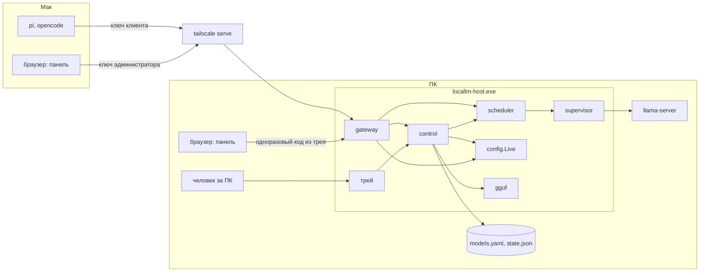

# locallm-host v2: трей, веб-панель и модели без перезапуска — дизайн-спецификация

> **Дата:** 2026-11-08 · **Статус:** дизайн утверждён владельцем; документ — основа плана реализации.
>
> **В открытом репозитории:** документ исторический. Упомянутые в нём `spikes/`, `docs/research/`, `docs/plans/` и `docs/manual-checks.md` в открытый репозиторий не вошли; актуальное описание — `docs/reference.ru.md`.
>
> **Область:** второй этап `locallm-host.exe`: значок в трее, веб-панель `/ui`, отдельный ключ администратора, добавление и изменение моделей и профилей запуска без перезапуска хоста, пауза, принудительная выгрузка, автозапуск при входе в Windows.
> **Основа:** [спецификация MVP](2026-11-03-locallm-mvp-host-design.md), далее — «MVP». Всё, о чём этот документ молчит, работает как в MVP; ссылка вида «MVP §6.5» ведёт туда. Правила MVP, которые меняются, собраны в одну таблицу — §16.1.
> **Связанные документы:** [06 — результаты фазы 0 и решения владельца](../../research/06-phase0-results.md) · [01 §1.3 — llama-swap](../../research/01-existing-solutions.md) · [02 — референсы модулей](../../research/02-module-references.md) · [04 §4.9 — трей и автозапуск](../../research/04-architecture.md) · [план мелких правок](../../plans/2026-11-08-review-small-fixes.md).
> «Должен», «не должен», «может» в тексте — нормативные.

---

## 1. Что это и зачем

MVP сделан для мака: pi и opencode приходят через Tailscale, а на самом ПК программа невидима. Окна и значка нет, остановить её можно только через `taskkill`, а сменить модель в списке или её флаги — только правкой `locallm.yaml` и перезапуском. Но за этим ПК сидит человек. Ему нужно видеть, что занимает видеокарту, освобождать её одним щелчком (например, перед игрой) и знать, что программа не загрузит модель обратно, пока он не разрешит.

Вторая версия добавляет:

- значок в трее с состоянием и меню;
- веб-панель `/ui`, одну и ту же на ПК и на маке: состояние, команды, список моделей, редактор флагов и профилей, поиск файлов `.gguf`;
- отдельный ключ администратора: ключи pi и opencode по-прежнему загружают и выгружают модели, но настроек не меняют;
- изменение списка моделей без перезапуска хоста и профили запуска: `qwen-coder-long` — та же модель с другими флагами;
- паузу (видеокарта свободна, запросы не принимаются; пауза переживает перезагрузку ПК) и принудительную выгрузку (оборвать ответы и выгрузить сразу);
- автозапуск при входе в Windows и штатный выход из меню.

Хост остаётся на Go. Автомат пересадки, супервизор и Job Object проверены на железе (приёмка A1–A5 закрыта 2026-11-08), а для новой части у Go есть всё нужное: `embed` для панели, трей без cgo на Windows, `x/sys/windows` для реестра, мьютексов и запуска процессов. Переписывание на другой язык дало бы риск без выигрыша.

---

## 2. Цели, не-цели, использование

### 2.1. Цели

| # | Цель | Чем подтверждается |
|---|---|---|
| V1 | Человек за ПК видит состояние в трее и управляет хостом из меню: загрузить, выгрузить, прервать, пауза, панель, журнал, автозапуск, выход | приёмка B1, B9, B10 (§14.4) |
| V2 | Веб-панель с ПК без ввода ключа и с мака по ключу администратора | B2, B3; тесты H1–H6 |
| V3 | Модели добавляются, меняются и удаляются из панели без перезапуска хоста. Новые флаги загруженной модели применяются при её следующем запуске, кнопкой «Перезапустить» — сразу | B4, B6; тесты H7–H12, T37–T42 |
| V4 | Профили запуска: у модели несколько наборов флагов, клиенты видят их как отдельные модели `<модель>-<профиль>` | B5; тесты конфига |
| V5 | Пауза: видеокарта освобождается, новые запросы получают понятный отказ, пауза переживает перезапуск хоста и ПК | B7; T30–T34, H13 |
| V6 | Принудительная выгрузка: незаконченные ответы обрываются, модель выгружается сразу | B8; T31, T35, T36, H14 |
| V7 | Разделение прав: клиентские ключи не меняют настроек; панель не может заставить `llama-server` писать или раздавать файлы, ходить в сеть или читать файлы вне каталогов моделей | §12; тесты H1, H8, H9 |
| V8 | Без регрессий MVP: правила MVP §6 и тесты T1–T29, Job Object, приёмка A1–A5; один exe без рантаймов (G7 с поправкой §3.2) | §14.3, §14.4 |

### 2.2. Не входит во v2

- Правка глобальных настроек из панели: адрес, ключи, `server_exe`, `default_args`, таймауты, `default_model`, `models_dirs`. Только вручную в `locallm.yaml` и с перезапуском хоста.
- Слежение за файлом `models.yaml`: ручная правка применяется кнопкой «Применить файл» в панели или перезапуском хоста.
- Сохранение комментариев в `models.yaml`, когда файл записывает панель.
- Скачивание моделей, пресеты router mode, несколько GPU, несколько моделей в памяти одновременно.
- Прерывание идущей загрузки модели: принудительная выгрузка ждёт её конца (§6.7.2).
- Выгрузка по простою (`idle_ttl`), режим «замок», алиас `current`, потоки событий (SSE): панель опрашивает состояние.
- Несколько администраторов, вход по Tailscale identity, HTTPS, служба Windows, установщик, подпись exe.
- Обновление llama.cpp из панели; приложение в строке меню мака.

### 2.3. Как пользоваться

| Действие | Как |
|---|---|
| Запустить | Двойной щелчок по `locallm-host.exe` или автозапуск при входе в Windows; появляется значок в трее. Повторный двойной щелчок открывает панель уже запущенного хоста |
| Остановить | Трей → «Выход»: модель выгружается, программа закрывается. `taskkill /f` по-прежнему безопасен (MVP §7.1) |
| Освободить видеокарту | Трей → «Выгрузить модель» (дождаться ответов) или «Прервать запросы и выгрузить» (сразу). Чтобы клиенты не загрузили модель снова — «Пауза» |
| Сменить модель | Как в MVP (pi `/llama`, opencode, `curl …/api/swap`), а также трей → «Загрузить ▸» и панель |
| Добавить модель, изменить флаги, завести профиль | Панель → «Модели» |
| Открыть панель | На ПК: трей → «Открыть панель». С мака: `http://<pc>.<tailnet>.ts.net:8080/ui/` и ключ администратора |
| Изменить глобальные настройки | Правка `locallm.yaml`, затем трей → «Выход» и запуск заново |

---

## 3. Контекст и ограничения

### 3.1. Что уже известно из MVP

- Приёмка A1–A5 выполнена 2026-11-08. Калибровка (`vram_margin_mib` — замер 428, `stop_timeout` 15 с, `wait_timeout` 210 с) и решения владельца F2-D6, F4-PM1, F4-PM2, F5-D1 записаны в 06.
- Поведение клиентов на ошибки (S7, 06), от которого зависит выбор ответа на паузе (§9.3):

  | Ответ | opencode | pi |
  |---|---|---|
  | `409` + `Retry-After: 5` | 11 попыток, около 85 с молча | 1 попытка |
  | `503` + `x-should-retry: false` | 1 попытка | 3 попытки (паузы 2 с и 4 с) |

  pi показывает пользователю только `error.message`, у одного его запроса лимит 15 с.
- `tailscale serve` проксирует на `127.0.0.1`, поэтому любой запрос, в том числе с мака, приходит с адреса loopback. Адрес клиента для авторизации не используется нигде. Вход «только с ПК» обеспечивает одноразовый код, который процесс хоста выдаёт сам себе (§9.4).
- `llama-server`: `C:\llama\llama-server.exe`, 0.9.0-dev, build 12128. Запретный список флагов панели (§5.6) составлен по `--help` этой сборки.
- План мелких правок нормализует имена флагов при проверке конфига: `_` → `-` у аргументов с `--`, синонимы `-hfr` и `--spec-draft-model`, префикс `--no-models-`. Кроме того, сборка 12128 не принимает форму `--flag=value` (06, решение F2-D1). Эта спецификация опирается на оба факта и не повторяет их.

### 3.2. Зависимости: поправка к цели G7

Цель G7 MVP — один exe без рантаймов; зависимости — stdlib, `golang.org/x/sys/windows`, `gopkg.in/yaml.v3`. Дух цели сохраняется: exe один, без рантаймов и установщика, `CGO_ENABLED=0`. **Поправка:** список зависимостей расширяется одной библиотекой.

| Зависимость | Зачем | Условие |
|---|---|---|
| `fyne.io/systray` | значок и меню в трее | только если спайк S8 (§14.1) подтвердит, что значок возвращается после перезапуска Проводника. На Windows библиотека написана на `x/sys/windows`, без cgo; тестовый трей — 2.8 МБ (02) |
| `github.com/godbus/dbus/v5` | транзитивно от `fyne.io/systray` | компилируется только под Linux и в Windows-сборку не попадает |

Если S8 не пройдёт, трей пишется вручную на `x/sys/windows` (§11.2), и список зависимостей MVP не меняется. Панель — `embed` из stdlib, без сборки фронтенда и без сторонних JS-библиотек.

### 3.3. Ограничения проекта

- Как MVP §3.4: Go ≥ 1.26 (директива `go 1.26.0` не меняется), `GOOS=windows`, `GOARCH=amd64`, модуль `github.com/strigov/strigov-locallm`.
- Тексты ошибок API — на английском (MVP §9.6).
- Тексты для человека — трей, панель, окна подтверждения из трея, окно второго экземпляра — на русском. Окна фатальных ошибок старта и кода 7 остаются как в MVP.

---

## 4. Архитектура

### 4.1. Компоненты

| Компонент | Пакет | Что делает | Статус |
|---|---|---|---|
| Конфиг | `internal/config` | два файла (`locallm.yaml`, `models.yaml`), профили, правила панели, атомарная запись, перенос моделей, `Live`, `state.json` | изменён |
| Планировщик | `internal/scheduler` | автомат MVP §6 плюс пауза, принудительная выгрузка, перезапуск, смена каталога (§6) | изменён |
| Супервизор | `internal/supervisor` | как MVP; определение модели приходит из эффекта; `ForgetLogs` (§7) | изменён |
| GGUF | `internal/gguf` | чтение заголовка `.gguf`, кэш, поиск файлов в `models_dirs` (§8) | новый |
| Контроллер | `internal/control` | единая точка команд администратора для API и трея; сохранение моделей; пауза; одноразовые коды и сессии | новый |
| Шлюз | `internal/gateway` | как MVP плюс `/ui`, `/api/admin/*`, проверка `Host`, ответы на паузе (§9) | изменён |
| Панель | `internal/ui` | статические файлы `/ui` через `embed` (§10) | новый |
| Трей | `internal/tray` | вид меню как чистая функция от Snapshot, значки, драйвер (§11.1–11.2) | новый |
| Рабочий стол Windows | `internal/desktop` | запуск браузера, Блокнота и Проводника вне Job Object; автозапуск; один экземпляр (§11.3–11.5) | новый |
| Хост | `cmd/locallm-host` | порядок старта §4.7, главный поток под трей, штатный выход | изменён |

### 4.2. Схема



### 4.3. Раскладка репозитория (новое и изменённое)

```
cmd/locallm-host/
  main.go               # шаги §4.7, главный поток, штатный выход
  tray_windows.go       # сборка трея из internal/tray и control
cmd/ggufinfo/           # печать заголовков .gguf для проверки владельцем (§14.1)
internal/config/
  models.go             # схема models.yaml, профили, развёртывание каталога (§5.3–5.4)
  panel.go              # правила PV1–PV8 и запретный список флагов (§5.6)
  canon_windows.go      # канонический путь (§5.6, PV1)
  write.go              # ETag, атомарная запись, резервные копии (§5.7)
  migrate.go            # перенос models: из locallm.yaml (§5.8)
  live.go               # Live (§5.9)
  state.go              # state.json (§5.10)
internal/scheduler/     # state.go, step.go, loop.go, snapshot.go, upstream.go — §6
internal/gguf/
  gguf.go               # ReadInfo (§8.1)
  scan.go               # поиск в models_dirs (§8.2)
  cache.go              # кэш (§8.3)
internal/control/
  controller.go         # команды, сохранение моделей, пауза, выход
  auth.go               # одноразовые коды, сессии, ограничение попыток (§9.4)
internal/gateway/
  adminapi.go           # /api/admin/* (§9.5)
  ui.go                 # /ui и заголовки безопасности (§9.1, §10.1)
  hostcheck.go          # Host и Origin (§9.1)
internal/ui/
  ui.go                 # embed.FS
  static/               # index.html, app.js, style.css
internal/tray/
  view.go               # Snapshot → вид меню (чистая функция)
  icons.go              # значки, рисуются кодом
  driver_fyne.go        # драйвер fyne.io/systray; или driver_win32.go по итогам S8
internal/desktop/
  launch_windows.go     # браузер, Блокнот, Проводник с CREATE_BREAKAWAY_FROM_JOB
  autostart_windows.go  # HKCU Run и StartupApproved
  instance_windows.go   # именованный мьютекс и события
spikes/s8-tray/, spikes/s9-launch/   # спайки §14.1
models.example.yaml
docs/research/07-v2-results.md       # результаты спайков и приёмки v2
```

### 4.4. Интерфейсы

```go
// internal/config
type Model struct {
	ID            string   // имя для клиентов: "<base>" или "<base>-<profile>"
	Base          string   // ключ модели в файле
	Profile       string   // "" — базовый вариант
	Path          string   // после раскрытия %VAR%
	Args          []string // args модели, затем args профиля; после раскрытия %VAR%
	ContextLength int
}

// SameLaunch — совпадают ли Path и Args; основа restart_required (§6.8).
func (m Model) SameLaunch(o Model) bool

// Config: поля MVP плюс
//   ModelsMode string     // "file" или "legacy" (§5.1)
//   ModelsFile string     // абсолютный путь models.yaml
//   ModelsDirs []string   // канонические корни (§5.2)
//   ModelsDoc  *ModelsDoc // документ моделей: строки до раскрытия %VAR%
//   Models     []Model    // развёрнутый каталог (§5.4) в порядке файла
//   Server.AdminKeyFile, Server.AdminHosts, Server.StateFile (§5.2)

type ModelsDoc struct{ Models []DocModel }
type DocModel struct {
	ID       string
	Path     string
	Args     []string
	Profiles []DocProfile
}
type DocProfile struct {
	Name string
	Args []string
}
type FieldError struct{ Field, Message string } // Field — путь в документе API: "models[2].profiles[0].args[3]"

func Load(path string) (*Config, error)
func (c *Config) WithModels(doc *ModelsDoc) (*Config, []FieldError) // копия глобальных полей + новый каталог; MVP §5.3 и §5.5, кроме §5.5 п. 13
func CheckDefault(c *Config) *FieldError                          // §5.5 п. 13: swap.default_model есть в каталоге
func CheckPanel(c *Config, ref, doc *ModelsDoc) []FieldError       // PV1–PV8 (§5.6)
func EncodeModels(doc *ModelsDoc) []byte                           // формат §5.7
func ETag(data []byte, exists bool) string
func WriteFileAtomic(path string, data []byte, ifMatch string) (etag, backup string, err error)
func Canonical(path string) (string, error)

type Live struct{ /* atomic.Pointer[Config] */ }
func (l *Live) Load() *Config
func (l *Live) Store(c *Config)

// internal/scheduler
type Init struct{ Paused bool }
func New(cfg *config.Config, b Backend, p vram.Probe, init Init, onFatal func(error), log *slog.Logger) *Scheduler
func (s *Scheduler) Load(model string) error        // ErrModelNotFound, ErrPaused, ErrHalted
func (s *Scheduler) Unload(model string) error      // ErrModelNotFound, ErrHalted
func (s *Scheduler) ForceUnload(model string) error // то же
func (s *Scheduler) Restart(model string) error     // ErrModelNotFound, ErrPaused, ErrHalted
func (s *Scheduler) Pause(force bool) error         // ErrHalted
func (s *Scheduler) Resume() error                  // ErrHalted
func (s *Scheduler) Reconfigure(catalog []config.Model, guard bool) error // *InUseError (только при guard, RC0), ErrHalted
var ErrPaused, ErrHalted error
type InUseError struct{ Models []string } // занятые удаляемые имена в порядке Catalog (§6.7.4)

type RetireReason int // RetireStop, RetireExited, RetireForced
func (u *Upstream) Retire(r RetireReason)  // идемпотентно, причина первого вызова сохраняется
func (u *Upstream) RetireReason() RetireReason

// internal/control
type Actor struct {
	Kind    string // "tray" или "admin_api"
	Session string // первые 8 hex SHA-256 токена сессии; "" — трей или ключ администратора
}
func (c *Controller) Load(a Actor, model string) error
func (c *Controller) Unload(a Actor, model string, force bool) error
func (c *Controller) Restart(a Actor, model string) error
func (c *Controller) Pause(a Actor, force bool) (persisted bool, err error)
func (c *Controller) Resume(a Actor) (persisted bool, err error)
func (c *Controller) State(now time.Time) StateView
func (c *Controller) Models() (ModelsView, error)
func (c *Controller) PutModels(a Actor, ifMatch string, doc *config.ModelsDoc) (SaveResult, error)
func (c *Controller) ReloadModels(a Actor) (SaveResult, error)
func (c *Controller) Migrate(a Actor) (MigrateResult, error)
func (c *Controller) Scan(ctx context.Context) (gguf.ScanResult, error)
func (c *Controller) OpenPanel() error              // одноразовый код + браузер (§9.4)
func (c *Controller) Shutdown(ctx context.Context)  // §11.6

func (a *Auth) MintOTP(now time.Time) string
func (a *Auth) Login(otp, adminKey string, now time.Time) (token string, expires time.Time, err error)
func (a *Auth) Check(bearer string, now time.Time) (Actor, bool)
func (a *Auth) Logout(bearer string)

// internal/gguf
type Info struct {
	Kind         string // "model", "mmproj", "adapter", "unknown"
	Architecture string
	Name         string
	ContextTrain int64
	EmbeddingLen int64
	SplitCount   int
	Size         int64 // байты; у составной модели — сумма шардов
	Partial      bool  // чтение остановлено лимитом (§8.1)
}
func ReadInfo(ctx context.Context, path string) (Info, error)

// internal/tray
func View(snap *scheduler.Snapshot, cfg *config.Config, vramMiB int64, now time.Time) MenuView // чистая функция
```

### 4.5. Модель конкурентности

- **Владелец планировщика** — как MVP §4.5, с одной заменой. У команд (`Load`, `Unload`, `Restart`, `Pause`, `Resume`, `Reconfigure`) вместо канала подтверждения — канал результата с буфером 1. `step` выдаёт на каждую команду ровно один эффект `CmdResult{Err}`. Владелец публикует Snapshot, отправляет `CmdResult` в канал результата и только потом исполняет остальные эффекты по порядку. Поэтому к возврату `Scheduler.Load` и других команд их результат уже виден в `Snapshot()`, как в MVP. `WaiterGone` сохраняет канал подтверждения MVP.
- **`config.Live`** — `atomic.Pointer[Config]`. На ходу меняются только поля моделей (`Models`, `ModelsDoc`, `ModelsMode`); остальные поля `Config` неизменны всё время жизни процесса. Поэтому планировщик и супервизор хранят `*Config` старта и читают из него только глобальные поля, а каталог планировщик держит в `State.Catalog` (§6.1). Шлюз, контроллер и трей читают `live.Load()` один раз на операцию и пользуются этим значением до её конца.
- **Контроллер** сериализует изменения моделей (`PutModels`, `ReloadModels`, `Migrate`) одним мьютексом: от чтения файла до `live.Store`, включая `Reconfigure` и его откат (§4.6). Остальные команды автомату (`Load`, `Unload`, `Restart`) под этот мьютекс не попадают: занятость модели проверяет сам автомат в шаге `Reconfigure` (RC0, §6.7.4), а не контроллер по Snapshot.
- **Пауза.** `Controller.Pause` и `Controller.Resume` сериализуются отдельным мьютексом паузы на всю операцию: команда автомату → запись `state.json` → ответ. Поэтому записи `state.json` идут в том же порядке, что и команды в автомате, и последняя запись совпадает с состоянием в памяти. Мьютекс паузы и мьютекс моделей независимы.
- **Трей.** Главный поток процесса закреплён `runtime.LockOSThread` в `init` и крутит только цикл сообщений драйвера. Обработчик пункта меню принимает щелчок и запускает действие в новой горутине. Значок, подсказку и меню обновляет отдельная горутина (§11.2). Ни один вызов в потоке трея не ждёт HTTP, планировщик или диск.
- **GGUF.** Кэш и поиск — свои мьютексы и `singleflight`. Обработчики `/models` берут из кэша только готовые значения и никогда не ждут чтения файла (§8.3).

### 4.6. Главный сценарий: сохранение параметров модели

```mermaid
sequenceDiagram
  participant B as панель (браузер)
  participant G as gateway
  participant C as control
  participant F as models.yaml
  participant S as scheduler
  B->>G: PUT /api/admin/models (If-Match, документ)
  G->>C: PutModels(actor, etag, документ)
  C->>F: прочитать, сверить ETag
  C->>C: собрать YAML, разобрать как при старте, проверить (MVP §5.3, §5.5, §5.6) — 422; default_model — 409
  C->>S: Reconfigure(каталог, guard) → CmdResult: занятые удаляемые имена — 409, ничего не изменено
  C->>F: временный файл → копия .bak → MoveFileEx
  alt запись не удалась
    C->>S: Reconfigure(прежний каталог, без guard) — откат
    G-->>B: 500 config_write_failed (или 412)
  end
  C->>C: live.Store(новый Config)
  G-->>B: 200 {etag, restart_required, warnings}
```

Проверка занятости и замена каталога — **один шаг автомата** (RC0, §6.7.4): между ними клиент не может ни начать загрузку удаляемой модели, ни встать к ней в очередь. Поэтому удаление занятой модели всегда даёт `409 model_in_use`, а не `200`. Порядок — автомат, файл, `live`:

- автомат отказал — файл и память не тронуты;
- запись файла не удалась — контроллер возвращает автомату прежний каталог (`Reconfigure` без проверки, откат), файл не тронут, `live` не менялся. Откат без проверки, потому что прежний каталог должен вернуться в любом случае; RC1–RC4 при нём срабатывают только для имён, добавленных этим сохранением и успевших стать занятыми в окне между `Reconfigure` и откатом (например, «Загрузить ▸» в трее берёт имена из Snapshot): их ожидающие получают `model_not_found`, загрузка выгружается. Процесс, запущенный в это окно с новым определением изменённой модели, после отката работает с ним, а Snapshot показывает `restart_required`;
- хост убит после `Reconfigure` — следующий старт прочитает файл на диске: прежний, если запись не дошла до `MoveFileEx`, иначе новый.

`Reconfigure` идёт раньше `live.Store`, поэтому шлюз никогда не видит в конфиге имя, которого ещё нет в каталоге автомата. Обратная гонка безопасна: запрос к удалённой модели, прочитавший старый конфиг, получает от автомата `model_not_found` (A1).

### 4.7. Старт и выход

Флаги MVP плюс `--no-tray` (не создавать значок; для тестов и отладки). Порядок старта:

| Шаг | Действие | Код выхода |
|---|---|---|
| 1 | Разбор флагов | 2 |
| 1a | Один экземпляр (§11.5): именованный мьютекс по пути конфига. Хост с этим конфигом уже запущен — попросить его открыть панель и выйти | 0 — первый экземпляр ответил; 6 — не ответил за 10 с |
| 2 | Конфиг: `locallm.yaml`, затем в режиме `file` — `models.yaml` (§5.1); все ошибки — одним сообщением | 2 |
| 3 | Журнал | 2 |
| 4 | Job Object: `KILL_ON_JOB_CLOSE` и `BREAKAWAY_OK` (§7.1) | 3 |
| 5 | Ключи клиентов, затем ключ администратора; если файлов нет, они создаются. Ключ, который есть в обоих файлах, — ошибка | 4 |
| 5a | `state.json` (§5.10). Файла нет — пауза снята; файл не читается — пауза включена и предупреждение в журнале | — |
| 6 | Источник VRAM | 5 |
| 7 | Супервизор, планировщик (`Init.Paused`), контроллер, шлюз; запуск цикла владельца; фоновое чтение заголовков GGUF моделей каталога (§8.3) | — |
| 8 | `net.Listen` | 6 |
| 9 | `swap.default_model` — если задан и пауза **не** включена. На паузе — строка журнала `default model skipped: host is paused` | — |
| 10 | `Serve` в отдельной горутине; обработчик просьбы второго экземпляра; трей в главном потоке, если нет `--no-tray`. Ошибка создания значка не фатальна: предупреждение в журнале, хост работает без значка | — |

- **Штатный выход** — трей → «Выход» (§11.6): выгрузка модели, закрытие HTTP-сервера, код **0**.
- **Фатальная ошибка во время работы** — как MVP §4.7 (код 7). Добавлено одно: перед `MessageBoxW` `onFatal` убирает значок из трея, чтобы человек не нажимал пункты меню останавливающегося хоста.
- Коды выхода MVP 2–7 сохраняются. Новый код **0** — штатный выход из трея или передача управления уже запущенному экземпляру.

### 4.8. Сборка

Как MVP §4.8; версия `-X main.version=0.2.0`. `scripts/build.ps1` дополнительно собирает `bin\ggufinfo.exe` и спайки `bin\s8-tray.exe`, `bin\s9-launch.exe` (с `-H=windowsgui`). Файлы панели встраиваются через `embed`, отдельного шага сборки нет. Прирост размера `locallm-host.exe` из-за трея замеряет S8.

---

## 5. Конфигурация

### 5.1. Два файла и два режима

- `locallm.yaml` — глобальные настройки (MVP §5.2 и новые ключи §5.2). Только ручная правка; изменения — после перезапуска хоста.
- `models.yaml` — модели и профили. Панель записывает его целиком; ручная правка допустима (§5.7).

Режим определяется при загрузке:

| Режим | Когда | Откуда модели | Панель |
|---|---|---|---|
| `file` | в `locallm.yaml` нет ключа `models` | `models_file`; файла нет — каталог пуст | читает и пишет модели |
| `legacy` | в `locallm.yaml` есть ключ `models`, как в MVP | `locallm.yaml`. `models_file` не читается; если файл существует — предупреждение в журнале | показывает модели только для чтения и предлагает перенести их одной кнопкой (§5.8) |

В режиме `file` каталог может быть пустым: хост стартует, `/v1/models` отдаёт пустой список, модели добавляются из панели. В режиме `legacy` действует правило MVP «не меньше одной модели».

### 5.2. Новые ключи `locallm.yaml`

| Ключ | Тип | По умолчанию | Правила |
|---|---|---|---|
| `server.admin_key_file` | путь | `%LOCALAPPDATA%\locallm\admin-key.txt` | Абсолютный; формат и создание — как у файла ключей (MVP §5.4, §5.10 этого документа); не тот же файл, что `server.api_keys_file` |
| `server.admin_hosts` | `[]string` | `[]` | Дополнительные допустимые значения `Host` для `/ui` и `/api/admin/*` (§9.1): имя DNS (буквы, цифры, `-`, `.`) или IP-литерал, без порта; не больше 16 |
| `server.state_file` | путь | `%LOCALAPPDATA%\locallm\state.json` | Абсолютный (§5.10) |
| `models_file` | путь | `models.yaml` в каталоге `locallm.yaml` | Абсолютный после раскрытия `%VAR%`; в режиме `legacy` не читается |
| `models_dirs` | `[]путь` | `[]` | Каталоги, откуда панель берёт модели и файлы (§5.6). Каждый — абсолютный путь. Существует, но не каталог — ошибка. Не существует (например, отключён диск) — предупреждение в журнале, каталог пропускается. Не больше 16. Хранятся в каноническом виде (PV1) |
| `models` | map | — | Только режим `legacy` (§5.1); схема — как `models` в `models.yaml` (§5.3) |

Меняется смысл `swap.default_model`: пусто или имя из **развёрнутого** каталога (§5.4), то есть им может быть и профиль.

### 5.3. `models.yaml`

| Ключ | Тип | По умолчанию | Правила |
|---|---|---|---|
| `version` | int | — (обязателен) | `1` |
| `models` | map | `{}` | Порядок сохраняется; имена и пути — MVP §5.2 и §5.3 |
| `models.<id>.path` | путь | — (обязателен) | Как MVP |
| `models.<id>.args` | `[]string` | `[]` | Как MVP |
| `models.<id>.profiles` | map имя → `[]string` | `{}` | §5.4 |

Неизвестный ключ и повтор имени — ошибка (MVP §5.3 п. 1). Те же правила, включая `profiles`, действуют для `models:` в `locallm.yaml` в режиме `legacy`: декодер один.

Пример `models.example.yaml`:

```yaml
# models.yaml — модели locallm-host. Файл перезаписывает веб-панель, комментарии при этом не сохраняются.
# После ручной правки: панель → «Применить файл» или перезапуск хоста.
version: 1
models:
  qwen-coder:
    path: 'C:\models\unsloth--Qwen3.8-27B-GGUF\Qwen3.8-27B-UD-IQ3_XXS.gguf'
    args: ['-c', '32768']
    profiles:
      long: ['-c', '65536', '-ctk', 'q8_0', '-ctv', 'q8_0']
  gemma:
    path: 'C:\models\google-- gemma-4-26B-q4-0-it-GGUF\gemma-4-26B_q4_0-it.gguf'
    args: ['-c', '16384', '--mmproj', 'C:\models\google-- gemma-4-26B-q4-0-it-GGUF\mmproj-gemma-4-26B-A4B-it-Q8_0.gguf']
  tiny:
    path: 'C:\models\LiquidAI--LFM2.5-2.6B-GGUF\LFM2.5-2.6B-QAD-Q4_0.gguf'
```

### 5.4. Профили

Профиль — именованный набор флагов, который дописывается к флагам модели. Модель с профилями даёт клиентам несколько имён; из примера выше получается каталог `qwen-coder`, `qwen-coder-long`, `gemma`, `tiny`.

- **Имя профиля** соответствует `^[A-Za-z0-9][A-Za-z0-9._-]{0,31}$`.
- **Имя для клиентов** — `<id>` для базового варианта и `<id>-<профиль>` для профиля. Каждое развёрнутое имя должно соответствовать правилу имени модели MVP (`^[A-Za-z0-9][A-Za-z0-9._-]{0,63}$`, то есть не длиннее 64 символов) и быть уникальным во всём каталоге, с учётом регистра, как в MVP. Совпадение (например, модель `qwen-coder-long` и профиль `long` у `qwen-coder`) — ошибка, в которой названы оба источника.
- **Порядок каталога:** модели в порядке файла; у каждой — сначала базовый вариант, затем профили в порядке файла.
- **argv** (MVP §7.2 п. 2): `server_exe`, `llama.default_args`, `args` модели, `args` профиля, затем флаги хоста. llama.cpp берёт последнее вхождение флага, поэтому профиль перекрывает модель, а модель — `default_args`.
- **`context_length`** — последнее `-c`/`--ctx-size` в `default_args + args + args профиля` (MVP §5.3 п. 7 с нормализацией плана мелких правок).
- Каждое развёрнутое имя — отдельная модель для автомата и клиентов: свой статус, своя метка failed, свой буфер вывода. Переход с `qwen-coder` на `qwen-coder-long` — обычная пересадка с выгрузкой и cooldown.
- Путь у профиля не меняется: другой файл — это другая модель.

### 5.5. Правила проверки: дополнения к MVP §5.3

Правила действуют для обоих режимов и для любого источника: старт, «Сохранить» в панели, «Применить файл», перенос.

9. **Профили** — §5.4.
10. **Ограничения размера:** файл `models.yaml` — не больше 1 МиБ; моделей — не больше 256; профилей у модели — не больше 32; развёрнутых имён — не больше 512; аргументов в одном списке — не больше 256; длина одного аргумента — не больше 4 КиБ.
11. **Файловые аргументы** (MVP §5.3 п. 5, с синонимами из плана мелких правок) дополнены флагами `--control-vector`, `--grammar-file`, `-jf`, `--json-schema-file`, `-lcs`, `--lookup-cache-static`. Значение `--lora` и `--control-vector` делится по запятым, каждая часть проверяется отдельно. Это ужесточение и для ручного конфига: относительный путь после этих флагов теперь ошибка.
12. **Ручные значения.** Запретный список панели (§5.6) и корни `models_dirs` к значениям, написанным вручную, не применяются. Для них действуют только правила MVP и пункты 9–11.
13. **`swap.default_model`** должен быть в развёрнутом каталоге. Проверяет его отдельная функция `CheckDefault`, а не `WithModels`, потому что ответ зависит от источника: старт — ошибка конфига, код 2; «Применить файл» — файл без неё не применится (`422 config_invalid` с полем `swap.default_model`); `PUT` из панели — удалить или переименовать модель по умолчанию нельзя (`409 model_is_default`, шаг 7 §9.5, после успешной проверки документа на шаге 6). Применённый каталог всегда содержит `default_model`, поэтому её отсутствие в документе `PUT` — всегда удаление или переименование.
14. **Ошибки не содержат значений аргументов** (правило F2-B3/F2-B4 плана 1 и `TestErrorsDoNotLeakSecrets`): в тексте — поле, флаг в каноническом написании и причина.
15. **Меняется MVP §5.3 п. 8.** Глобальные настройки по-прежнему читаются один раз при старте. Модели перечитываются при «Сохранить», «Применить файл» и переносе (§5.9).

### 5.6. Значения из панели

Значения, пришедшие через `PUT /api/admin/models`, проверяются строже ручных. Причина — защита в глубину: украденный токен сессии или ключ администратора не должен давать больше, чем выбор модели из каталогов владельца и безопасные флаги. Всё, что запрещено из панели, владелец может написать вручную в `models.yaml`.

| # | Правило |
|---|---|
| PV1 | **Путь модели** лежит внутри одного из `models_dirs`. Сравниваются канонические пути: файл открывается `CreateFile` (`FILE_READ_ATTRIBUTES`, общий доступ на чтение, запись и удаление, `FILE_FLAG_BACKUP_SEMANTICS`); путь берётся из `GetFinalPathNameByHandle(FILE_NAME_NORMALIZED, VOLUME_NAME_DOS)`; префикс `\\?\` снимается, `\\?\UNC\` заменяется на `\\`. Так ссылки и junction, ведущие наружу, ловятся. Сравнение без учёта регистра и только по границе разделителя: `C:\models2\x.gguf` не лежит внутри `C:\models`. Остальные правила MVP (`.gguf`, файл существует, шарды) действуют как обычно; все шарды лежат в том же каталоге, что и первый |
| PV2 | **Нет запретных флагов** (таблица ниже) ни в `args` модели, ни в `args` профилей |
| PV3 | **Файловые аргументы** (п. 11 §5.5) лежат внутри `models_dirs` по правилу PV1. Причина: содержимое, например, `--chat-template-file` клиент видит через `GET /props` (F5-D1) |
| PV4 | **Нет ссылок на переменные окружения:** каждый `%` в новом значении стоит в паре `%%` (литерал `%`). Иначе через `--alias %HF_TOKEN%` и `GET /props` можно было бы прочитать окружение хоста |
| PV5 | **Нет формы `--flag=value`:** аргумент, который начинается с `-` и содержит `=`, отклоняется с подсказкой «значение — следующей строкой». Сборка 12128 такую форму не принимает (06, F2-D1); то же правило действует при проверке конфига (06, решение владельца 2026-11-09) |
| PV6 | **Нет управляющих символов** (U+0000–U+001F, U+007F) и пустых строк в значениях |
| PV7 | **Сырой путь** — путь модели и каждое значение файлового аргумента (каждая часть `--lora` и `--control-vector`) — абсолютный (`filepath.IsAbs`), не начинается с `\\?\` или `\\.\` и не содержит `:` нигде, кроме буквы диска (альтернативные потоки NTFS) |
| PV8 | **Исключение для уже существующих значений.** Путь модели, строка которого совпадает с путём любой модели опорного документа, не проверяется по PV1, PV4, PV6 и PV7; правила MVP для него действуют. Список аргументов (модели или профиля), поэлементно равный любому списку опорного документа, не проверяется по PV2–PV7. **Опорный документ** — документ файла на диске, если файл проходит проверку, иначе применённый документ (шаг 5 `PUT`, §9.5). Это тот же документ, который отдал `GET /api/admin/models` с ETag из `If-Match` (§5.7). Так ручные значения переживают сохранение из панели, а новые значения проверяются полностью |

`GET /api/admin/models` помечает значения, которые не прошли бы PV1–PV7 без исключения PV8: `path_hand_only`, `args_hand_only`, `hand_only` у профиля, плюс причины (имена флагов, «вне models_dirs», «%VAR%»). Панель показывает такие поля только для чтения с пояснением «изменить можно только вручную в `models.yaml`». Удалить такую модель или переименовать её из панели можно: значения при этом не меняются.

**Запретный список флагов.** Аргумент сравнивается целиком после нормализации плана мелких правок (`_` → `-` в имени у аргументов с `--`). Короткие формы сравниваются точно. Формы, которые выключают возможность (`--no-agent`, `-no-ag`, `--no-ui-mcp-proxy`, `--no-webui-mcp-proxy`), разрешены. Значение, случайно совпавшее с запретным флагом, тоже отклоняется; это безопасная ложная тревога.

| Группа | Почему нельзя из панели | Флаги (`llama-server --help`, build 12128) |
|---|---|---|
| Пишут файлы | панель не должна заставлять `llama-server` писать на диск ПК | `--log-file`, `--slot-save-path`, `--log-prompts-dir`, `-lcd`, `--lookup-cache-dynamic` |
| Раздают файлы, исполняют инструменты | раздача файлов ПК и выполнение команд через `llama-server` | `--path`, `--media-path`, `--tools`, `--tools-runtime`, `-ag`, `--agent`, `--mcp-servers-config`, `--mcp-servers-json`, `--ui-mcp-proxy`, `--webui-mcp-proxy`, `--video-ffmpeg-dir`, `--ui-config-file`, `--webui-config-file` |
| Сеть и скачивание | `llama-server` не должен ходить в сеть | `-dr`, `--docker-repo`, `-hff`, `--hf-file`, `-hft`, `--hf-token`, `--spec-draft-hf`, `-hfd`, `-hfrd`, `--hf-repo-draft`, `-mmu`, `--mmproj-url`, `--rpc`, `--connect`, `--connect-code`, `--embd-gemma-default`, `--fim-qwen-1.5b-default`, `--fim-qwen-3b-default`, `--fim-qwen-7b-default`, `--fim-qwen-7b-spec`, `--fim-qwen-14b-spec`, `--fim-qwen-30b-default`, `--gpt-oss-20b-default`, `--gpt-oss-120b-default`, `--vision-gemma-4b-default`, `--vision-gemma-12b-default` |
| Конфликт с хостом | транспорт и жизненный цикл процесса ведёт хост; при `--sleep-idle-seconds` `llama-server` сам освобождал бы память, а хост считал бы модель загруженной | `--ssl-key-file`, `--ssl-cert-file`, `--api-prefix`, `--reuse-port`, `--sleep-idle-seconds` |
| Сразу завершают процесс | модель «не загрузится» с непонятной ошибкой | `-h`, `--help`, `--usage`, `--version`, `--list-devices`, `--completion-bash`, `-cl`, `--cache-list` |
| Сложный формат значения | путь внутри `FNAME:SCALE,…` панель не проверяет | `--lora-scaled`, `--control-vector-scaled` |

Флаги хоста (MVP §5.3 п. 6 вместе с синонимами плана мелких правок: `-m`, `--model`, `--host`, `--port`, `--api-key`, `--api-key-file`, `-hf`, `-hfr`, `--hf-repo`, `-mu`, `--model-url`, префиксы `--models-` и `--no-models-`) запрещены везде, в том числе вручную, как сейчас.

Список живёт в `internal/config/panel.go` с номером сборки в комментарии. При обновлении llama.cpp `--help` перечитывается и список дополняется; шаг записан в README. Это список запретов, а не разрешений (решение владельца): новый опасный флаг будущей сборки проходит, пока его не внесли. Риск принят.

### 5.7. Запись файлов

- **ETag** файла — `"sha256:<64 hex>"` от его байтов; отсутствующий файл — `"absent"`. `GET /api/admin/models` отдаёт ETag файла на диске в заголовке `ETag`; `PUT` обязан прислать его в `If-Match`.
- **Атомарная запись** `WriteFileAtomic(path, data, ifMatch)`:
  1. прочитать текущий файл, посчитать ETag; не равен `ifMatch` — ошибка «файл изменился» (`412`);
  2. создать в том же каталоге `<имя>.tmp-<8 hex>` (`O_EXCL`), записать, `Sync`, закрыть;
  3. если файл был — записать прочитанные в шаге 1 байты в `<имя>.<UTC ГГГГММДДTччммссZ>.bak` (`O_EXCL`; при совпадении имени — суффикс `-1`, `-2`), `Sync`; оставить 10 самых новых копий этого файла, остальные удалить;
  4. `MoveFileEx(временный, path, MOVEFILE_REPLACE_EXISTING | MOVEFILE_WRITE_THROUGH)`;
  5. при ошибке любого шага — удалить временный файл и вернуть ошибку; исходный файл не тронут.

  Копия делается копированием, а не переименованием: файл по пути `path` существует в любой момент. Окно между шагами 1 и 4 (миллисекунды) не защищено: ручная правка в это окно потеряется. Риск принят.
- **Формат, который пишет панель** (`EncodeModels`), детерминированный:
  - первые две строки — комментарий из примера §5.3; затем `version: 1` и `models:`; пустой каталог — `models: {}`;
  - у модели — `path`, затем `args` (если не пуст), затем `profiles` (если есть);
  - списки — в одну строку `['a', 'b']`;
  - строки — в одинарных кавычках (`'` удваивается); строка с управляющими символами (бывает только в ручных значениях, PV8) — в двойных кавычках с экранированием;
  - имена моделей и профилей — без кавычек, если `yaml.v3` прочитает их как строку (тег `!!str`), иначе в одинарных кавычках (`'1.5'`, `'true'`).

  Тест: `EncodeModels` → разбор → тот же документ.
- **Ручная правка** `models.yaml` допустима в любой момент. Хост её не видит, пока не нажата «Применить файл» (`POST /api/admin/models/reload`) или хост не перезапущен. Контроллер хранит `applied_etag` — ETag последнего применённого файла — и сравнивает его с ETag на диске. Расхождение панель показывает баннером. Чтобы не хэшировать файл на каждый опрос, ETag на диске пересчитывается только при изменении размера или времени записи файла. `GET /api/admin/models` отдаёт документ **файла на диске**, если он проходит проверку, даже когда файл ещё не применён: «Сохранить» из панели в этом случае применяет и ручную правку (её значения доверенные по PV8).
- **Испорченный вручную файл.** Если файл на диске не проходит проверку, `GET /api/admin/models` отдаёт применённый документ, список ошибок файла и ETag файла на диске. Панель может сохранить применённый документ поверх испорченного файла (испорченный уйдёт в `.bak`). Опорный документ PV8 в этом случае — применённый.

### 5.8. Перенос моделей из `locallm.yaml`

`POST /api/admin/models/migrate`, только в режиме `legacy` (иначе `409 already_migrated`). Под мьютексом контроллера:

1. Прочитать `locallm.yaml` (запомнить ETag), разобрать в `yaml.Node`, взять узел `models`.
2. Собрать `models.yaml`: комментарий, `version: 1`, `models:` и этот узел, закодированный `yaml.v3` с отступом 2. Комментарии и стиль кавычек внутри узла сохраняются.
3. Собрать новый `locallm.yaml`: корневой узел без пары `models`, закодированный `yaml.v3` с отступом 2. Комментарии сохраняются, отступы могут измениться; оригинал останется в `.bak`.
4. Проверить: новый `locallm.yaml` даёт те же глобальные настройки, а новый `models.yaml` — тот же развёрнутый каталог (после раскрытия `%VAR%`). Не так — `500 config_write_failed` с текстом `migration check failed`, ничего не записано.
5. Записать `models.yaml` (§5.7; существующий файл уйдёт в `.bak`).
6. Записать `locallm.yaml` (§5.7, `If-Match` — ETag из шага 1).
7. Переключить режим в памяти на `file`, `live.Store`. Каталог не изменился, поэтому `Reconfigure` не нужен.

Если шаг 6 не удался, `locallm.yaml` по-прежнему содержит `models`, режим `legacy` побеждает при следующем старте, и перенос можно повторить: шаг 5 перезапишет `models.yaml`. Ответ `200 {"models_file": "...", "backup": "<путь .bak locallm.yaml>"}`.

### 5.9. Что меняется на ходу

| Что | Когда действует |
|---|---|
| Новая модель, новый профиль | сразу после сохранения: появляется в `/models`, `/v1/models`, в трее |
| Удаление и переименование модели или профиля | сразу; модель, которая загружена, грузится, ждёт в очереди или названа в намерении, удалить нельзя (`409 model_in_use`) — сначала выгрузить. Занятость проверяет автомат в том же шаге, что и замену каталога (RC0, §6.7.4) |
| Путь и флаги незагруженной модели | при её следующем запуске; `/models` и `/v1/models` сразу показывают новые значения |
| Путь и флаги загруженной модели | при её следующем запуске; панель показывает «нужен перезапуск», будущие значения и кнопку «Перезапустить» (мягкий перезапуск, §6.7.3). До перезапуска `/models`, `/v1/models` и `/api/admin/state` показывают параметры работающего процесса (§6.8) |
| Глобальные настройки `locallm.yaml` | после перезапуска хоста |

Новый `Config` для `live.Store` — копия глобальных полей старта и новый каталог; `locallm.yaml` на ходу не перечитывается.

### 5.10. Ключ администратора и `state.json`

- **Ключ администратора** — файл `server.admin_key_file`, формат, создание при первом старте и права — как у файла ключей (MVP §5.4): 32 байта из `crypto/rand` в base64url, строка-комментарий, в журнал пишется только путь. Ключей может быть несколько. Ключ, который есть и в файле ключей клиентов, — фатальная ошибка старта (код 4): разделение прав держится на том, что это разные строки. Смена ключа — правка файла и перезапуск хоста.
- **`state.json`** — состояние, которое переживает перезапуск:

  ```json
  {"version": 1, "paused": true, "changed_at": "2026-11-08T20:15:00Z", "by": "tray"}
  ```

  Записывается атомарно (§5.7, без `If-Match` и без `.bak`) после каждой паузы и снятия паузы, под мьютексом паузы вместе с командой автомату (§4.5): в файл идёт значение, которое эта команда установила в автомате. Строгий разбор: неизвестное поле или версия ≠ 1 — файл считается испорченным. Испорченный или нечитаемый файл при старте — пауза **включена**, предупреждение в журнале: владелец, скорее всего, ставил паузу, и безопаснее оставить видеокарту свободной; «Продолжить» перезапишет файл. Ошибка записи — новое значение действует в памяти до перезапуска хоста, на диске остаётся прежнее (после перезапуска действует оно, а нечитаемый файл даёт паузу); ответ команды `persisted: false`, баннер в панели.

---

## 6. Планировщик v2

Все правила MVP §6 действуют, если ниже не сказано иное. Новые правила, как и старые, живут в чистой функции `step` и проверяются табличными тестами и рандомизированным тестом без GPU (§14.2).

### 6.1. Состояние

| Поле | Тип | Смысл |
|---|---|---|
| `Catalog` | `[]config.Model` | Развёрнутый каталог в порядке файла. Заменяется целиком событием `Reconfigure`; сам срез не изменяется, поэтому его можно разделять со Snapshot |
| `Paused` | bool | Пауза (§6.7.1) |
| `Running` | `config.Model` | Определение, с которым запущено текущее поколение. Присваивается в P11, обнуляется, когда `Current` становится `""` (E8, E9, E10) |

- `Params.Models` удаляется: о моделях автомат знает только из `Catalog`. Остальные `Params` (`SwapCooldown`, `MaxQueue`, `FailedTTL`) глобальные и не меняются.
- `Intent.Kind`: `Load`, `Unload` и новое `Restart`.
- `nextTarget()`: `Intent.Model`, если `Intent.Kind` ∈ {Load, Restart}; иначе `Queue[0].Model`; иначе `""`.
- Обозначения: `m ∈ Catalog` — в каталоге есть элемент с `ID == m`; `def(m)` — этот элемент.

### 6.2. События и эффекты

Изменённые и новые события (остальные — MVP §6.3):

| Событие | Источник | Поля |
|---|---|---|
| `Load` | `Scheduler.Load`: `/models/load`, предзагрузка, трей, панель | `Model`, канал результата |
| `Unload` | `Scheduler.Unload`, `Scheduler.ForceUnload` | `Model` (`""` — всё), **`Force`**, канал результата |
| `Restart` | `Scheduler.Restart`: панель, `/api/admin/restart` | `Model`, канал результата |
| `Pause` | `Scheduler.Pause` | `Force`, канал результата |
| `Resume` | `Scheduler.Resume` | канал результата |
| `Reconfigure` | `Scheduler.Reconfigure`: контроллер до записи файла (`Guard = true`) и при откате после неудачной записи (`Guard = false`), §4.6 | `Catalog`, **`Guard`**, канал результата |

| Эффект | Исполнение |
|---|---|
| `CmdResult{Err}` | **Новый.** Владелец отправляет `Err` (`nil` — команда принята) в канал результата сразу после публикации Snapshot и раньше остальных эффектов шага, где бы `CmdResult` ни стоял в списке |
| `StartModel{Gen, Model config.Model}` | **Изменён:** несёт копию `def(m)` на момент P11. Исполнитель передаёт её в `Backend.Start` и **не** ищет модель в конфиге. В MVP `startModel` делал `cfg.Model(id)`: при смене каталога между P11 и исполнением эффекта процесс запустился бы с другим определением, чем записано в `Running` |
| `RetireUpstream{Gen, Upstream, Reason}` | **Изменён:** `Reason` — `stop` (P8), `exited` (E9) или `forced` (F1); исполнитель вызывает `Upstream.Retire(Reason)` |

### 6.3. Приём запросов (`Acquire`)

Изменения MVP §6.4:

| # | Условие | Результат |
|---|---|---|
| A0 | `LoadedOnly ∧ Paused` | `Reject(host_paused)`. Без паузы `LoadedOnly` работает как в MVP (F5-D1) |
| A1 | `m ∉ Catalog` (было: «неизвестна» по `Params.Models`) | `Reject(model_not_found)` |
| A1p | `Paused` | `Reject(host_paused)`. Это относится и к явному `Acquire` (`/api/swap`): A1a не применяется |
| A1a–A6 | — | как MVP |

Порядок проверок: ветка `LoadedOnly` (A0, затем MVP), A1, A1p, A1a, A2–A6.

### 6.4. Команды

Правила проверяются по порядку внутри команды; срабатывает первое подходящее.

| # | Команда | Условие | Изменения состояния | Эффекты |
|---|---|---|---|---|
| C1 | любая | `Halted` | — (E15: `step` не выдаёт эффектов) | нет; владелец, не получив `CmdResult`, отвечает `ErrHalted` |
| C2 | `Load(m)` | `m ∉ Catalog` | — | `CmdResult(model_not_found)` |
| C3 | `Load(m)` | `Paused` | — | `CmdResult(host_paused)` |
| C4 | `Load(m)` | иначе | E3 MVP | `Log`; `CmdResult(nil)`; продвижение |
| C5 | `Unload(m, f)` | `m ≠ ""`, `m ≠ Current`, `m ∉ Catalog` | — | `CmdResult(model_not_found)` |
| C6 | `Unload(m, f)` | `m ≠ ""`, `m ≠ Current` | E4 (§6.5: снимает и `Restart(m)`); `f` ничего не меняет | `CmdResult(nil)`; продвижение |
| C7 | `Unload(m, false)` | `m == ""` или `m == Current` | E5 MVP | `Log`; `CmdResult(nil)`; продвижение |
| C8 | `Unload(m, true)` | `m == ""` или `m == Current` | E5 MVP; затем, если Phase ∈ {Ready, Draining}, — F1 | `Log`; эффекты F1; `CmdResult(nil)`; продвижение |
| C9 | `Restart(m)` | `m ∉ Catalog` | — | `CmdResult(model_not_found)` |
| C10 | `Restart(m)` | `Paused` | — | `CmdResult(host_paused)` |
| C11 | `Restart(m)` | `Current == m`, Phase ∈ {Loading, Ready, Draining} | `delete(Failed, m)`; `Intent = Restart(m)`; если Draining — `Target = m` | `Log`; `CmdResult(nil)`; продвижение |
| C12 | `Restart(m)` | иначе | как C4 | как C4 |
| C13 | `Pause(f)` | — | `Paused = true`; каждому ожидающему `Reject(host_paused)`, `Queue = []`; `Intent = Unload("")`; если Draining — `Target = ""`; если `f` и Phase ∈ {Ready, Draining} — F1 | `Reject` ожидающим; `Log`; эффекты F1; `CmdResult(nil)`; продвижение |
| C14 | `Resume` | — | `Paused = false`; `Intent` не меняется (начатая выгрузка доводится до конца) | `Log`; `CmdResult(nil)`; продвижение |
| C15g | `Reconfigure(C', g)` | `g` и среди удаляемых есть занятые (RC0, §6.7.4) | — | только `CmdResult(model_in_use, занятые имена)` |
| C15 | `Reconfigure(C', g)` | иначе | RC1–RC5 (§6.7.4) | `Reject` по RC1; `Log`; `CmdResult(nil)`; продвижение |

Выгрузка разрешена на паузе: C5–C8 паузу не проверяют. C7 и C8 разрешают выгрузить текущую модель, даже если её уже нет в каталоге.

**F1 — принудительное снятие поколения.** Применяется только из C8 и C13 и только в фазах Ready и Draining:

1. Эффект `RetireUpstream(Gen, Upstream, forced)`.
2. `Upstream = nil`; `Inflight = 0` (их `Release` станут устаревшими по E13); `Target = ""`; Phase = Stopping с `reason = forced_unload`.
3. Эффект `StopModel(Gen)`.
4. `Log(warn, "forced unload")` с `model`, `gen` и `aborted` — прежним `Inflight`.

Дальше — как после P8 MVP: `Stopped` → WaitVRAM (P9 пересчитывает `Target`) → Empty. В Loading, Stopping, WaitVRAM и Empty `Force` ничего не добавляет: идущая загрузка не прерывается (у `Backend.Start` нет отмены, MVP §6.7.5), а в остальных фазах процесса нет или он уже останавливается.

### 6.5. Изменения правил событий

| # | Изменение MVP §6.5 |
|---|---|
| E4 | Снимает намерение, если `Intent` ∈ {`Load(m)`, `Restart(m)`}; в MVP — только `Load(m)` |
| E8, E9 | Снимают намерение, если `Intent` ∈ {`Load(Current)`, `Restart(Current)`}. Метку `Failed[Current]` ставят, только если `Current ∈ Catalog`: модель могли удалить, пока она грузилась. `Running` обнуляется вместе с `Current`. `RetireUpstream` в E9 — с `Reason = exited` |
| E10 | `Running` обнуляется вместе с `Current` |
| E13 | Без изменений; `Release` поколения, снятого F1, — устаревшее событие: фаза Stopping не обслуживается |
| E15 | Без изменений: при `Halted` команды не дают эффектов, в том числе `CmdResult` (C1) |

### 6.6. Продвижение

Изменения MVP §6.6. Порядок в фазе Ready: P1, P2, P3, P3r, P4, P5, P6.

| # | Фаза | Условие | Действие |
|---|---|---|---|
| P2 | Ready | `Intent == Load(Current)` | как MVP; `Restart(Current)` сюда не относится |
| P3 | Ready | `Intent` ∈ {`Load(m)`, `Restart(m)`}, `m ≠ Current` | Phase = Draining, `Target = m` |
| P3r | Ready | `Intent == Restart(Current)` | Phase = Draining, `Target = Current`, `reason = restart` |
| P8 | Draining | `Inflight == 0` | как MVP; `RetireUpstream` с `Reason = stop` |
| P11 | Empty | `!Paused ∧ nextTarget() == m ≠ ""` | как MVP, плюс: `Running = def(m)`; если `Intent == Restart(m)` — `Intent = Load(m)` (его снимет P2 после Ready); эффект `StartModel(Gen, def(m))` |

`Restart(m)` при `m ≠ Current` в фазе Ready возникнуть не может: C11 создаёт его только для `Current`, а P11 превращает его в `Load`. P3 включает этот случай, чтобы правила были полными.

P4 срабатывает только при `Intent.Kind == Unload`. В коде MVP (`pumpOnce`) P4 стоит после ветки `Load` и проверяет лишь `Intent != nil`; с третьим видом намерения эта проверка должна стать явной, иначе `Restart` попал бы в P4 и выгрузил модель без повторной загрузки. По той же причине `nextTarget()` и снятие намерения в E4, E8, E9 (`applyUnload`, `processGone`), которые сейчас сравнивают только с `IntentLoad`, должны принимать и `IntentRestart`.

### 6.7. Правила поведения

#### 6.7.1. Пауза

- Пауза = `Unload("")` плюс запрет: ожидающие получают `503 host_paused`, начатые ответы дорабатывают (с `force` — обрываются, F1).
- На паузе любой `Acquire` (неявный, явный, `LoadedOnly`), `Load` и `Restart` получают `host_paused`. `Unload`, `Pause`, `Resume`, `Reconfigure` разрешены: модели можно править на паузе.
- P11 на паузе ничего не запускает; по I13 запускать и нечего.
- `Resume` ничего не загружает: ни `default_model`, ни прежнюю модель. Первый запрос клиента загрузит свою модель как обычно.
- Пауза в Loading: загрузка доходит до конца, затем модель сразу выгружается (после `LoadOK` P4 переводит в Draining). Lease никто не получает: очередь уже отклонена.
- Сохранение паузы — не дело автомата. Контроллер пишет `state.json` (§5.10) под мьютексом паузы вместе с командой автомату (§4.5), а при старте передаёт `Init.Paused`.

#### 6.7.2. Принудительная выгрузка

- Что видит клиент. Запрос, получивший Lease, но не начавший проксирование, получает `502 upstream_error` с текстом `request aborted: model "A" was unloaded by the administrator`. Запрос, ждущий заголовков ответа, — то же (обработчик ошибок прокси по `RetireReason`). Начатый поток обрывается: соединение закрывается, как при падении `llama-server` (MVP §12.2).
- Ожидающие в очереди не отклоняются (правило MVP §6.7.4 для `Unload`): после WaitVRAM очередь снова загрузит свою модель. Чтобы видеокарта осталась свободной, нужна пауза с `force`. Панель и трей пишут это рядом с кнопкой.
- В Loading команда работает как мягкая выгрузка. Трей и панель в этой фазе кнопку «Прервать» не показывают активной.
- У клиентских ключей принудительной выгрузки нет: `/api/unload` и `/models/unload` остаются мягкими.

#### 6.7.3. Перезапуск

- `Restart(m)` применяет текущее определение из `Catalog`: мягко выгружает модель (ждёт ответов, cooldown не проверяет) и запускает то же имя с `def(m)`.
- Если `m` — не текущая модель или она уже останавливается, `Restart` = `Load(m)` (C12).
- `Restart` в Loading срабатывает после `LoadOK` (P3r).
- `Load(m)` или явный `Acquire(m)` (`/api/swap`, A1a) во время перезапускающего Draining отменяет перезапуск (E3 MVP: «оставь m»). Неявный `Acquire(m)` в этом Draining встаёт в очередь (A6) и получает Lease после перезагрузки (P1).
- `Unload(m)` после P8 отменяет повторную загрузку. В Stopping (`Current == m`) это C7/E5: намерение заменяется на `Unload(m)`. В WaitVRAM (`Current == ""`) это C6/E4: `Restart(m)` снимается. В обоих случаях P9 пересчитывает `Target`, и `m` загрузится снова, только если её ждёт очередь.
- Перезапуск есть только у администратора: панель, трей не содержит, клиентам недоступен.

#### 6.7.4. Смена каталога

`R` — имена, которые есть в `Catalog`, но нет в `C'`. `Busy` — занятые имена: `Current`, если Phase ∈ {Loading, Ready, Draining}; `Target`, если не `""`; `Intent.Model`, если `Intent ≠ nil` и имя не `""`; модель каждого ожидающего.

| # | Правило |
|---|---|
| RC0 | `Guard ∧ R ∩ Busy ≠ ∅` → отказ (C15g): состояние не меняется, продвижения нет, единственный эффект — `CmdResult` с ошибкой `*InUseError{Models: R ∩ Busy в порядке Catalog}`. RC1–RC5 не применяются |
| RC1 | Каждому ожидающему с моделью из `R` — `Reject(model_not_found)`; он убирается из очереди |
| RC2 | `delete(Failed, r)` для каждого `r ∈ R` |
| RC3 | `Intent` ∈ {`Load(r)`, `Restart(r)`}, `r ∈ R` → `Intent = nil` |
| RC4 | `Current ∈ R`, Phase ∈ {Loading, Ready, Draining}, `Intent == nil` → `Intent = Unload(Current)`; если Draining — `Target = ""` |
| RC5 | `Catalog = C'`; `Running` не меняется; `Log(info, "catalog updated")` с числом добавленных, удалённых и изменённых |

Затем продвижение: P7 отменяет пересадку к удалённой модели, P9 пересчитывает `Target` в Stopping и WaitVRAM.

- Изменённое определение (то же имя, `!SameLaunch`) состояния не меняет: процесс работает с `Running`, Snapshot показывает `restart_required`.
- Проверка занятости и замена каталога — один шаг `step`, поэтому гонки между ними нет: сохранение из панели и «Применить файл» вызывают `Reconfigure` с `Guard = true`, и удаление занятой модели всегда даёт `409 model_in_use` (§9.5). С `Guard = true` RC1, RC3 и RC4 не срабатывают никогда: каждое их условие делает удаляемое имя занятым. Без проверки (`Guard = false`) контроллер вызывает `Reconfigure` только для отката после неудачной записи файла (§4.6); тогда RC1, RC3 и RC4 убирают имена, добавленные неудавшимся сохранением. Правила покрыты тестами T39–T42 (без проверки), T46 (RC0) и T47 (откат).

### 6.8. Snapshot и статусы моделей

- Новые поля Snapshot: `Paused`, `Running`, `Catalog` (тот же неизменяемый срез).
- Модели вне `Catalog` в `/models` и `/v1/models` не показываются.
- Правило статуса 4 (MVP §6.8): `Intent` ∈ {`Load(X)`, `Restart(X)`}, `X ≠ Current`, Phase — Loading → `loading`.
- Метод `RestartRequired() bool`: `Current ≠ ""`, Phase ∈ {Loading, Ready, Draining}, `Current ∈ Catalog` и `!Running.SameLaunch(def(Current))`. Перезапуска может требовать только текущая модель.
- **Откуда берутся опубликованные параметры модели.** Список имён, их порядок и определения шлюз берёт из `Snapshot.Catalog`, а не из `live.Load()` (глобальные поля, например `default_args`, — из `Config` старта). Для каждого имени `m` действующее определение `eff(m)` — `Running`, если `Running.ID == m` (процесс этого имени запущен или грузится), иначе `def(m)`: следующий запуск возьмёт именно его. Из `eff(m)` вычисляются все поля, которые описывают модель клиенту:

  | Поле | Где | Источник |
  |---|---|---|
  | `context_length` | `/v1/models`, `/api/admin/state` | `eff(m).ContextLength` (MVP §5.3 п. 7) |
  | `meta.n_ctx` | `/models`, `/v1/models` (только `loaded`) | `eff(m).ContextLength` |
  | `architecture.input_modalities` | `/models`, `/v1/models` | `hasImageInput` по argv из `eff(m)` (план мелких правок) |
  | `meta.n_ctx_train`, `meta.n_embd` | `/models`, `/v1/models` (только `loaded`) | кэш GGUF по `eff(m).Path` (§8.3) |

  Поэтому после сохранения `-c 65536` для модели, работающей с `-c 8192`, клиенты до перезапуска видят 8192; после смены пути GGUF-метаданные — от файла работающего процесса. Будущие значения клиентским маршрутам не отдаются (в форме router mode для них нет места); их показывает только `/api/admin/state` в поле `next` (§9.5). После перезапуска `Running == def(m)`, и оба источника совпадают.
- `/api/status` (MVP §9.5): новое поле `"paused"`; `intent.action` может быть `restart`.

### 6.9. Инварианты

Инварианты I1–I12 MVP действуют. Новые:

| # | Инвариант |
|---|---|
| I13 | `Paused` ⇒ после продвижения `Queue` пуста, а `Intent == nil` или `Intent.Kind == Unload` |
| I14 | `StartModel(g, d)` выдаётся только при `!Paused`; `d` равно `def(d.ID)` в `Catalog` этого шага; после шага `Running == d` |
| I15 | После продвижения: модель каждого ожидающего ∈ `Catalog`; ключи `Failed` ⊆ имена `Catalog`; `Intent` вида Load или Restart называет модель из `Catalog`; `Target` ∈ имена `Catalog` ∪ {`""`} |
| I16 | В шаге с F1 эффект `RetireUpstream(Gen, …, forced)` стоит раньше `StopModel(Gen)`; после шага `Inflight == 0`, `Upstream == nil`, Phase == Stopping. I12 выполняется и для F1. I3 проверяется по состоянию после шага: F1 обнуляет `Inflight` раньше, чем выдаёт `StopModel`; запросы, которые ещё идут, к этому моменту отрезаны `RetireUpstream` — это и есть смысл принудительной выгрузки |
| I17 | На каждое событие-команду при `!Halted` — ровно один `CmdResult`; при `Halted` — ни одного |
| I18 | `Running.ID == Current` (оба пустые или равны) |

---

## 7. Супервизор и Job Object

### 7.1. Job Object

Меняется третий пункт MVP §7.1:

- `LimitFlags = JOB_OBJECT_LIMIT_KILL_ON_JOB_CLOSE` и `JOB_OBJECT_LIMIT_BREAKAWAY_OK`. `SILENT_BREAKAWAY_OK` не ставится никогда.
- `BREAKAWAY_OK` позволяет дочернему процессу покинуть job, только если он создан с `CREATE_BREAKAWAY_FROM_JOB`. Супервизор (`llama-server`) и монитор VRAM (`nvidia-smi`) этот флаг не ставят никогда: они остаются в job и умирают вместе с хостом (A3). Флаг ставит только `internal/desktop` (§11.3) для браузера, Блокнота и Проводника, чтобы они не закрывались вместе с хостом. Без этого браузер, впервые открытый из трея, оказался бы в job хоста и закрылся бы при его выходе.
- Тест: в `SysProcAttr` супервизора и монитора VRAM нет `CREATE_BREAKAWAY_FROM_JOB`; тест MVP «Job Object убивает `fakeupstream` при гибели процесса-хоста» проходит с новыми флагами.
- Хост, запущенный из другого job (Windows Terminal, IDE): если внешний job не разрешает выход, `CreateProcess` с `CREATE_BREAKAWAY_FROM_JOB` может вернуть `ERROR_ACCESS_DENIED`. Тогда запуск повторяется без флага (§11.3). Поведение проверяет S9.

### 7.2. Запуск `llama-server`

Как MVP §7.2. `Backend.Start(ctx, m config.Model)` получает определение из эффекта `StartModel`; `models.<id>.args` в п. 2 — это `args` модели, затем `args` профиля (§5.4).

### 7.3. Вывод `llama-server`

- Буфер вывода (MVP §7.5) — на развёрнутое имя.
- Новый метод `ForgetLogs(ids []string)` удаляет буферы имён, которых больше нет в каталоге, кроме имени работающего процесса. Контроллер вызывает его после `live.Store`.

### 7.4. Причина снятия поколения

`Upstream.Retire(reason)` запоминает причину первого вызова. Шлюз выбирает текст `502` по `RetireReason()`: `forced` — `request aborted: model "A" was unloaded by the administrator`, иначе — как MVP (`llama-server for "A" exited`).

---

## 8. GGUF и поиск моделей

### 8.1. Чтение заголовка

`gguf.ReadInfo(ctx, path)` читает только метаданные. Файл открывается на чтение с общим доступом на чтение, запись и удаление: работающему `llama-server` чтение не мешает.

- **Формат** (little-endian): `GGUF` (4 байта), версия `uint32` (поддерживаются 2 и 3, иначе `ErrUnsupported`), `tensor_count uint64`, `kv_count uint64`, затем `kv_count` пар. Ключ — длина `uint64` и UTF-8. Тип значения — `uint32`: 0 `uint8`, 1 `int8`, 2 `uint16`, 3 `int16`, 4 `uint32`, 5 `int32`, 6 `float32`, 7 `bool`, 8 строка (длина `uint64` и байты), 9 массив (тип элемента `uint32`, число `uint64`, элементы), 10 `uint64`, 11 `int64`, 12 `float64`. Неизвестный тип — ошибка: дальше читать нельзя.
- **Нужные ключи:** `general.architecture`, `general.type`, `general.name`, `split.count`, а также все ключи, оканчивающиеся на `.context_length` и `.embedding_length`. В конце выбираются значения с префиксом архитектуры. Принимается любой целый тип.
- **Остановка:** все нужные ключи найдены или пары кончились.
- **Ограничения:** метаданных прочитано не больше 16 МиБ; ключ не длиннее 64 КиБ; строка не длиннее 1 МиБ (ненужные пропускаются без сохранения); вложенность массивов не больше 3; число элементов массива, умноженное на минимальный размер элемента, не больше остатка бюджета; не дольше 2 с. Сработал лимит — вернуть найденное с `Partial = true`, без ошибки. Функция никогда не паникует; это проверяет `FuzzReadInfo`.
- **Вид файла (`Kind`):** `general.type` равен `model`, `mmproj` или `adapter` — он и есть. Иначе архитектура `clip` — `mmproj` (так помечены старые проекторы). Иначе имя файла содержит `mmproj` без учёта регистра — `mmproj`. Иначе архитектура есть — `model`. Иначе `unknown`.
- **Размер:** размер файла. У составной модели (`split.count > 1` и имя по шаблону шардов MVP §5.3 п. 4) — сумма размеров шардов по `stat`.

### 8.2. Поиск в `models_dirs`

`GET /api/admin/scan` (только администратор) обходит каждый корень `models_dirs`:

- точки повторной обработки (символические ссылки, junction) не обходятся и в выдачу не попадают;
- глубина — не больше 6 от корня; записей каталогов — не больше 50 000 всего; файлов `.gguf` — не больше 2 000; время — не больше 30 с. Сработал любой лимит — `truncated: true`;
- заголовки читают 4 параллельных обработчика через кэш (§8.3);
- у составной модели в выдаче только шард `00001`, с `split_count` и `shards_ok` (все шарды на месте);
- у каждой модели — `mmproj`: файлы вида `mmproj` в том же каталоге;
- `used_by` — базовые имена моделей каталога с тем же каноническим путём;
- ошибки чтения каталогов и файлов собираются в `errors` и поиск не прерывают;
- одновременно идёт один поиск (`singleflight`): второй запрос присоединяется к идущему.

### 8.3. Кэш и `/models`

- Кэш: ключ — (канонический путь, размер, время записи), значение — `Info`; не больше 4096 записей, самые старые вытесняются.
- На шаге 7 старта фоновая горутина читает заголовки путей каталога и их `--mmproj`; после сохранения — новых путей.
- `/models` и `/v1/models`: у загруженной модели `meta.n_ctx_train` и `meta.n_embd` берутся из кэша по пути `Running.Path` (§6.8: до перезапуска — путь работающего процесса), если запись готова; иначе `0`, как в MVP, и запускается фоновое чтение. Обработчик никогда не ждёт файла: требование G8 MVP (≤ 50 мс) сохраняется. Остальные поля `meta` — как MVP и план мелких правок, но `meta.n_ctx` и модальности вычисляются из `eff(m)` (§6.8). Архитектура видна только в панели: в форме router mode для неё поля нет.

### 8.4. Предупреждения в редакторе

Ответ сохранения и `GET /api/admin/models` содержат предупреждения. Это не ошибки, сохранению они не мешают:

- файл модели — проектор или адаптер, а не модель;
- значение `--mmproj` — не проектор;
- `context_length` больше `context_train` из заголовка;
- заголовок не читается (текст ошибки).

---

## 9. HTTP API

### 9.1. Общие правила

Меняется абзац «Авторизация» MVP §9.1. Порядок разбора запроса:

1. `GET /health` — без ключа, как в MVP.
2. Путь `/ui` или начинается с `/ui/` — проверка `Host`; затем статические файлы панели без ключа (§10.1). Метод только `GET`, другой — `405`. `/ui` перенаправляется на `/ui/` (`308`).
3. Путь начинается с `/api/admin/` — проверка `Host` и `Origin`. `POST /api/admin/session` (вход, §9.4) идёт без Bearer. Остальные маршруты требуют Bearer администратора — токен сессии или ключ администратора; иначе `401 invalid_admin_credentials`. Затем проверка точечных сегментов, маршрут, `404` или `405`.
4. Всё остальное — как MVP: ключ клиента, `401` раньше `404`.

- **Разделение ключей.** Ключ клиента не открывает `/api/admin/*`. Ключ администратора и токены сессий не открывают клиентские маршруты: их нет в файле ключей клиентов (§5.10).
- **Проверка `Host`** (защита от DNS rebinding). Значение заголовка без порта, в нижнем регистре, IPv6 без скобок. Допустимы `127.0.0.1`, `::1`, `localhost`, хост из `server.listen`, любое имя на `.ts.net` и значения `server.admin_hosts`. Иначе `403 host_not_allowed`. Короткое имя MagicDNS (`http://<pc>:8080`) и адрес `100.x.y.z` в список не входят: их владелец добавляет в `admin_hosts`. Заголовок `Origin`, если он есть в запросе к `/api/admin/*`, проверяется по тому же списку (у `Origin` берётся хост; `Origin: null` — отказ). Клиентские маршруты `Host` не проверяют: у pi и opencode ничего не меняется.
- **Тела запросов администратора.** `POST` и `PUT` требуют `Content-Type: application/json` (параметры допустимы), иначе `415 unsupported_media_type`. Тело — не больше 1 МиБ, иначе `413 request_too_large`. Разбор строгий: неизвестное поле — `400 invalid_request`. Сжатое тело — `400`, как в MVP.
- **Заголовки безопасности.** `/ui` и `/api/admin/*`: `X-Content-Type-Options: nosniff`, `Referrer-Policy: no-referrer`, `X-Frame-Options: DENY`. `/ui`: `Content-Security-Policy: default-src 'none'; script-src 'self'; style-src 'self'; img-src 'self' data:; connect-src 'self'; base-uri 'none'; form-action 'none'; frame-ancestors 'none'` и `Cache-Control: no-cache`. `/api/admin/*`: `Cache-Control: no-store`. Заголовков CORS нет нигде; `OPTIONS` — `405`.
- Адрес клиента (`RemoteAddr`) для авторизации не используется (§3.1).

### 9.2. Маршруты

Новые маршруты; маршруты MVP §9.2 не меняются.

| Метод | Путь | Кто | Назначение |
|---|---|---|---|
| GET | `/ui`, `/ui/…` | все (проверка `Host`) | Статические файлы панели |
| POST | `/api/admin/session` | все (проверка `Host`) | Вход: код или ключ администратора → токен |
| DELETE | `/api/admin/session` | администратор | Выход |
| GET | `/api/admin/state` | администратор | Состояние для панели |
| POST | `/api/admin/load` | администратор | Явная загрузка, асинхронно |
| POST | `/api/admin/unload` | администратор | Выгрузка, мягкая или принудительная, асинхронно |
| POST | `/api/admin/restart` | администратор | Перезапуск модели, асинхронно |
| POST | `/api/admin/pause`, `/api/admin/resume` | администратор | Пауза и её снятие |
| GET, PUT | `/api/admin/models` | администратор | Документ моделей (`ETag`, `If-Match`) |
| POST | `/api/admin/models/reload` | администратор | «Применить файл» |
| POST | `/api/admin/models/migrate` | администратор | Перенос из `locallm.yaml` |
| GET | `/api/admin/scan` | администратор | Поиск `.gguf` в `models_dirs` |
| GET | `/api/admin/logs` | администратор | Хвост вывода `llama-server`, как `/api/logs` |

### 9.3. Клиентские маршруты на паузе и после принудительной выгрузки

| Маршрут | На паузе | Прочее |
|---|---|---|
| `POST /v1/*` | `503 host_paused` (A1p) | после принудительной выгрузки — `502 upstream_error` (§7.4) или обрыв начатого ответа |
| `POST /api/swap` | `503 host_paused` | — |
| `POST /models/load` | `503 host_paused`. Правило MVP §9.4 «409 и 429 не возвращает никогда» по-прежнему верно | гонка с удалением модели — `404` |
| `GET /props` | `503 host_paused` (A0) | — |
| `POST /models/unload`, `POST /api/unload` | работают (мягкая выгрузка) | `force` у клиентов нет |
| `GET /api/status` | поле `"paused": true` | `intent.action` может быть `restart` |
| `GET /models`, `GET /v1/models` | статусы как обычно | профили — отдельные элементы; `meta` загруженной модели из кэша GGUF (§8.3) |

Почему `503`, а не `409`: по S7 opencode повторяет `409` с `Retry-After` около 85 с молча, а пауза может длиться часами. На `503` с `x-should-retry: false` opencode сразу показывает ошибку, pi делает три попытки за 6 с и показывает `error.message`.

`ErrHalted` в ответ на команду — `500 internal_error` (MVP `errInternal`). На практике недостижимо: `onFatal` сразу закрывает HTTP-сервер.

### 9.4. Вход в панель: одноразовый код и сессии

Обе дороги ведут к одному — токену сессии.

| Откуда | Как |
|---|---|
| ПК | Трей → «Открыть панель». Процесс хоста сам создаёт одноразовый код и открывает браузер на `http://<server.listen>/ui/#otp=<код>` (IPv6 — в скобках). Панель меняет код на токен (`POST /api/admin/session {"otp": "…"}`) и стирает код из адресной строки (`history.replaceState`). HTTP-маршрута, выдающего код, нет: получить код может только тот, кто управляет треем на ПК. Это же делает второй запуск exe (§11.5) |
| Мак, а также ПК вручную | Поле «Ключ администратора» → `POST /api/admin/session {"admin_key": "…"}` |

- **Одноразовый код:** 32 байта из `crypto/rand` в base64url; живёт 60 с; работает один раз; одновременно не больше 8, самый старый вытесняется.
- **Токен сессии:** 32 байта из `crypto/rand` в base64url. В памяти хранится только его SHA-256. Срок — 12 ч от входа, без продления. Сессий не больше 32, самая старая вытесняется. Перезапуск хоста закрывает все сессии. `DELETE /api/admin/session` закрывает текущую.
- **Ответ входа:** `200 {"token": "…", "expires_at": "<RFC 3339>"}`.
- Панель хранит токен в `sessionStorage` (закрыть вкладку — выйти) и шлёт его в `Authorization: Bearer`. Cookie нет, поэтому подделка запроса с чужого сайта (CSRF) невозможна.
- Ключ администратора как Bearer тоже открывает `/api/admin/*` — для скриптов с `curl`.
- **Ограничение попыток.** Неудачей считается неверный код, неверный ключ при входе и неверный Bearer на `/api/admin/*`. Больше 10 неудач за 60 с — следующие 60 с вход по ключу администратора и Bearer с ключом администратора получают `429 too_many_attempts` (`Retry-After: 60`). Действующие токены сессий и коды из трея при этом работают, поэтому человек за ПК не может оказаться заблокированным.
- Если S9 покажет, что фрагмент `#…` теряется при запуске браузера, трей открывает `/ui/?otp=<код>`; панель читает оба варианта. Журнал доступа пишет только путь (MVP §13), так что код в журнал не попадает ни в одном варианте.

### 9.5. `/api/admin/*`

**`GET /api/admin/state`** — `200`. Поля `/api/status` (MVP §9.5) плюс:

```json
{
  "paused": false,
  "pause_saved": true,
  "restart_required": false,
  "config": { "mode": "file", "models_file": "C:\\Users\\me\\AppData\\Local\\locallm\\models.yaml",
              "applied_etag": "\"sha256:…\"", "disk_etag": "\"sha256:…\"", "out_of_sync": false },
  "models": [
    { "id": "qwen-coder", "base": "qwen-coder", "profile": "", "status": "loaded",
      "context_length": 32768, "default": true, "failed": null, "next": null },
    { "id": "qwen-coder-long", "base": "qwen-coder", "profile": "long", "status": "unloaded",
      "context_length": 65536, "default": false, "failed": null, "next": null }
  ]
}
```

`status` — по MVP §6.8; `context_length` — действующее значение из `eff(m)` (§6.8); `next` — `{"context_length": N, "input_modalities": [...]}` из `def(m)`, если `Running.ID == m` и `!Running.SameLaunch(def(m))` (значения после перезапуска), иначе `null`; `failed` — `{exit_code, message, retry_in_ms}` или `null`; `pause_saved` — `false`, если последняя запись `state.json` не удалась.

**Команды** — асинхронные, ответ после публикации Snapshot:

| Маршрут | Тело | Ответ | Ошибки |
|---|---|---|---|
| `POST /api/admin/load` | `{"model": "gemma"}` | `202 {"accepted": true, "state": "<фаза>"}` | `400`, `404`, `503 host_paused` |
| `POST /api/admin/unload` | `{"model": "", "force": false}` (оба поля необязательны) | `202`, как выше | `404` |
| `POST /api/admin/restart` | `{"model": "gemma"}` | `202`, как выше | `400`, `404`, `503 host_paused` |
| `POST /api/admin/pause` | `{"force": false}` | `200 {"paused": true, "persisted": true}` | — |
| `POST /api/admin/resume` | `{}` | `200 {"paused": false, "persisted": true}` | — |

**`GET /api/admin/models`** — `200`, заголовок `ETag`:

```json
{
  "mode": "file",
  "models_file": "C:\\Users\\me\\AppData\\Local\\locallm\\models.yaml",
  "models_dirs": ["C:\\models"],
  "default_args": ["-ngl", "99", "-np", "1", "-fa", "on", "--cache-reuse", "256", "--no-webui"],
  "default_model": "qwen-coder",
  "out_of_sync": false,
  "disk_errors": [],
  "models": [
    { "id": "qwen-coder",
      "path": "C:\\models\\unsloth--Qwen3.8-27B-GGUF\\Qwen3.8-27B-UD-IQ3_XXS.gguf", "path_hand_only": false,
      "args": ["-c", "32768"], "args_hand_only": false,
      "profiles": [ { "name": "long", "args": ["-c", "65536"], "hand_only": false } ],
      "hand_only_reasons": [],
      "info": { "kind": "model", "architecture": "qwen3", "context_train": 131072, "size_bytes": 11811160064 },
      "warnings": [] }
  ]
}
```

`default_args` — как в `locallm.yaml`, без раскрытия `%VAR%`, так же как `args` моделей и профилей: значения переменных окружения панель не видит (§12.2).

**`PUT /api/admin/models`**, тело `{"models": [{"id", "path", "args", "profiles": [{"name", "args"}]}]}`. Порядок проверок:

1. режим `legacy` — `409 models_not_migrated`;
2. нет `If-Match` — `428 if_match_required`;
3. тело: JSON, размер, ограничения §5.5 п. 10 — `400`, `413` или `422`;
4. под мьютексом контроллера: прочитать файл; ETag ≠ `If-Match` — `412 config_changed_on_disk` с полем `etag`;
5. опорный документ — документ файла на диске, если он проходит проверку, иначе применённый (§5.7);
6. собрать YAML (§5.7), разобрать как при старте, но без §5.5 п. 13 (`WithModels`: MVP §5.3 и §5.5), и проверить по `CheckPanel` (§5.6) — `422 config_invalid` с `details`;
7. `CheckDefault`: в новом каталоге нет `swap.default_model` (её удаляют или переименовывают) — `409 model_is_default`;
8. `Reconfigure(новый каталог, guard = true)`: автомат в одном шаге сверяет удаляемые имена с занятыми (`Current` в Loading, Ready или Draining; `Target`; модель намерения; модель любого ожидающего — RC0, §6.7.4). Есть занятые — `409 model_in_use` с полем `models`, ничего не изменено. Иначе каталог автомата заменён;
9. записать файл (§5.7). Ошибка — откат: `Reconfigure(прежний каталог, guard = false)`, затем `500 config_write_failed` (или `412 config_changed_on_disk`, если файл изменили вручную после шага 4); файл не изменён, каталог автомата прежний, `live` не менялся;
10. `live.Store`, `ForgetLogs`, фоновое чтение заголовков новых путей;
11. `200 {"etag": "…", "restart_required": ["qwen-coder"], "warnings": [{"field", "message"}]}`.

**`POST /api/admin/models/reload`** — «Применить файл». Режим `legacy` — `409 models_not_migrated`. Файл читается и проверяется как при старте, включая `CheckDefault`: файл без `swap.default_model` — `422 config_invalid` с полем `swap.default_model`. Правила панели §5.6 к нему не применяются: ручные значения доверенные. Файл не проходит проверку — `422`, работает прежний каталог. Затем шаг 8 `PUT` (`Reconfigure` с проверкой занятости, `409 model_in_use`) и шаг 10. Файл не пишется, поэтому шага 9 и отката нет. Ответ — как у `PUT`.

**`POST /api/admin/models/migrate`** — §5.8.

**`GET /api/admin/scan`** — `200`:

```json
{ "roots": ["C:\\models"], "truncated": false, "elapsed_ms": 820,
  "files": [ { "path": "C:\\models\\…\\gemma-4-26B_q4_0-it.gguf", "size_bytes": 15032385536, "kind": "model",
               "architecture": "gemma3", "name": "…", "context_train": 131072, "split_count": 1, "shards_ok": true,
               "mmproj": ["C:\\models\\…\\mmproj-gemma-4-26B-A4B-it-Q8_0.gguf"], "used_by": ["gemma"], "error": "" } ],
  "errors": [] }
```

Пустой `models_dirs` — `roots: []`; панель подсказывает добавить каталоги в `locallm.yaml`.

**`GET /api/admin/logs?model=<id>&tail=<n>`** — как `/api/logs` MVP §9.5, имена из текущего каталога.

### 9.6. Ошибки

Дополнения к таблице MVP §9.6. Формат, правила `type` и язык текста — как в MVP.

| HTTP | `code` | `type` | Когда | Заголовки | `message` |
|---|---|---|---|---|---|
| 400 | `invalid_request` | `invalid_request_error` | тело запроса администратора не по схеме | — | `invalid request body: <деталь>` |
| 401 | `invalid_admin_credentials` | `authentication_error` | нет или неверный Bearer на `/api/admin/*`; неверный код или ключ при входе | `WWW-Authenticate: Bearer` | `missing or invalid administrator credentials` |
| 403 | `host_not_allowed` | `permission_error` | `Host` или `Origin` не из списка §9.1 | — | `host "X" is not allowed for the admin interface; add it to server.admin_hosts` |
| 409 | `model_in_use` | `conflict_error` | удаление занятой модели. Доп. поле `models` | — | `model "A" is in use (loaded, loading or requested); unload it first` |
| 409 | `model_is_default` | `conflict_error` | удаление или переименование `swap.default_model` через `PUT` (шаг 7 §9.5; «Применить файл» в этом случае даёт `422`) | — | `model "A" is swap.default_model in locallm.yaml; change it there first` |
| 409 | `models_not_migrated` | `conflict_error` | сохранение или «Применить файл» в режиме `legacy` | — | `models are defined in locallm.yaml; migrate them to models.yaml first` |
| 409 | `already_migrated` | `conflict_error` | перенос в режиме `file` | — | `models are already in models.yaml` |
| 412 | `config_changed_on_disk` | `conflict_error` | `If-Match` не совпал. Доп. поле `etag` | — | `models.yaml changed on disk; reload it and repeat` |
| 413 | `request_too_large` | `invalid_request_error` | тело запроса администратора больше 1 МиБ | — | `request body exceeds 1 MiB` |
| 415 | `unsupported_media_type` | `invalid_request_error` | `POST` или `PUT` без `application/json` | — | `Content-Type must be application/json` |
| 422 | `config_invalid` | `invalid_request_error` | проверка §5.5–5.6. Доп. поле `details: [{field, message}]` без значений аргументов | — | `models document is invalid: N problems` |
| 428 | `if_match_required` | `invalid_request_error` | `PUT` без `If-Match` | — | `If-Match header with the ETag from GET /api/admin/models is required` |
| 429 | `too_many_attempts` | `rate_limit_error` | ограничение попыток §9.4 | `Retry-After: 60` | `too many failed attempts; retry in 60 s` |
| 500 | `config_write_failed` | `server_error` | запись файла или проверка переноса не удалась; файл не изменён, каталог автомата возвращён откатом (§4.6) | — | `cannot write models.yaml: <ошибка>` |
| 502 | `upstream_error` | `server_error` | Lease поколения, снятого F1 | — | `request aborted: model "A" was unloaded by the administrator` |
| 503 | `host_paused` | `server_error` | пауза: A0, A1p, C3, C10 | `x-should-retry: false` | `host is paused by the administrator; requests are not accepted until it is resumed` |

---

## 10. Веб-панель

### 10.1. Файлы и правила

- `internal/ui/static/`: `index.html`, `app.js` (ES-модуль; может импортировать другие модули того же каталога), `style.css`. Всего не больше 100 КиБ. Без шага сборки, без сторонних библиотек, без CDN.
- Ни встроенных скриптов, ни встроенных стилей, ни атрибутов-обработчиков: это запрещает CSP (§9.1).
- Текст в DOM — только через `textContent` и `createElement`. Запрещены `innerHTML`, `outerHTML`, `insertAdjacentHTML`, `document.write`, `eval`, `new Function`, строка в `setTimeout`. Тест на Go ищет эти слова во встроенных файлах. Так имя модели, путь или строка вывода `llama-server` не могут стать кодом страницы.
- Интерфейс на русском. Память показывается в ГБ с одним знаком после запятой, время — местное.
- Токен — в `sessionStorage`. Ответ `401` — экран входа; `429` — сообщение «Слишком много неудачных попыток, подождите минуту».

### 10.2. Экраны

1. **Вход.** Поле «Ключ администратора» (тип `password`) и кнопка «Войти». Подсказка: «На ПК панель открывается из значка в трее без ключа».
2. **Шапка.** Строка состояния (как в трее, §11.1), видеопамять. Кнопки: «Пауза» или «Продолжить» с флажком «прервать текущие ответы»; «Выгрузить»; «Прервать и выгрузить» — с подтверждением, в котором названо число незаконченных ответов, неактивна вне Ready и Draining; «Выйти». Рядом с «Выгрузить» — пояснение: «если клиенты продолжают слать запросы, модель загрузится снова; чтобы видеокарта осталась свободной — Пауза».
3. **Модели.** Строка на каждое развёрнутое имя: имя, статус, контекст (действующий; при `next` — «8192 → 65536 после перезапуска»), метки «по умолчанию», «нужен перезапуск», «ошибка загрузки» (с текстом). Кнопки: «Загрузить», «Выгрузить», «Перезапустить» (у загруженной), «Журнал». У строки базового варианта — «Изменить» и «Удалить» (с подтверждением).
4. **Редактор модели.** Имя; файл (выбор из поиска или ввод пути); флаги — поле, один аргумент на строку; профили — имя и такое же поле; общие флаги `default_args` только для чтения; предупреждения GGUF (§8.4). Кнопка «Сохранить» отправляет весь документ (`PUT`). Поля `hand_only` — только для чтения с причиной. Ошибки `422` показываются у полей по `details.field`.
5. **Поиск `.gguf`.** Список файлов по каталогам с видом, архитектурой, контекстом, размером, `used_by`. Выбор модели открывает редактор: имя предложено по имени файла и приведено к правилу имени; проектор выбирается из `mmproj`.
6. **Баннеры.**
   - Режим `legacy`: «Модели описаны в `locallm.yaml`; здесь их можно только смотреть» и кнопка «Перенести в `models.yaml`».
   - `out_of_sync`: «`models.yaml` изменён вручную» и кнопка «Применить файл»; ошибки файла списком.
   - `pause_saved: false`: «Изменение паузы не сохранено; состояние после перезапуска может отличаться».
7. **Журнал модели.** Хвост `/api/admin/logs` моноширинным шрифтом.

### 10.3. Обновление данных

- `/api/admin/state` — раз в секунду, пока вкладка видна (`document.visibilityState == "visible"`); скрытая вкладка не опрашивает.
- `/api/admin/models` — при открытии, после «Сохранить», «Применить файл», переноса и когда в состоянии меняется `config.applied_etag`.
- Редактор хранит ETag из `GET`. Ответ `412` — вопрос «Файл изменился. Загрузить новую версию? Несохранённые правки пропадут».
- Поле флагов: строка — один аргумент; пробелы по краям обрезаются, пустые строки пропускаются, пробелы внутри строки сохраняются (путь с пробелами — одна строка).

---

## 11. Трей и интеграция с Windows

### 11.1. Меню, значок, подсказка

| Пункт | Действие | Активен |
|---|---|---|
| Строка состояния | — | всегда неактивна |
| «Загрузить ▸» → имена моделей | `Controller.Load` | не на паузе |
| «Выгрузить модель (освободить видеокарту)» | `Unload("")`, ответы дорабатывают | есть `Current` или `Target` |
| «Прервать запросы и выгрузить» | `ForceUnload("")`. При `Inflight > 0` — окно «Будут прерваны незаконченные ответы: N. Продолжить?» | Phase ∈ {Ready, Draining} |
| «Пауза» или «Продолжить» | `Pause(false)` с записью `state.json` или `Resume` | всегда |
| «Открыть панель» | §9.4 | всегда |
| «Открыть журнал» | `host.log` в Блокноте | всегда |
| «Открыть папку настроек» | Проводник, каталог `locallm.yaml` | всегда |
| «Запускать при входе в Windows» (флажок) | §11.4 | всегда |
| «Выход» | §11.6 | всегда |

- Подменю «Загрузить» — до 40 имён в порядке каталога с метками `✓` (загружена), `…` (загружается), `✗` (ошибка загрузки). Если имён больше — последний пункт «Остальные — в панели» открывает панель.
- Строка состояния: «Модель не загружена»; «Загружается: <m>…»; «Готова: <m>» и, если `Inflight > 0`, «· отвечает (N)»; «Заканчивает ответы: <m> → <target>» или «→ выгрузка»; «Выгружается: <m>…»; «Освобождается видеопамять…». На паузе впереди «Пауза ·». Если модель пуста и есть свежая метка failed — «Ошибка загрузки: <m>». При `Halted` — «Ошибка: хост завершается».
- Значок — эмодзи 🦙 из Microsoft Fluent Emoji (MIT; источник и лицензия — `internal/tray/assets`) с тонким тёмным контуром и цветной точкой состояния внизу справа. Сама лама не меняет цвет. ICO (PNG внутри, 16, 20, 24, 32 и 48 пикселей) хранятся в `internal/tray/assets` и встроены в exe; исходный PNG и генератор `scripts/generate-tray-icons.py` позволяют обновить изображения; при сборке и запуске генератор не нужен. Цвет точки: серый — Empty без паузы; жёлтый — Loading, Draining, Stopping, WaitVRAM; зелёный — Ready; синий — пауза в любой фазе.
- Подсказка: `locallm: <модель или «пусто»>`, `· запросов: N`, `· VRAM N,N ГБ`, на паузе — `· пауза`. Не длиннее 127 символов UTF-16, лишнее заменяется на `…`.

### 11.2. Потоки и драйвер

- Главная горутина закреплена за потоком ОС (`runtime.LockOSThread` в `init` пакета `main`) и вызывает `Driver.Run`. Цикл сообщений не делает ничего, кроме работы с меню.
- `Driver` — узкий интерфейс: значок, подсказка, пункты (`SetTitle`, `Enable`, `Disable`, `Check`, `Uncheck`, `Show`, `Hide`, канал щелчков), подменю, `Quit`. Логика меню — чистая функция `tray.View` (Snapshot, конфиг, VRAM → `MenuView`), её тесты работают без Windows.
- Горутина обновления: Snapshot раз в 500 мс; VRAM раз в 2 с с таймаутом 1 с в своей горутине; состояние автозапуска раз в 10 с. Драйверу передаются только изменения. Значок меняется только при смене цвета, чтобы не плодить дескрипторы иконок.
- Щелчки: на каждый пункт — горутина, читающая его канал; действие запускается в новой горутине. Окна подтверждения — `MessageBoxW` с `MB_YESNO`, `MB_ICONWARNING`, `MB_SETFOREGROUND`, `MB_TOPMOST` из горутины действия.
- Пункты подменю не удаляются: при смене каталога существующие переименовываются, лишние скрываются, недостающие добавляются.
- **Запасной драйвер** (если S8 не пройдёт), около 400 строк на `x/sys/windows`:
  - скрытое окно верхнего уровня, не `HWND_MESSAGE`: сообщение `TaskbarCreated` рассылается только окнам верхнего уровня;
  - `RegisterWindowMessage("TaskbarCreated")` → значок добавляется заново;
  - `Shell_NotifyIconW` с `NOTIFYICON_VERSION_4`;
  - меню — `CreatePopupMenu` и `TrackPopupMenu`, перед показом `SetForegroundWindow`, после — `PostMessage(WM_NULL)`, иначе меню не закрывается щелчком мимо;
  - тот же интерфейс `Driver`.
- Ошибка создания значка — предупреждение в журнале, хост работает без трея.

### 11.3. Запуск браузера, Блокнота и Проводника

- `desktop.OpenURL(url)`: `%SystemRoot%\System32\rundll32.exe url.dll,FileProtocolHandler <url>`.
- `desktop.OpenFile(path)`: `%SystemRoot%\System32\notepad.exe <path>`.
- `desktop.OpenFolder(dir)`: `%SystemRoot%\explorer.exe <dir>`.
- Все три — через `exec.Cmd` с `SysProcAttr.CreationFlags = CREATE_BREAKAWAY_FROM_JOB`, полным путём к exe (без поиска по `PATH`), без ожидания процесса (`Process.Release`).
- `ERROR_ACCESS_DENIED` (внешний job не разрешает выход) — повтор без флага и предупреждение в журнале.
- `cmd /c start` не используется. Адреса собирает только хост: схема `http`, хост из `server.listen`, фиксированный путь, код в base64url. Пользовательского ввода в командной строке нет.
- Браузер не открылся — окно с адресом панели (без кода) и строка в журнале.

### 11.4. Автозапуск

- Значение `locallm-host` (`REG_SZ`) в `HKCU\Software\Microsoft\Windows\CurrentVersion\Run`: `"<абсолютный путь exe>" --config "<абсолютный путь locallm.yaml>"`.
- Значение `locallm-host` (`REG_BINARY`) в `HKCU\Software\Microsoft\Windows\CurrentVersion\Explorer\StartupApproved\Run` пишут Диспетчер задач и Параметры, когда пользователь выключает автозапуск. Младший бит первого байта `1` — выключено (например, `03 00 …`), `0` — включено (`02 00 …`).
- Флажок включён, если значение `Run` есть, путь exe в нём (первая строка в кавычках) совпадает с путём текущего exe без учёта регистра, а значения `StartupApproved` нет или оно «включено».
- Включить: записать значение `Run`, удалить наше значение `StartupApproved`. Выключить: удалить оба значения. Ошибка — окно и строка в журнале.
- Пути разделов — параметры; тесты работают с `HKCU\Software\locallm-test\…`.

### 11.5. Один экземпляр

- Имена: мьютекс `Local\locallm-host-<h>`, события с автосбросом `Local\locallm-host-<h>-show` и `Local\locallm-host-<h>-shown`, где `<h>` — первые 16 hex SHA-256 от `strings.ToLower(filepath.Clean(<абсолютный путь конфига>))`.
- **Первый экземпляр** держит мьютекс всё время жизни. Горутина ждёт `show`; по сигналу вызывает `Controller.OpenPanel()` и ставит `shown`.
- **Второй экземпляр** получает `ERROR_ALREADY_EXISTS`, ставит `show` и ждёт `shown` до 10 с. Дождался — выход с кодом 0. Не дождался — окно (если нет `--no-dialog`) «locallm-host уже запущен, но не отвечает. Если он завис, завершите его в Диспетчере задач и запустите снова» и выход с кодом 6.
- Разные пути конфига — разные экземпляры; дальше они столкнутся на порту, как в MVP (код 6). Пространство `Local\` — своё у каждого сеанса Windows.
- Мьютекс не создался — хост работает без этой защиты, предупреждение в журнале после шага 3.
- Тесты e2e MVP запускают хосты с разными временными конфигами, поэтому `TestE2EBusyListenExits6` и остальные проходят без изменений.

### 11.6. Штатный выход

1. Если `Inflight > 0` или очередь не пуста — окно «Прервать незаконченные ответы (N) и выйти?»; «Нет» — ничего не происходит.
2. `Controller.Shutdown`: берёт мьютекс паузы (§4.5) и не отпускает его до выхода, чтобы «Продолжить» не сняло паузу во время выхода; `Scheduler.Pause(true)` — только в памяти, `state.json` не трогается.
3. `http.Server.Close()`.
4. Ждать, пока Phase не станет Empty или WaitVRAM, либо Loading (загрузку не ждём: при выходе её завершит Job Object), либо `Halted` — не дольше `3 × stop_timeout + 2 с`.
5. Строка журнала `locallm-host exiting`, значок убирается, код выхода 0.

Если во время ожидания наступил `Halted`, побеждает путь `onFatal` (код 7). Канал `fatalDone` MVP заменяется каналом кода выхода с буфером 1, который заполняет первый инициатор — «Выход» (0) или `onFatal` (7); остальные попытки отбрасываются. `Serve` работает в отдельной горутине и возвращает `ErrServerClosed` в обоих случаях; другая ошибка `Serve` — фатальная, как в MVP. Главная горутина после выхода из цикла трея (или, с `--no-tray`, сразу) ждёт код из канала и возвращает его.

---

## 12. Безопасность и отказы

### 12.1. Кто что может

| Кто | Чем входит | Может | Не может |
|---|---|---|---|
| Клиент: pi, opencode, `curl` с мака | ключ из `keys.txt` | `/v1/*`, `/models*`, `/props`, `/api/status`, `/api/swap`, мягкая выгрузка, `/api/logs` | менять модели и флаги, ставить паузу, выгружать принудительно, пользоваться `/api/admin/*` |
| Администратор: панель или `curl` | ключ администратора → сессия; на ПК — код из трея | всё в `/api/admin/*`: команды, пауза, модели, профили, поиск `.gguf` | глобальные настройки и `server_exe`; запретные флаги; пути вне `models_dirs`; `%VAR%` |
| Человек за ПК | трей; доступ к файлам | всё из меню; вручную — любые настройки в YAML | — |

### 12.2. Угрозы и защита

| Угроза | Защита |
|---|---|
| Утёк ключ клиента | настроек не меняет; худшее — инференс и мягкая выгрузка, как в MVP |
| Утёк ключ администратора или токен | модели — только из `models_dirs`; запретные флаги и `%VAR%` не проходят; `server_exe` и глобальные настройки не меняются. Смена ключа — правка файла и перезапуск |
| DNS rebinding из браузера на ПК | проверка `Host` и `Origin`; токен только в заголовке `Authorization`; без токена данных нет, кроме статических файлов |
| Подделка запроса с чужого сайта (CSRF) | токен в заголовке, а не в cookie; `application/json` требует предварительного запроса CORS, а заголовков CORS хост не отдаёт |
| Внедрение кода в страницу через имя модели, путь, вывод `llama-server` | только `textContent`; CSP без встроенных скриптов; сторонних скриптов нет |
| Подбор ключа | 43 символа случайных; больше 10 неудач за 60 с — `429` на 60 с |
| Перехват одноразового кода | живёт 60 с, работает один раз, во фрагменте URL (не уходит на сервер), стирается из адресной строки |
| Запись и раздача файлов, сеть, инструменты через `llama-server` | запретный список (§5.6) |
| Чтение файлов через `GET /props` (`--chat-template-file`) | файловые аргументы из панели — только внутри `models_dirs` (PV3) |
| Чтение переменных окружения (`--alias %HF_TOKEN%`) | `%VAR%` из панели запрещены (PV4) |
| Выход за корень по ссылке или junction | канонический путь через `GetFinalPathNameByHandle` (PV1) |
| Браузер, открытый из трея, закрывается вместе с хостом | `CREATE_BREAKAWAY_FROM_JOB` (§7.1, §11.3) |

**Принятые риски:** любое имя на `.ts.net` проходит проверку `Host`; запретный список, а не список разрешений; подмена файла между проверкой пути и запуском `llama-server` (нужен доступ на запись в каталог моделей); ключ администратора на маке живёт в памяти вкладки, а токен — в `sessionStorage` до её закрытия; локальные процессы ПК по-прежнему могут обращаться к `llama-server` на `127.0.0.1:8081` без ключа (MVP §12.1).

### 12.3. Отказы

Дополнения к MVP §12.2:

| Ситуация | Поведение |
|---|---|
| Запись `models.yaml` не удалась (диск, права, файл держит антивирус) | `500 config_write_failed`; файл не изменён, временный файл удалён; каталог автомата возвращён откатом, `live` не менялся (§4.6) |
| Хост убит между `Reconfigure` и `live.Store` | следующий старт читает файл на диске: прежний или уже новый |
| `models.yaml` испорчен вручную | при старте — ошибка конфига, код 2, как в MVP; на ходу «Применить файл» — `422`, работает прежний каталог, панель показывает ошибки |
| `state.json` не читается | пауза включена, предупреждение в журнале; «Продолжить» перезапишет файл |
| `state.json` не записывается | новое значение паузы действует до перезапуска хоста, после него — значение с диска (§5.10); `persisted: false`, баннер в панели |
| Перезапущен Проводник | значок возвращается (S8; запасной драйвер — по `TaskbarCreated`) |
| Значок не создался | хост работает без трея, панель доступна, предупреждение в журнале |
| Каталог из `models_dirs` недоступен | предупреждение при старте; поиск его пропускает; модель с файлом на нём при загрузке падает, как в MVP (`503 model_load_failed`) |
| Второй запуск exe | открывается панель первого экземпляра, второй выходит с кодом 0 |
| После перезагрузки хост на паузе | значок синий, `default_model` не загружается; «Продолжить» в трее или в панели |

---

## 13. Логирование

Дополнения к MVP §13:

| Событие | Уровень | Поля |
|---|---|---|
| Команда администратора: load, unload, restart, pause, resume | info | `actor` (`tray` или `admin_api`), `session` (8 символов), `model`, `force` |
| «Сохранить», «Применить файл», перенос | info | `actor`, `file`, `etag_before`, `etag_after`, `backup`, `added`, `removed`, `changed` |
| Отказ сохранения: `409`, `412`, `422` | info | `actor`, `code`, число ошибок — без значений |
| Ошибка записи файла и откат каталога | error | `file`, `err`, `rolled_back` |
| Смена каталога в автомате (RC5) | info | `added`, `removed`, `changed`, `restart_required` |
| Принудительная выгрузка (F1) | warn | `model`, `gen`, `aborted` |
| Пауза, её снятие, запись `state.json` | info или warn | `paused`, `persisted`, `err` |
| Вход в панель | info | `method` (`otp` или `admin_key`), `session` |
| Неудачный вход, неверный Bearer администратора | warn | `remote`, `ts_user`, `path`, `reason` — без значений |
| Блокировка входа (`429`) | warn | `failures`, `until` |
| Запрет по `Host` или `Origin` | warn | `host` (значение заголовка, не длиннее 100 символов), `path` |
| Трей создан, ошибка, повторное создание значка | info или warn | `err` |
| Запуск браузера, Блокнота, Проводника | debug или warn | `what`, `breakaway` |
| Автозапуск включён или выключен | info | `enabled` |
| Второй экземпляр попросил панель | info | — |
| Штатный выход | info | `reason` |

Никогда не пишутся: ключ администратора, токены сессий, одноразовые коды, заголовок `Authorization`, тела запросов к `/api/admin/*`. Журнал доступа — как MVP; строка запроса (`?otp=`) в него не попадает.

---

## 14. Тестирование и приёмка

### 14.1. Спайки и проверка владельцем

Программы спайков лежат в `spikes/`, собираются `scripts/build.ps1`; инструкции для владельца — в `docs/manual-checks.md` простым языком с готовыми командами; результаты — в `docs/research/07-v2-results.md`.

**S8 — `fyne.io/systray`.** `spikes/s8-tray`: значок с меню; заголовок пункта меняется из горутины раз в 500 мс; подменю на 50 пунктов со скрытием и показом; пункт-флажок; четыре значка сменяются раз в 2 с; события пишутся в файл. Проверки:

1. значок появляется; правый и левый щелчок показывают меню (записать, что делают левый и двойной щелчок);
2. `taskkill /f /im explorer.exe`, затем `start explorer.exe` — значок возвращается за 10 с;
3. 10 минут обновлений: столбцы «Объекты GDI» и «Дескрипторы» процесса в Диспетчере задач не растут;
4. сборка с `CGO_ENABLED=0` проходит; записать размер exe;
5. меню работает, пока заголовки обновляются.

Все пять пунктов выполнены — драйвер `fyne.io/systray`; иначе запасной драйвер (§11.2).

**S9 — запуск вне Job Object.** `spikes/s9-launch` помещает себя в job с `KILL_ON_JOB_CLOSE` и `BREAKAWAY_OK`, отдаёт на `127.0.0.1:8099` страницу, которая показывает `location.hash` и `location.search`, и запускает: браузер через `rundll32` с адресами `#otp=TEST` и `?otp=TEST2`, Блокнот, Проводник — с `CREATE_BREAKAWAY_FROM_JOB`; `fakeupstream` — без флага. Проверки:

1. страница показывает `#otp=TEST`: фрагмент доходит;
2. после `taskkill /f` спайка браузер, Блокнот и Проводник остаются, `fakeupstream` завершён;
3. запуск двойным щелчком и из Windows Terminal: записать, отказывает ли выход из job (`ERROR_ACCESS_DENIED`) и работает ли повтор без флага;
4. браузер был закрыт и браузер уже открыт — оба случая.

Пункт 1 решает, какой адрес открывает трей: `#otp=` или `?otp=`. Пункт 2 при запуске двойным щелчком обязателен.

**GGUF на файлах владельца.** `bin\ggufinfo.exe C:\models` печатает `Info` каждого `.gguf`. Владелец присылает вывод; проверяется вид файла для его проекторов (gemma, LFM). Неверный вид — правило §8.1 уточняется до фазы Ф7.

### 14.2. Автотесты без железа (`go test ./...`)

**Конфиг** (`internal/config`):

- схема `models.yaml`: верные и неверные примеры, `version`, неизвестные ключи, повторы, режимы `file` и `legacy`, пустой каталог в `file`, «не меньше одной» в `legacy`;
- профили: порядок развёртывания, имена, совпадения (профиль и модель, профили разных моделей), правило имени, предел 64 символа, `context_length` по последнему `-c`, порядок argv;
- ограничения §5.5 п. 10, новые файловые флаги, деление по запятым;
- правила панели: каждый запретный флаг (таблица в тесте строится из того же списка) в каноническом написании и через `_` для имён с `--`; форма `=`; `%`; управляющие символы; путь вне корней; выход за корень через junction (`mklink /J` во временном каталоге, прав администратора не нужно); альтернативный поток; `\\?\`; регистр корня; файловые аргументы вне корней; исключение PV8; ручной файл с запретными флагами загружается;
- `EncodeModels`: случайные документы → кодирование → разбор → тот же документ; кавычки, имена `true` и `1.5`;
- `WriteFileAtomic`: несовпадение ETag; временный файл удалён при сбое (сбой подставляется); копия создаётся, их остаётся 10; оставшийся после сбоя временный файл не мешает;
- перенос: комментарии внутри `models` сохранены; глобальные настройки и каталог совпадают; сбой между двумя записями — `legacy` по-прежнему побеждает;
- `state.json`: нет файла, верный, испорченный, чужая версия;
- ключ администратора: создание; совпадение с ключом клиента — ошибка;
- ошибки не содержат значений аргументов (расширение `TestErrorsDoNotLeakSecrets`).

**Автомат** (`internal/scheduler`, табличные тесты на `step`):

| # | Сценарий |
|---|---|
| T30 | Ready(A), `Inflight = 2`, в очереди B и явный A + `Pause(false)` → ожидающим `host_paused`, Draining(T = ""); после двух `Release` → Stopping → WaitVRAM → Empty; `StartModel` нет; `Intent == nil`; `Acquire(A)` и `LoadedOnly` → `host_paused` |
| T31 | Ready(A), `Inflight = 2` + `Pause(true)` → `RetireUpstream(forced)`, затем `StopModel`; `Inflight == 0`, Stopping; поздний `Release` старого `Gen` — устаревший |
| T32 | Loading(A) + `Pause(true)` → `RetireUpstream` нет; `LoadOK(A)` → в том же шаге Draining без `Grant`; затем выгрузка |
| T33 | Пауза в Draining, затем `Resume` → выгрузка доводится, `StartModel` нет; следующий `Acquire(A)` грузит A как обычно |
| T34 | На паузе `Load`, `Restart`, явный `Acquire` → `host_paused`, состояние не меняется; `Unload` и `Reconfigure` работают |
| T35 | Draining(A→B) по ожидающему B, `Inflight = 1` + `ForceUnload("")` → `RetireUpstream(forced)`, Stopping; P9 даёт `Target = B`; после WaitVRAM грузится B |
| T36 | `ForceUnload` в Empty, Loading, Stopping, WaitVRAM — то же, что мягкая выгрузка; `RetireUpstream` сверх обычного нет |
| T37 | Ready(A), `Inflight = 1` + `Restart(A)` → Draining(T = A); новый `Acquire(A)` встаёт в очередь; `Release` → Stopping → … → Loading(A), `StartModel` несёт новое `def(A)`; после `LoadOK` ожидающий получает Lease, `Intent == nil` |
| T38 | `Restart(A)`, когда A не загружена, = `Load(A)`; `Restart(A)` в Loading(A) → после `LoadOK` P3r; `Load(A)` во время перезапускающего Draining отменяет перезапуск |
| T39 | `Reconfigure(guard = false)` удаляет B: ожидающие B → `model_not_found`, `Intent = Load(B)` снят, `Failed[B]` удалена; Draining(A→B) отменяется (P7), Ready(A) |
| T40 | `Reconfigure(guard = false)` удаляет текущую A в Ready, `Inflight = 1` → `Intent = Unload(A)`, Draining; в итоге Empty; `Acquire(A)` → `model_not_found` |
| T41 | `Reconfigure(guard = true)` меняет флаги A в Loading(A) → принят, `Running` прежний; после `LoadOK` `RestartRequired() == true`; следующий `StartModel(A)` после `Restart` несёт новое определение |
| T42 | Текущая A в Loading удалена `Reconfigure(guard = false)`, затем `LoadFailed(A)` → метки failed для A нет, `Running` обнулён |
| T43 | `Halted` + любая команда → эффектов нет (E15) |
| T44 | `LoadedOnly` на паузе → `host_paused`; без паузы — как F5-D1 |
| T45 | Каждая команда даёт ровно один `CmdResult` с верной ошибкой: неизвестная модель в `Load`, `Restart`, `Unload(m ≠ Current)` → `model_not_found` |
| T46 | RC0: `Reconfigure(guard = true)`, удаляющий занятое имя, — по отдельности `Current` в Loading, Ready, Draining; `Target`; модель `Intent` Load, Restart и Unload; модель ожидающего → единственный эффект `CmdResult(*InUseError)` с этими именами в порядке `Catalog`, состояние до и после шага равно. Удаление незанятых имён (включая `Current` в Stopping при `Intent == nil`) и смена флагов занятого — приняты, `Failed` удалённых снята (RC2) |
| T47 | Откат: Empty + `Reconfigure(C', guard = true)` добавляет N → принят; `Load(N)` → Loading(N); `Reconfigure(C, guard = false)` → `Catalog == C`, `Intent = Unload(N)`; после `LoadOK` — Draining → … → Empty; `Acquire(N)` → `model_not_found`; I15 выполняется на каждом шаге |

**Рандомизированный тест** (`fuzz_test.go`): к событиям MVP добавляются `Pause{Force}`, `Resume`, `Restart`, `Unload{Force}`, `Reconfigure` (случайные подмножества четырёх имён, по два определения на имя, случайный `Guard`); после каждого шага проверяются I1–I18, а при отказе по RC0 — что состояние не изменилось; правила завершения последовательностей — как MVP §14.4.

**Цикл-владелец** (`loop_test.go`): `CmdResult` приходит после публикации Snapshot; команда при `Halted` возвращает `ErrHalted`; `StartModel` несёт определение момента P11, даже если `Reconfigure` пришёл раньше, чем исполнитель (фейковый `Backend` записывает полученную `Model`); причина `Retire` — первого вызова.

**GGUF** (`internal/gguf`): синтетические файлы, создаваемые тестом: версии 2 и 3, все типы значений, вложенные массивы, лимиты → `Partial`, неизвестный тип → ошибка, обрезанный файл, правила вида; `FuzzReadInfo` — без паник, чтение ограничено. Поиск: лимиты глубины, записей и файлов; junction не обходится; шарды группируются; `singleflight`; срок 30 с (подменяемые часы).

**Шлюз и панель** (`internal/gateway`, `httptest` + `fakeupstream`):

| # | Проверка |
|---|---|
| H1 | Матрица авторизации: каждый маршрут `/api/admin/*` без Bearer, с ключом клиента, с неверным, с ключом администратора, с токеном, с истёкшим токеном; клиентские маршруты с ключом администратора и токеном — `401` |
| H2 | `Host` и `Origin`: допустимые и недопустимые значения, порт, IPv6, регистр, `admin_hosts` |
| H3 | `/ui`: файлы без ключа, `308` с `/ui`, заголовки §9.1, неизвестный файл — `404`; встроенный JS без запрещённых слов (§10.1); общий размер не больше 100 КиБ |
| H4 | Коды и сессии на подменяемых часах: код однократный, 60 с, не больше 8; сессия 12 ч, не больше 32, выход |
| H5 | 11 неудач за 60 с → `429` для входа по ключу; токены и код из трея работают |
| H6 | `415`, `413`, `400` на теле запросов администратора |
| H7 | `PUT`: без `If-Match` → `428`; старый ETag → `412`; верный → файл записан, копия создана, новое имя сразу в `/v1/models`, `/api/swap` на него работает |
| H8 | Запретные флаги через API → `422` с полем и флагом без значения; метки `hand_only`; исключение PV8; правка одного аргумента в ручном списке → `422` |
| H9 | Корни: путь вне корня, через junction, альтернативный поток, `\\?\` → `422`; файловый аргумент вне корня → `422` |
| H10 | Удаление загруженной, загружающейся, ожидаемой в очереди модели → `409 model_in_use`, файл, ETag и каталог прежние; удаление и переименование модели по умолчанию → `409 model_is_default` (не `422`); переименование = удаление + добавление |
| H11 | «Применить файл»: ручная правка применяется; испорченный файл → `422`, каталог прежний; файл без `swap.default_model` → `422 config_invalid` с полем `swap.default_model`, каталог прежний; файл, удаляющий загруженную модель, → `409 model_in_use`; `out_of_sync` |
| H12 | Перенос через API: режим `legacy` → `file`; повтор → `409 already_migrated` |
| H13 | Пауза через API: `/v1/*`, `/api/swap`, `/models/load`, `/props` → `503 host_paused` с `x-should-retry: false`; `/models/unload` работает; `/api/status` — `paused: true`; `state.json` записан; каталог только для чтения → `persisted: false` |
| H14 | Принудительная выгрузка: поток `fakeupstream` (`--sse-interval 100ms --chunks 100`) обрывается не позже чем через 1 с; Lease, выданный, но не начавший проксирование (хук G13), → `502` с текстом §9.6 |
| H15 | Перезапуск применяет новые флаги: `--chunks 3` → `--chunks 7`, `restart_required` true, после `restart` поток из 7 частей |
| H16 | G8 MVP сохраняется: `GET /models` не дольше 50 мс во время сохранения и поиска |
| H17 | Гонка удаления и откат. (а) Тестовый хук контроллера между шагами 7 и 8 `PUT` выполняет `POST /api/admin/load B` и ждёт `202`; `PUT`, удаляющий B, → `409 model_in_use`, файл, ETag и каталог прежние, B грузится. (б) 200 повторов под `-race`: `PUT`, удаляющий B, параллельно с `POST /api/admin/load B` — исход либо `409` и B в каталоге, либо `200` и `load` получил `404`; после `200` B нет ни в Snapshot (`Current`, `Target`, намерение, очередь), ни в `/v1/models`. (в) Подставленная ошибка записи файла после принятого `Reconfigure` → `500 config_write_failed`; файл не изменён; `Snapshot().Catalog`, `/v1/models` и `/api/admin/models` прежние; в журнале `rolled_back` |
| H18 | Параметры до и после перезапуска (фейковый `Backend`, §6.8). A загружена с `-c 8192`, без `--mmproj`. До сохранения и сразу после `PUT` с `-c 65536` и `--mmproj`: `/v1/models` `context_length`, `/models` и `/v1/models` `meta.n_ctx` — 8192, `input_modalities` — `["text"]`; `/api/admin/state`: `context_length` 8192, `next` — 65536 и `["text","image"]`, `restart_required` true. Незагруженная B с изменённым `-c` сразу показывает новое значение, `next: null`. После `restart` и `LoadOK` — 65536 и `["text","image"]` везде, `next: null`. Смена пути загруженной модели: `meta.n_ctx_train` — от прежнего файла до перезапуска и от нового после (эта часть — в Ф7, вместе с `meta` из кэша GGUF) |

**Контроллер:** флаг `persisted`; конкурирующие `Pause` и `Resume` (фейковый планировщик, подставная запись `state.json` со случайной задержкой, 1000 команд из 8 горутин под `-race`) — записи идут в том же порядке, что команды в автомате, и после всех команд `paused` в файле равно `Snapshot().Paused`; порядок `Shutdown` с фейковым планировщиком; адрес `OpenPanel` из `server.listen`, включая IPv6.

**Трей:** `View` по таблице: каждая фаза × пауза × `Inflight` → строка состояния, значок, активные пункты, длина подсказки ≤ 127; больше 40 имён в подменю; фейковый драйвер получает только изменения.

**Рабочий стол Windows** (без GPU): автозапуск на тестовом разделе — включить, выключить, «выключено» в `StartupApproved` → флажок снят, чужой путь exe → флажок снят; один экземпляр — два захвата с тестовыми именами, сигнал и ответ, таймаут; запуск — флаги `CreationFlags` через подменяемый `exec`; `SysProcAttr` супервизора и монитора VRAM без `CREATE_BREAKAWAY_FROM_JOB`.

**Сквозные** (`cmd/locallm-host`, `fakeupstream`, `--no-tray`): старт с `models.yaml`, `PUT` с ключом администратора, новое имя в `/v1/models`, пересадка на него; пауза переживает перезапуск хоста в тесте (`state.json` во временном каталоге), `default_model` при этом не грузится; второй экземпляр с тем же конфигом выходит с кодом 0, первый получает просьбу (фейковый запуск браузера); штатный выход через тестовый хук → код 0, `fakeupstream` завершён; тесты кодов 2–7 MVP проходят без изменений.

### 14.3. Тесты с GPU

S1–S5 и `TestSwapHW` (MVP §14.5) без изменений; на сборке v2 их прогоняют на целевом ПК в фазе Ф7.

### 14.4. Приёмка v2 (владелец, инструкции — в `docs/manual-checks.md`)

| # | Критерий | Как проверяем |
|---|---|---|
| B1 | Трей показывает состояние и управляет моделью | После запуска значок серый; «Загрузить ▸ gemma» — жёлтый, затем зелёный; «Выгрузить модель» — серый, `nvidia-smi` вернулся к числу до загрузки ± 512 МиБ |
| B2 | Панель с мака | `http://<pc>.<tailnet>.ts.net:8080/ui/`, вход по ключу администратора, видно состояние; ключ клиента не подходит. При `403 host_not_allowed` записать имя из ответа в 07 |
| B3 | Панель на ПК без ключа; браузер переживает выход хоста | Трей → «Открыть панель» — панель открылась без ввода ключа; трей → «Выход» — вкладка браузера осталась |
| B4 | Новая модель без перезапуска | Панель → поиск → выбрать `.gguf`, `-c 8192`, «Сохранить»; модель видна в pi `/llama`; `/api/swap` на неё работает |
| B5 | Профиль | Добавить gemma профиль `long` с `-c 32768`; `gemma-long` в `/v1/models` с `context_length` 32768; пересадка на него работает |
| B6 | Изменение загруженной модели | Сменить `-c` у загруженной (например, 8192 → 16384); панель показывает «нужен перезапуск» и «8192 → 16384 после перезапуска»; до перезапуска `context_length` в `/v1/models` и `meta.n_ctx` в `/models` прежние (8192); «Перезапустить» — после загрузки оба новые (16384) |
| B7 | Пауза | Во время ответа pi — «Пауза» в трее: ответ дошёл; новый запрос opencode — ошибка с текстом о паузе; видеокарта свободна; перезапуск хоста (или ПК) — значок синий, модель не грузится; «Продолжить» — запросы работают |
| B8 | Принудительная выгрузка | Во время длинного ответа opencode — «Прервать запросы и выгрузить»: ответ обрывается за 1–2 с, видеокарта свободна |
| B9 | Автозапуск и повторный запуск | Включить флажок, выйти из Windows и войти — значок есть; двойной щелчок по exe — открывается панель, второго значка нет; выключить автозапуск в Диспетчере задач — флажок снят |
| B10 | Проводник и выход | `taskkill /f /im explorer.exe`, `start explorer.exe` — значок вернулся за 10 с; «Выход» — `tasklist` не показывает ни `locallm-host`, ни `llama-server` |

Регрессия MVP: A3, A4 и A5 (MVP §14.6) — полностью; A1 и A2 — короткая проверка.

---

## 15. Фазы реализации

План разбивает работу на семь фаз. Каждая заканчивается зелёным `go vet ./...` и `go test ./...` без GPU. Фазы с риском (столбец «Риск») реализует Sol, остальные — GLM-5.3-Flash, запасной исполнитель — Luna.

| Фаза | Содержание | Зависит от | Готово, когда | Риск |
|---|---|---|---|---|
| Ф1 | Спайки S8 и S9 (`spikes/`), сборка в `build.ps1`, инструкции в `manual-checks.md`, заготовка `07-v2-results.md` | — | программы собираются; владелец прислал результаты; в 07 записаны выбор драйвера трея и вид адреса (`#otp` или `?otp`) | WINDOWS |
| Ф2 | Конфиг v2: `models.yaml`, режимы, профили, ограничения, новые файловые флаги, правила панели и запретный список, канонические пути, ETag и атомарная запись, перенос, `Live`, `state.json`, файл ключа администратора; `config.Model.Base`, `Profile`, `SameLaunch` | план мелких правок завершён | тесты «Конфиг» §14.2; тесты `internal/config` MVP проходят; хост работает как MVP (`Live` с неизменным каталогом) | SECURITY (обязательное ревью безопасности) |
| Ф3 | Планировщик v2 (§6): `Catalog`, `Paused`, `Running`, команды C1–C15 и C15g, F1, RC0–RC5, `CmdResult`, `StartModel` с определением, причина `Retire`; API `Scheduler`; минимальная правка шлюза под новые ошибки и `Live` | Ф2 | T1–T47, рандомизированный тест с I1–I18, тесты цикла; все тесты шлюза MVP проходят | STATE-MACHINE |
| Ф4 | GGUF: `ReadInfo`, кэш, поиск; `cmd/ggufinfo`; проверка владельцем на своих файлах | Ф2 (`Canonical`, `models_dirs`) | тесты GGUF и `FuzzReadInfo`; вывод `ggufinfo` владельца в 07 | — |
| Ф5 | Контроллер; вход (коды, сессии, ограничение попыток); `/api/admin/*`; проверка `Host` и `Origin`; заголовки безопасности; `/ui` с временной страницей; клиентские маршруты на паузе; параметры моделей из `eff(m)` (§6.8); ключ администратора и `state.json` на старте | Ф2, Ф3, Ф4 | H1, H2, H4–H15, H17, H18, сквозные тесты без трея | SECURITY |
| Ф6 | Windows: флаги Job Object, `internal/desktop` (запуск, автозапуск, один экземпляр), трей (`View`, значки, драйвер по итогам S8), новый порядок старта, штатный выход, `--no-tray` | Ф1, Ф5 | тесты трея и рабочего стола; сквозные тесты второго экземпляра и выхода; тест MVP «Job Object убивает `fakeupstream`» | WINDOWS |
| Ф7 | Панель (JS, CSS); `meta` из кэша GGUF в `/models`; README, `locallm.example.yaml`, `models.example.yaml`, `manual-checks.md` (B1–B10); прогон тестов с GPU; приёмка владельцем | Ф5, Ф6 | H3, H16, часть H18 про `meta.n_ctx_train`; тесты с GPU; B1–B10 и регрессия A1–A5 записаны в 07 | — |

Ф4 не зависит от Ф3, и их можно делать параллельно. README в Ф7 описывает: трей и панель, передачу ключа администратора на мак (как `keys.txt`, через Taildrop), профили в конфиге opencode (каждое развёрнутое имя — отдельный `modelID`), паузу и принудительную выгрузку, новые коды ошибок, код выхода 0, шаг «перечитать `--help` после обновления llama.cpp».

---

## 16. Изменения правил MVP и открытые вопросы

### 16.1. Что меняется в MVP

| MVP | Было | Стало | Почему |
|---|---|---|---|
| §2.1, G7 | Зависимости: stdlib, `x/sys/windows`, `yaml.v3` | Плюс `fyne.io/systray` (и `godbus/dbus/v5`, только Linux), если пройдёт S8 | Трей (§3.2) |
| §2.2 | Трей, автозапуск, `/ui`, перечитывание конфига, `force` — вне MVP | Входят во v2 в объёме этой спецификации | Запрос владельца |
| §2.3 | Остановка — `taskkill`, настройки — правка и перезапуск | Трей, панель, «Выход» | V1–V3 |
| §4.5 | Канал подтверждения у `Load` и `Unload` | Канал результата и эффект `CmdResult` у всех команд | Ошибки команд решает `step` |
| §4.7 | Шаги 1–10, коды 2–7, штатного выхода нет | Шаги 1a и 5a, код 0, штатный выход, второй экземпляр открывает панель | §4.7, §11.5, §11.6 |
| §5.2 `models` | В `locallm.yaml`, не меньше одной | В `models.yaml` (режим `file`, можно ноль) или в `locallm.yaml` (режим `legacy`); профили | §5.1 |
| §5.2 | — | `server.admin_key_file`, `server.admin_hosts`, `server.state_file`, `models_file`, `models_dirs` | §5.2 |
| §5.2 `swap.default_model` | Ключ из `models` | Развёрнутое имя, в том числе профиль | §5.4 |
| §5.3 п. 5 | Шесть файловых флагов (с синонимами плана мелких правок) | Плюс `--control-vector`, `--grammar-file`, `-jf`, `--json-schema-file`, `-lcs`, `--lookup-cache-static`; деление `--lora` и `--control-vector` по запятым | §5.5 п. 11 |
| §5.3 п. 8 | Конфиг читается один раз | Модели перечитываются при «Сохранить», «Применить файл», переносе | §5.9 |
| §6.1 | `Params.Models` | `State.Catalog`, `Paused`, `Running`; `Intent.Restart` | §6.1 |
| §6.3 | `Load`, `Unload{Model}`; `StartModel{Gen, Model string}`; `RetireUpstream{Gen, Upstream}` | Плюс `Unload.Force`, `Restart`, `Pause`, `Resume`, `Reconfigure`, `CmdResult`; `StartModel` несёт `config.Model`; `RetireUpstream.Reason` | §6.2 |
| §6.4 | A1 по `Params.Models` | A0, A1 по `Catalog`, A1p | §6.3 |
| §6.5 | E4, E8, E9 снимают только `Load` | Снимают и `Restart`; метка failed только для моделей каталога; `Running` | §6.5 |
| §6.6 | P3 только для `Load`; P11 без условий | P3 и для `Restart`, P3r; P11 только без паузы, присваивает `Running` | §6.6 |
| §6.8 правило 4 | `Intent == Load(X)` | `Intent` ∈ {`Load(X)`, `Restart(X)`} | §6.8 |
| §6.10 | I1–I12 | Плюс I13–I18 | §6.9 |
| §7.1 | `BREAKAWAY_OK` не ставится | Ставится; `SILENT_BREAKAWAY_OK` — никогда; супервизор и монитор VRAM не выходят из job | §7.1 |
| §9.1 | Всё, кроме `/health`, — ключ клиента; `401` раньше `404` | `/ui` — без ключа; `/api/admin/*` — данные администратора и проверка `Host`; клиентские маршруты не меняются | §9.1 |
| §9.2 | Маршруты MVP | Плюс `/ui` и `/api/admin/*` | §9.2 |
| §9.4 `/models/load` | `409` и `429` не возвращает | По-прежнему; может вернуть `503 host_paused` | §9.3 |
| §9.5 `/api/status` | — | Поле `paused`; `intent.action` может быть `restart` | §6.8 |
| §9.3, §9.4 `/v1/models`, `/models` | `context_length`, `meta.n_ctx`, модальности — из конфига | Из определения работающего процесса (`Running`), иначе из каталога автомата | §6.8 |
| §9.6 | Таблица ошибок MVP | Плюс §9.6 этого документа; второй текст `502 upstream_error` | §9.6 |
| §12.1 слой 3 | Флаги — только из `locallm.yaml` | Из `locallm.yaml` и `models.yaml`; значения из панели ограничены §5.6 | §12 |
| §13 | События MVP | Плюс §13 этого документа | §13 |

### 16.2. Открытые вопросы

| # | Вопрос | Кто отвечает | Что меняется по ответу |
|---|---|---|---|
| QV1 | Какой `Host` присылает `tailscale serve`: исходное имя `*.ts.net` или `127.0.0.1:8080` | приёмка B2 | Ничего, если подходит одно из правил §9.1; иначе — строка в `admin_hosts` и запись в README |
| QV2 | Возвращает ли `fyne.io/systray` значок после перезапуска Проводника; что делают левый и двойной щелчок; не текут ли дескрипторы | S8 | Драйвер трея (§11.2) |
| QV3 | Доходит ли фрагмент URL через `rundll32 url.dll,FileProtocolHandler`; отказывает ли выход из job при запуске из Windows Terminal | S9 | `#otp` или `?otp` (§9.4); текст README о запуске из терминала |
| QV4 | Есть ли `general.type` в проекторах владельца; помечены ли старые проекторы архитектурой `clip` | `ggufinfo` (§14.1) | Правило вида файла (§8.1) |
| QV5 | Совпадает ли формат `StartupApproved` на Windows 11 26200 с §11.4 | приёмка B9 | Правило флажка автозапуска |

---

## 17. Глоссарий

| Термин | Простыми словами |
|---|---|
| **Панель** | Веб-страница `/ui` хоста: состояние, команды и список моделей; открывается в браузере на ПК и на маке |
| **Ключ администратора** | Отдельный от ключей pi и opencode ключ, который открывает панель и её API |
| **Сессия** | Пропуск в панель после входа: живёт 12 часов или до закрытия вкладки |
| **Одноразовый код** | Пропуск, который значок в трее выдаёт браузеру на ПК: работает один раз и 60 секунд, ключ вводить не нужно |
| **Каталог моделей** | Список имён, которые видят клиенты: модели и их профили |
| **Профиль** | Другой набор флагов для той же модели, например с большим контекстом; для клиентов — отдельная модель `<модель>-<профиль>` |
| **Пауза** | Модель выгружена, новые запросы получают отказ, сама ничего не загружается; переживает перезагрузку |
| **Принудительная выгрузка** | Выгрузить модель сразу, оборвав незаконченные ответы |
| **Перезапуск модели** | Мягко выгрузить и сразу загрузить ту же модель, чтобы применились новые флаги |
| **Корни моделей** (`models_dirs`) | Папки, из которых панель разрешает брать файлы моделей |
| **Ручные значения** | Флаги и пути, которые можно записать только руками в `models.yaml`; панель показывает их, но не меняет |
| **ETag** | Отпечаток файла: если файл изменился, отпечаток другой, и панель не затрёт чужую правку |
| **Режим legacy** | Модели всё ещё описаны в `locallm.yaml`, как в MVP; панель предлагает перенести их в `models.yaml` |
| **Трей** | Область значков у часов на панели задач Windows |
